# Capítulo V: Product Implementation, Validation & Deployment

## 5.1. Software Configuration Management

### 5.1.1. Software Development Environment Configuration

Para garantizar una colaboración fluida y estandarizada a lo largo del ciclo de vida del producto digital **SumaqAgro**, el equipo ha definido y configurado un entorno de desarrollo integrado. Este conjunto de herramientas abarca las seis categorías fundamentales exigidas por la metodología del proyecto: *Project Management*, *Requirements Management*, *Product UX/UI Design*, *Software Development*, *Software Deployment* y *Software Documentation*. A continuación, se detalla la caracterización técnica de cada herramienta utilizada, su propósito específico en el proyecto y las rutas oficiales de acceso o descarga.

---
#### 1. Project Management

##### **Jira Software**

* **Propósito en el proyecto:** Gestión centralizada del Product Backlog, planificación y seguimiento de los Sprints, asignación de tareas (*work-items*), control de velocidad del equipo y visualización del flujo de trabajo en tableros Kanban/Scrum.
* **Ruta de Referencia:** [https://www.atlassian.com/software/jira](https://www.atlassian.com/software/jira)


---

#### 2. Requirements Management

##### **UXPressia**

* **Propósito en el proyecto:** Modelado y documentación visual de los artefactos de investigación del usuario. Se utiliza para la elaboración de los *User Personas* (productores agrícolas, directivos de cooperativa y asesores agrónomos), *Empathy Maps*, *User Journey Maps* e *Impact Mapping*.
* **Ruta de Referencia:** [https://uxpressia.com](https://uxpressia.com)


##### **Miro**

* **Propósito en el proyecto:** Facilitar las sesiones de modelado colaborativo de dominio en tiempo real. Permite la construcción del *Big Picture Event Storming* y el *Design-Level Event Storming*, mapeando eventos de dominio, comandos, agregados y *Bounded Contexts*.
* **Ruta de Referencia:** [https://miro.com](https://miro.com)


---

#### 3. Product UX/UI Design

##### **Figma**

* **Propósito en el proyecto:** Diseño de la arquitectura de información y experiencia de usuario. Permite la creación de la guía de estilos visuales (*Style Guide*), los *wireframes* de baja fidelidad, los *mockups* de alta fidelidad, los *wireflows* navegables y el prototipo interactivo de la Landing Page y la aplicación web.
* **Ruta de Referencia:** [https://www.figma.com](https://www.figma.com)


---

#### 4. Software Development

##### **GitHub**

* **Propósito en el proyecto:** Gestión de control de versiones distribuido (SCM), alojamiento del repositorio central del proyecto, revisión colaborativa de código mediante *Pull Requests*, integración del modelo de ramificación GitFlow y auditoría de *commits*.
* **Ruta de Referencia:** [https://github.com](https://github.com)


##### **JetBrains Rider**

* **Propósito en el proyecto:** Entorno de Desarrollo Integrado (IDE) principal para la programación del backend. Se utiliza para la construcción de los servicios Web RESTful utilizando C# y ASP.NET Core.
* **Ruta de Descarga:** [https://www.jetbrains.com/rider/download](https://www.jetbrains.com/rider/download)

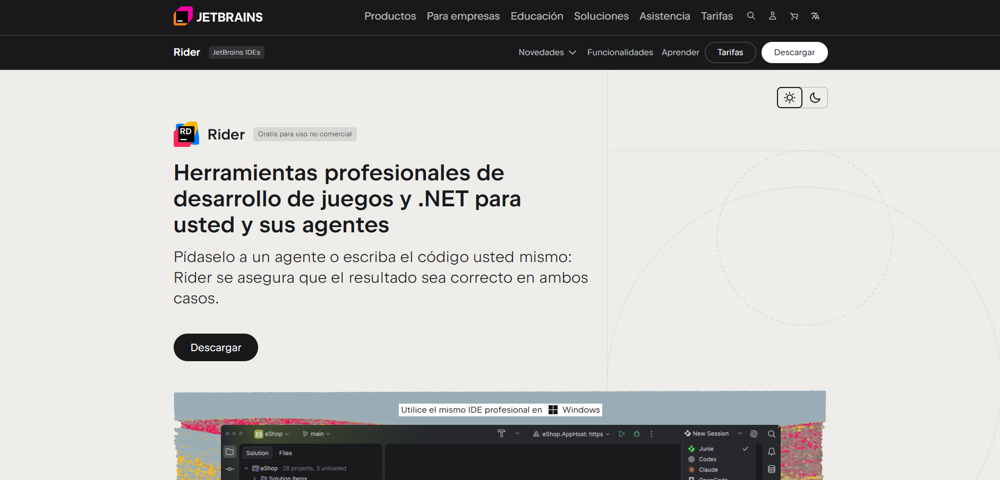

##### **WebStorm**

* **Propósito en el proyecto:** IDE especializado para la implementación del frontend de la plataforma web. Proporciona soporte avanzado para Vue Framework, HTML5, CSS3/SASS y herramientas de depuración de código en el navegador.
* **Ruta de Descarga:** [https://www.jetbrains.com/webstorm](https://www.jetbrains.com/webstorm)


##### **DataGrip**

* **Propósito en el proyecto:** Entorno de desarrollo para bases de datos relacionales utilizado para la administración, modelado Entidad-Relación, gestión de esquemas y ejecución de consultas sobre el motor de base de datos MySQL.
* **Ruta de Descarga:** [https://www.jetbrains.com/datagrip](https://www.jetbrains.com/datagrip)


##### **Postman**

* **Propósito en el proyecto:** Cliente API HTTP para la prueba, validación y documentación de las peticiones (`GET`, `POST`, `PUT`, `DELETE`) hacia los endpoints RESTful del backend, permitiendo verificar los códigos de estado HTTP y los objetos JSON de respuesta.
* **Ruta de Descarga:** [https://www.postman.com/downloads](https://www.postman.com/downloads)


#### 5. Software Deployment


##### **Cloudflare Pages / GitHub Pages**
* **Propósito en el proyecto:** Plataformas de alojamiento en la nube para el despliegue continuo (*Continuous Deployment*) automatizado del frontend estático de la Landing Page, garantizando alta disponibilidad a través de la red Edge global de servidores, certificado SSL/TLS (HTTPS) de renovación automática y tiempos de respuesta optimizados.
* **Ruta de Referencia:** [https://pages.cloudflare.com](https://pages.cloudflare.com) / [https://pages.github.com](https://pages.github.com)


##### **Railway**

* **Propósito en el proyecto:** Infraestructura Cloud PaaS utilizada para el despliegue continuo y alojamiento del backend RESTful desarrollado en ASP.NET Core, así como el aprovisionamiento del servidor de base de datos relacional MySQL en entorno de producción.
* **Ruta de Referencia:** [https://railway.app](https://railway.app)


---

#### 6. Software Documentation

##### **Scalar / OpenAPI**

* **Propósito en el proyecto:** Documentación de los contratos HTTP mediante OpenAPI y consulta interactiva a través de Scalar. Permite a los desarrolladores explorar los endpoints, probar llamadas HTTP directamente desde el navegador y consultar los esquemas de petición y respuesta JSON.
* **Ruta de Referencia:** [https://scalar.com/](https://scalar.com/)

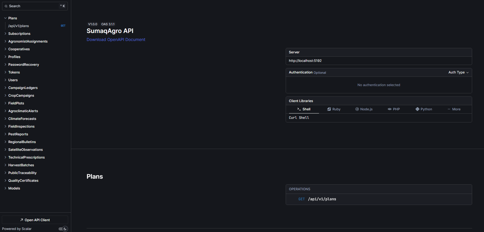

##### **Structurizr**

* **Propósito en el proyecto:** Herramienta para el diagramado y documentación de la arquitectura de software bajo el estándar **C4 Model** (Contexto, Contenedores y Componentes), utilizando Structurizr DSL para mantener la arquitectura como código (*Architecture as Code*).
* **Ruta de Referencia:** [https://structurizr.com](https://structurizr.com)


### 5.1.2. Source Code Management

Para garantizar la integridad del código fuente, el trabajo colaborativo eficiente y la trazabilidad inmutable del desarrollo de **SumaqAgro**, el equipo utiliza **Git** como sistema de control de versiones distribuido, alojado de forma centralizada en la plataforma **GitHub**.

A continuación, se especifican la estructura de la organización en GitHub, las URLs de los repositorios de cada producto digital, el flujo de trabajo con **GitFlow**, el esquema de versionado semántico (**Semantic Versioning**) y el estándar de mensajes mediante **Conventional Commits**.


---

#### 1. Organización y Repositorios en GitHub

Todos los componentes de software y la documentación del proyecto están agrupados bajo una organización pública en GitHub. Se ha asignado un repositorio independiente para cada producto digital de la solución, incluyendo las suites de pruebas unitarias e integración en el caso de los servicios web:

* **Organización Oficial en GitHub:** https://github.com/dymbia-aplicaciones-web


* **Repositorio del Landing Page (Sitio Web Estático):** https://github.com/dymbia-aplicaciones-web/sumaq-agro-website


* **Repositorio de Web Services (RESTful API backend):**  https://github.com/dymbia-aplicaciones-web/sumaq-agro-platform


* **Repositorio de Frontend Web Application:**  https://github.com/dymbia-aplicaciones-web/sumaq-agro-web-app


* **Repositorio del Informe del Proyecto (Project Report):**  https://github.com/dymbia-aplicaciones-web/sumaq-agro-report


---

#### 2. Estrategia de Ramificación - GitFlow Workflow

El equipo ha adoptado **GitFlow** como modelo y flujo de trabajo estructurado para la gestión de ramas (*branches*). Este enfoque garantiza la separación entre el código estable listo para producción y el desarrollo activo de nuevas funcionalidades.

#### Ramas Principales (*Main Branches*)
1. `main` **(Producción):**  
   Contiene exclusivamente código de producción estable y libre de errores. Cada confirmación en esta rama representa un despliegue oficial (*release*) firmado con una etiqueta de versión semántica (*tag*).
2. `develop` **(Integración / Staging):**  
   Sirve como la rama principal de integración continua. Agrupa los avances terminados y revisados de las distintas funcionalidades antes de ser empaquetados para una nueva versión de producción.

#### Ramas de Soporte (*Supporting Branches*)
* **Ramas de Funcionalidad (`feature/*`):**  
  Se crean exclusivamente a partir de `develop` para construir un módulo, historia de usuario o componente específico. Una vez completada y revisada la funcionalidad, se integra de regreso a `develop` mediante un *Pull Request*.
* **Ramas de Preparación de Lanzamiento (`release/*`):**  
  Se derivan de `develop` cuando las historias de un Sprint están listas para producción. Permiten realizar ajustes menores de configuración, documentación y pruebas finales sin congelar el desarrollo activo en `develop`. Al finalizar, se fusiona hacia `main` y `develop`.
* **Ramas de Corrección Urgente (`hotfix/*`):**  
  Se crean directamente a partir de `main` para solucionar fallos críticos detectados en el entorno de producción en vivo. Una vez corregido el problema, la rama se integra tanto a `main` como a `develop` para mantener la sincronización.

---

#### 3. Convenciones para el Nombrado de Ramas

Para mantener una nomenclatura consistente y trazable entre los tableros de gestión y los repositorios de GitHub, se han definido las siguientes reglas estandarizadas:

* **Feature branches:** `feature/<numero-tarea>-<descripcion-corta>`  
  *Ejemplo:* `feature/10-satellite-ndvi-map`
* **Release branches:** `release/v<version-semantica>`  
  *Ejemplo:* `release/v1.0.0`
* **Hotfix branches:** `hotfix/<numero-incidencia>-<descripcion-corta>`  
  *Ejemplo:* `hotfix/401-jwt-expired-token`

---

#### 4. Versionado Semántico (Semantic Versioning 2.0.0)

Para el etiquetado (*tagging*) de lanzamientos oficiales en la rama `main`, el proyecto adopta la norma **Semantic Versioning 2.0.0**, utilizando el formato estructurado **`MAJOR.MINOR.PATCH`**:

* **MAJOR (Incremento de versión mayor):** Cambios incompatibles en la API RESTful o reestructuraciones arquitectónicas mayores. *(Ejemplo: `v1.0.0` → `v2.0.0`)*
* **MINOR (Incremento de versión menor):** Adición de nuevas historias de usuario o módulos funcionales compatibles con las versiones anteriores. *(Ejemplo: `v1.0.0` → `v1.1.0`)*
* **PATCH (Incremento de parche):** Correcciones de errores (*bug fixes*) o parches de seguridad menores retrocompatibles. *(Ejemplo: `v1.0.1` → `v1.0.2`)*

---

#### 5. Estándar de Mensajes de Commit - Conventional Commits

El equipo aplica estrictamente la especificación **Conventional Commits** para la redacción de mensajes de confirmación de cambios (*commits*). La sintaxis adoptada sigue la estructura:

`tipo(alcance): descripción corta en presente e imperativo`

#### Tipos de Commits Permitidos (`type`):
* `feat`: Nueva funcionalidad implementada para el usuario final.
* `fix`: Corrección de un fallo o error en el código.
* `docs`: Modificaciones exclusivas en documentación (archivos Markdown, comentarios, OpenAPI/Scalar).
* `style`: Cambios de formato, identación o reglas de estilo CSS/HTML sin alterar la lógica.
* `refactor`: Reestructuración de código que no corrige errores ni añade características.
* `test`: Adición o corrección de pruebas unitarias o de integración.
* `chore`: Tareas de mantenimiento, actualización de dependencias o scripts de compilación.


### 5.1.3. Source Code Style Guide & Conventions

Para mantener un código fuente legible, mantenible, uniforme y alineado con los estándares internacionales de ingeniería de software, el equipo de desarrollo ha adoptado guías oficiales de estilo y convenciones de codificación para cada lenguaje y tecnología utilizada en la solución **SumaqAgro** (HTML5, CSS3, JavaScript, Vue, C# y .NET), así como las especificaciones de comportamiento en Gherkin.

#### Regla General de Nomenclatura en Inglés
En cumplimiento estricto de las normas del proyecto y los estándares globales de software, **todas las identificaciones de elementos de código** (nombres de archivos, clases, interfaces, métodos, funciones, variables, constantes, parámetros, llaves de objetos JSON, rutas de endpoints REST y comentarios técnicos) **se redactan obligatoriamente en idioma inglés**. Los textos explicativos y la documentación del informe se mantienen en español.

A continuación, se detallan las guías de estilo adoptadas y sus reglas específicas:

---

#### 1. Guía de Estilo para HTML5, CSS3 / SASS y JavaScript (Landing Page & Web App)

#### Normas de Referencia
Se adoptan la **HTML Style Guide and Coding Conventions**, la **Google HTML/CSS Style Guide** y la **Google JavaScript Style Guide** (ES6+).

#### Convenciones HTML5
* **Etiquetas y Atributos:** Todas las etiquetas, elementos y atributos HTML deben escribirse estrictamente en minúsculas (`lowercase`).  
  *Ejemplo correcto:* `<input type="email" id="user-email" class="form-control" name="userEmail" />`
* **HTML5 Semántico:** Es obligatorio el uso de etiquetas semánticas (`<header>`, `<nav>`, `<main>`, `<section>`, `<article>`, `<aside>`, `<footer>`) en lugar de contenedores genéricos `<div>` para estructurar la maquetación, garantizando la accesibilidad y optimización SEO.
* **Comillas en Atributos:** Todos los valores de los atributos deben delimitarse mediante comillas dobles (`"`).
* **Accesibilidad (WCAG 2.1):** Todas las imágenes y elementos multimedia deben incluir obligatoriamente el atributo `alt` declarativo en inglés (ej. `alt="Satellite NDVI spectral map"`).
* **Indentación:** Se establece una indentación consistente de 2 espacios por cada nivel jerárquico de anidamiento HTML, evitando el uso de tabuladores.

#### Convenciones CSS3 / SASS
* **Nomenclatura BEM (Block Element Modifier):** Para la organización de clases CSS y evitar colisiones de estilos, se aplica la convención BEM con identificadores en inglés:
    * `Block`: Representa la entidad principal independiente (ej. `.card`, `.navbar`).
    * `Element`: Componente dependiente del bloque (ej. `.card__title`, `.navbar__item`).
    * `Modifier`: Variante de estado o apariencia (ej. `.card__button--accent`, `.navbar__link--active`).
* **Propiedades CSS Ordenadas:** Las declaraciones dentro de una regla CSS deben ordenarse siguiendo la estructura:
    1. Posicionamiento (`position`, `top`, `z-index`).
    2. Modelo de Caja (`display`, `flex`, `grid`, `width`, `padding`, `margin`).
    3. Tipografía (`font-family`, `font-size`, `color`, `text-align`).
    4. Visuales y Efectos (`background-color`, `border`, `box-shadow`, `opacity`).
* **Uso de Variables:** Se centralizan los colores corporativos, tipografías y espaciados mediante variables CSS/SASS (`:root` o `_variables.scss`), prohibiendo el uso de colores en formato hexadecimal directamente en las hojas de estilo de los componentes.

#### Convenciones JavaScript (Vanilla JS para scripts dinámicos en la Landing Page)
* **Variables y Funciones:** Se redactan en `camelCase` e idioma inglés. Se exige el uso de `const` para valores inmutables y `let` para variables mutables, quedando estrictamente prohibido el uso de `var`.
* **Manipulación de DOM:** Se promueve el uso de métodos modernos de la API DOM (`document.querySelector`, `addEventListener`) con nombres de handlers descriptivos en inglés (ej. `handleLanguageToggle`, `initHeroSlider`).

---

#### 2. Guía de Estilo para JavaScript y Vue Framework (Frontend Web Application)

#### Normas de Referencia
Se adopta la **Vue Style Guide** (prioridad A y B) en conjunto con la **Google JavaScript Style Guide**, las **MDN JavaScript guidelines** y la **W3C JavaScript Style Guide**. Se prioriza el paradigma de **Composition API** con la sintaxis `<script setup>`.

#### Convenciones para el Nombrado de Archivos
Todos los nombres de archivos y carpetas del proyecto Vue deben redactarse en inglés bajo las siguientes convenciones:
* **Componentes de Archivo Único (SFC):** Deben nombrarse en `PascalCase` y constar de varias palabras para evitar colisiones con elementos HTML estándar *(Ejemplo: `ParcelMonitoring.vue`, `CropEvaluationCard.vue`)*.
* **Componentes Base o UI Genéricos:** Deben llevar el prefijo `App`, `Base` o `V` *(Ejemplo: `BaseButton.vue`, `AppModal.vue`)*.
* **Componentes de Instancia Única:** Componentes que solo se renderizan una vez por página llevan el prefijo `The` *(Ejemplo: `TheNavbar.vue`, `TheSidebar.vue`)*.
* **Composables (Lógica reutilizable):** Se ubican en `src/composables/`, usan `camelCase` e inician con el prefijo `use` *(Ejemplo: `useSatelliteData.js`)*.
* **Servicios API:** `name.service.js` en `kebab-case` *(Ejemplo: `satellite-data.service.js`)*.
* **Enrutamiento y Estado:** `router/index.js` y stores de Pinia nombrados como `name.store.js` *(Ejemplo: `auth.store.js`)*.

#### Convenciones de Nombres en Código
* **Clases y Objetos Constructores:** Se redactan en `PascalCase` e inglés.
* **Variables, Funciones, Propiedades y Métodos:** Se redactan en `camelCase` e inglés.  
  *Ejemplo:* `const currentNdviScore = ref(0.78);`
* **Nombres de Props y Emits en Plantillas:** En las plantillas HTML se declaran en `kebab-case` y dentro de `<script setup>` en `camelCase`.  
  *Ejemplo template:* `<parcel-item :crop-id="item.id" @select-crop="onSelect" />`
* **Constantes Globales:** Se redactan en `UPPER_SNAKE_CASE` e inglés.  
  *Ejemplo:* `export const DEFAULT_LANGUAGE = 'en';`

#### Reglas de Calidad JavaScript y Vue
* **Estándar ES6+:** Queda prohibido el uso de `var`; se debe utilizar exclusivamente `const` (por defecto) y `let` (solo si el valor reasignará). Promover el uso de *arrow functions*, *template literals* y *destructuring*.
* **Definición de Props y Emits:** Al utilizar JavaScript, las props deben definirse explícitamente utilizando la sintaxis de objetos de Vue, detallando el `type`, `required` y `default` para validar correctamente los datos de entrada en tiempo de desarrollo.
* **Manejo de Reactividad:** Se prefiere `ref()` sobre `reactive()` para estandarizar el manejo y trazabilidad tanto de tipos primitivos como de objetos complejos. Toda propiedad derivada de un estado debe definirse con `computed()`.
* **Ciclo de Vida y Limpieza:** Todo listener manual, intervalo (`setInterval`) o consumo de eventos del DOM debe limpiarse explícitamente dentro de `onUnmounted()` para evitar fugas de memoria (*memory leaks*).

---

#### 3. Guía de Estilo para C# y ASP.NET Core Framework (Backend RESTful API)

#### Normas de Referencia
Se adoptan las guías oficiales exigidas para el proyecto: **C# Coding Conventions** y **Microsoft ASP.NET Core Coding Guidelines**.

#### Estructura de Namespaces
La estructura de la solución no utiliza paquetes invertidos, sino **Namespaces** redactados en `PascalCase` e inglés, separados por puntos, siguiendo el patrón:  
`SumaqAgro.Platform.<BoundedContext>.<Layer>`

*Ejemplo de capas:*
* `SumaqAgro.Platform.Farming.Domain.Model`
* `SumaqAgro.Platform.Farming.Infrastructure.Persistence`
* `SumaqAgro.Platform.Farming.Interfaces.Rest`

#### Convenciones de Nombres en C#
* **Clases y Records:** Se redactan en `PascalCase` e inglés utilizando sustantivos claros.  
  *Ejemplos:* `CropParcel`, `CalculateBreakEvenUseCase`.
* **Interfaces:** Se redactan en `PascalCase` e inglés, y es obligatorio que inicien con la letra mayúscula **I**.  
  *Ejemplo:* `IParcelRepository`, `ICropService`.
* **Métodos y Propiedades Públicas:** A diferencia de otros lenguajes, en C# se redactan en `PascalCase` e inglés.  
  *Ejemplos:* `CalculateNdviAverage()`, `TotalCostPerHectare { get; set; }`.
* **Variables Locales y Parámetros:** Se redactan en `camelCase` e inglés.  
  *Ejemplo:* `int maxHectares = 500;`
* **Campos Privados (Private Fields):** Deben utilizar `camelCase` pero obligatoriamente precedidos por un guion bajo (`_`).  
  *Ejemplo:* `private readonly IParcelRepository _parcelRepository;`

#### Estándares de Ingeniería Backend y REST API
* **Persistencia de Datos:** Se utilizará exclusivamente **Entity Framework Core** para el mapeo relacional. No se permite escribir consultas SQL en texto plano dentro de los controladores.
* **Uso de DTOs (Data Transfer Objects):** La capa REST no debe exponer directamente entidades de Entity Framework Core. Se exige el uso de `Records` o clases DTO simples para las peticiones (`RequestDTO`) y respuestas (`ResponseDTO`).
* **Propiedades Autoinmplementadas:** En C# no se usan librerías externas (como Lombok en Java) para getters y setters. Se exige el uso de propiedades nativas: `public string Name { get; set; }`.
* **Documentación:** Es obligatorio que todos los Endpoints estén documentados aplicando **OpenAPI Specification con Scalar**.
* **Diseño de Endpoints RESTful:**
  * URIs en minúsculas, plurales (o `kebab-case`), en idioma inglés y versionadas: `/api/v1/parcels`, `/api/v1/crop-certificates`.
  * Verbos HTTP adecuados: `GET` (lectura), `POST` (creación), `PUT` (actualización completa), `PATCH` (actualización parcial), `DELETE` (eliminación).
* **Manejo Global de Excepciones:** Se implementará un Middleware o Filtro de Excepciones Global para capturar errores de negocio y retornar respuestas estructuradas nativas de ASP.NET Core utilizando la clase `ProblemDetails` (estándar RFC 7807), junto con el código de estado HTTP correspondiente.

---

#### 4. Convenciones Gherkin para Especificaciones Legibles (BDD Acceptance Criteria)

#### Norma de Referencia
Se adopta la convención **Gherkin Conventions for Readable Specifications** para la especificación de los Criterios de Aceptación de las Historias de Usuario bajo el enfoque BDD (*Behavior-Driven Development*).

#### Reglas de Redacción de Escenarios
* **Estructura Declarativa:** Los escenarios deben redactarse con una sintaxis orientada al comportamiento del usuario (*behavior-driven*) y no a los detalles técnicos de la interfaz gráfica (evitar expresiones como "hacer clic en el botón X").
* **Palabras Clave Estándar:** Cada escenario debe articularse estrictamente con los conectores BDD en español:
    * **`Dado que` (`Given`):** Establece las precondiciones y el contexto inicial del sistema.
    * **`Cuando` (`When`):** Describe la acción o evento desencadenante ejecutado por el actor.
    * **`Entonces` (`Then`):** Especifica el resultado esperado, la respuesta del sistema o el cambio de estado observable.
* **Atomicidad y Claridad:** Cada escenario debe probar una única regla de negocio o flujo alternativo (un escenario por cada caso de éxito o fallo principal).

---

### 5.1.4. Software Deployment Configuration

En esta sección se especifica la arquitectura y los procedimientos de despliegue continuo (*Continuous Deployment - CD*) e integración desde GitHub para los productos digitales que integran la solución **SumaqAgro**.


#### 5.1.4.1\. Landing Page — Cloudflare Pages

El Landing Page funciona como el portal público de presentación e ingreso a la solución. Su código fuente es un sitio web estático responsivo alojado en el repositorio público de GitHub y publicado en entorno de producción mediante la plataforma **Cloudflare Pages** (contando con **GitHub Pages** como entorno de respaldo y redundancia).

#### Guía Paso a Paso del Despliegue

##### Paso 1: Acceso al panel de administración de Workers &amp; Pages

Se ingresa a la consola de administración de Cloudflare en la sección *Workers &amp; Pages*, donde se visualiza el panel principal de control del proyecto, junto con las métricas de solicitudes y estado del servicio.


##### Paso 2: Inicio del asistente de creación de aplicación

En la cabecera superior del panel de *Workers &amp; Pages*, se selecciona el botón principal **"Create application"** para iniciar el flujo de aprovisionamiento de un nuevo sitio o servicio estático en la nube.


##### Paso 3: Selección del método de integración con repositorio (GitHub)

Dentro de la pantalla de opciones *Make something new*, se elige el método **"Continue with GitHub"**. Esto permite establecer una conexión directa mediante *webhooks* con el repositorio de control de versiones para habilitar la compilación e integración continua (CI/CD).


##### Paso 4: Autenticación y autorización de la organización en GitHub

Se autoriza a la plataforma Cloudflare Pages para acceder a la organización pública de GitHub, otorgando permisos de lectura sobre el código fuente para sincronizar las confirmaciones de cambios (*commits*).


##### Paso 5: Selección del repositorio del Landing Page

En el listado de repositorios vinculados de la organización, se selecciona el proyecto correspondiente al sitio estático: `sumaqAgro-landing-page`. Se confirma la elección presionando el botón **"Begin setup"**.


##### Paso 6: Configuración de parámetros de build y rama de producción

Se configuran los ajustes fundamentales del despliegue:

* **Project name:** `sumaqagro-landing-page`
* **Production branch:** `main` *(rama protegida de producción bajo GitFlow)*
* **Framework preset:** `None` / `Static HTML`
* **Build command:** *(Vacío para sitio estático directo)*
* **Build output directory:** `/` *(directorio raíz)*

Se finaliza la configuración haciendo clic en **"Save and Deploy"**.


##### Paso 7: Ejecución del pipeline de compilación y distribución Edge

Cloudflare Pages inicia automáticamente el pipeline de entrega continua: clona el código fuente desde GitHub, valida la estructura de archivos estáticos (HTML/CSS/JS/Assets) y distribuye los artefactos en los más de 300 centros de datos de su red Edge global.

 

##### Paso 8: Confirmación de despliegue exitoso y dominio público HTTPS

Finalmente, se completa el proceso de publicación en producción de forma satisfactoria. Cloudflare genera la URL pública de acceso (`sumaqagro-landing-page.pages.dev`) con certificado SSL/TLS de encriptación automático, forzando la navegación segura mediante `HTTPS://`.


* **URL Oficial de Producción:** [https://sumaqagro-landing-page.pages.dev](https://sumaqagro-landing-page.pages.dev)


## 5.2. Landing Page, Services & Applications Implementation

En esta sección se detalla el proceso de planificación, desarrollo, pruebas, documentación, despliegue y colaboración en equipo para los productos digitales de la plataforma **SumaqAgro**, organizados modularmente por Sprints.

### 5.2.1. Sprint 1

El **Sprint 1** constituye la primera iteración de desarrollo del proyecto, teniendo como objetivo central la construcción, maquetación, optimización y despliegue en entorno de producción de la primera versión del **Landing Page** de **SumaqAgro**, sirviendo como portal público de presentación e ingreso a la solución.
#### 5.2.1.1. Sprint Planning 1

En esta sección se especifican los aspectos principales de la reunión de planificación del **Sprint 1** (*Sprint Planning Meeting*) realizada por el equipo de la startup **Dymbia** para la plataforma **SumaqAgro**. El objetivo central de esta primera iteración es la maquetación, desarrollo, internacionalización y despliegue en entorno de producción de la primera versión del **Landing Page** de SumaqAgro en **Cloudflare Pages**.

| Sprint # | Sprint 1                                                                                                                                                                                                                                                                                                                                                                                                                                                                                                                                                   |
| :--- |:-----------------------------------------------------------------------------------------------------------------------------------------------------------------------------------------------------------------------------------------------------------------------------------------------------------------------------------------------------------------------------------------------------------------------------------------------------------------------------------------------------------------------------------------------------------|
| **Sprint Planning Background** |                                                                                                                                                                                                                                                                                                                                                                                                                                                                                                                                                            |
| Date | 2026-09-02                                                                                                                                                                                                                                                                                                                                                                                                                                                                                                                                                 |
| Time | 11:30 AM                                                                                                                                                                                                                                                                                                                                                                                                                                                                                                                                                   |
| Location | Discord                                                                                                                                                                                                                                                                                                                                                                                                                                                                                                                                                    |
| Prepared By | Tejada Pumacayo, Yamil Jared                                                                                                                                                                                                                                                                                                                                                                                                                                                                                                                               |
| Attendees (to planning meeting) | Tejada Pumacayo, Yamil Jared / Duarte Ruffner, Drago Derick / Sanca Condori, Miguel / Solorzano Sullca, Benjamin / Vargas Enriquez, Jose Carlos                                                                                                                                                                                                                                                                                                                                                                                                            |
| Sprint 0 Review Summary | N/A (Primer Sprint de implementación del proyecto. No existen iteraciones ni entregables previos).                                                                                                                                                                                                                                                                                                                                                                                                                                                         |
| Sprint 0 Retrospective Summary | N/A (Primer Sprint de implementación del proyecto. No existen retrospectivas previas).                                                                                                                                                                                                                                                                                                                                                                                                                                                                     |
| **Sprint Goal & User Stories** |                                                                                                                                                                                                                                                                                                                                                                                                                                                                                                                                                            |
| Sprint 1 Goal | Our focus is on delivering an accessible, responsive, and deployed Landing Page for SumaqAgro to present our value proposition, subscription plans, team profiles, and legal policies to Peruvian agricultural producers and cooperative managers. We believe it delivers brand clarity, trust, and early user interest to our target audience. This will be confirmed when visitors can smoothly navigate all portal sections, select language preferences (Spanish/English), view our product solutions, and access the live portal on Cloudflare Pages. |
| Sprint 1 Velocity | 16 Story Points                                                                                                                                                                                                                                                                                                                                                                                                                                                                                                                                            |
| Sum of Story Points | 16 Story Points

#### 5.2.1.2. Aspect Leaders and Collaborators

En esta sección se presenta el artefacto **Leadership-and-Collaboration Matrix (LACX)** de acuerdo con las especificaciones de la metodología del curso y la rúbrica del proyecto para el **Sprint 1**.

El objetivo de esta matriz es brindar mayor claridad, responsabilidad directa y efectividad en la comunicación interna del equipo de la startup **Dymbia** durante el desarrollo del **Landing Page** de la solución **SumaqAgro**. En este Sprint 1, los aspectos considerados corresponden a los subconjuntos del alcance funcional y técnico necesarios para la maquetación, internacionalización, estilizado, estructuración de contenido y despliegue automatizado del portal estático.

Bajo este modelo, cada integrante del equipo asume el rol de **Aspect Leader (L)** sobre un aspecto técnico o funcional específico, siendo responsable de coordinar la calidad, arquitectura y cumplimiento del componente, mientras actúa como **Collaborator (C)** en los demás aspectos desarrollados por sus compañeros.

---

##### Leadership-and-Collaboration Matrix (LACX) — Sprint 1

| Team Member (Last Name, First Name) | GitHub Username | Aspect 1: Semántica HTML5 & SEO (US-01, US-04) | Aspect 2: Módulos & Políticas Legales (US-06, US-09) | Aspect 3: Internacionalización i18n & JS (US-03, US-08) | Aspect 4: Componentes UI & CSS3/SASS (US-01, US-07) | Aspect 5: Despliegue CI/CD Cloudflare (US-02, Deploy) |
| :--- |:---------------:|:----------------------------------------------:| :---: | :---: |:---------------------------------------------------:|:-----------------------------------------------------:|
| **Duarte Ruffner, Drago Derick** |   `Drago0724`   |                     **C**                      | **C** | **C** |                        **L**                        |                         **C**                         |
| **Sanca Condori, Miguel** |  `MiguelSanca`  |                     **C**                      | **L** | **C** |                        **C**                        |                         **C**                         |
| **Solorzano Sullca, Benjamin** |   `benjass2`    |                     **C**                      | **C** | **L** |                        **C**                        |                         **C**                         |
| **Vargas Enriquez, Jose Carlos** | `JoseAngelKyo`  |                     **C**                      | **C** | **C** |                        **C**                        |                         **L**                         |
| **Tejada Pumacayo, Yamil Jared** | `miguel-sanca`  |                     **L**                      | **C** | **C** |                        **C**                        |                         **C**                         |

*Leyenda: **L** = Leader (Líder del Aspecto Técnico) | **C** = Collaborator (Colaborador en el Desarrollo)*


#### 5.2.1.3. Sprint Backlog 1

En esta sección se detalla el **Sprint Backlog** correspondiente al **Sprint 1**. El objetivo principal de esta iteración fue la maquetación, desarrollo, internacionalización y despliegue del Landing Page de SumaqAgro. A continuación, se presenta la evidencia del tablero de control utilizado para el seguimiento de las historias de usuario y tareas técnicas durante el sprint.

**Tablero de Control del Sprint (Jira Software):**


**URL Público del Tablero:**
[Tablero Jira - SumaqAgro](https://sumaq-agro.atlassian.net/jira/software/c/projects/DSB/boards/2/backlog?epics=visible)

##### Tabla de Descomposición de Historias de Usuario y Tareas Técnicas (Sprint Backlog 1)

| User Story ID | User Story Title | Task ID | Task Title                                    | Task Description                                                                                                           | Estimation (Hours) | Assigned To | Status |
| :---: | :--- | :---: |:----------------------------------------------|:---------------------------------------------------------------------------------------------------------------------------| :---: | :--- | :---: |
| **US-01** | Presentación de la propuesta de valor | **TSK-01** | Maquetación HTML5 de la Hero Section          | Crear la estructura semántica `<header>` y `<main>` con los titulares principales de propuesta de valor.                   | 4 h | Tejada Pumacayo, Yamil Jared | **Done** |
| **US-01** | Presentación de la propuesta de valor | **TSK-02** | Estilizado CSS3/SASS de botones CTA           | Diseñar e implementar los estilos responsivos BEM para los botones de llamada a la acción hacia registro.                  | 4 h | Duarte Ruffner, Drago Derick | **Done** |
| **US-01** | Presentación de la propuesta de valor | **TSK-03** | Optimización de assets visuales               | Comprimir y adaptar a formato WebP las imágenes de fondo y elementos gráficos de la Hero Section para mejorar rendimiento. | 2 h | Tejada Pumacayo, Yamil Jared | **Done** |
| **US-02** | Navegación por secciones del sitio | **TSK-04** | Menú de navegación responsivo                 | Implementar la barra de navegación fija `<nav>` y el menú hamburguesa adaptativo para dispositivos móviles.                | 4 h | Vargas Enriquez, Jose Carlos | **Done** |
| **US-02** | Navegación por secciones del sitio | **TSK-05** | Desplazamiento suave (Smooth Scroll)          | Programar en JavaScript vanilla la navegación fluida con desplazamiento suave hacia las anclas de cada sección.            | 3 h | Vargas Enriquez, Jose Carlos | **Done** |
| **US-03** | Selección e intercambio de idioma | **TSK-06** | Diccionarios i18n JSON                        | Crear los archivos `es.json` y `en.json` con las claves de traducción para todos los textos del portal.                    | 4 h | Solorzano Sullca, Benjamin | **Done** |
| **US-03** | Selección e intercambio de idioma | **TSK-07** | Lógica JS de alternancia de idioma            | Desarrollar el selector dinámico de idioma y almacenar la preferencia del usuario en el `localStorage`.                    | 4 h | Solorzano Sullca, Benjamin | **Done** |
| **US-04** | Presentación de la startup y equipo fundador | **TSK-08** | Sección "About Us" y tarjetas de equipo       | Maquetar la sección institucional con las tarjetas de presentación de los 5 fundadores de la startup Dymbia.               | 4 h | Tejada Pumacayo, Yamil Jared | **Done** |
| **US-04** | Presentación de la startup y equipo fundador | **TSK-09** | Enlaces sociales e iconografía                | Integrar hipervínculos hacia perfiles profesionales (LinkedIn, GitHub) y optimizar avatares gráficos.                      | 3 h | Tejada Pumacayo, Yamil Jared | **Done** |
| **US-06** | Consulta de módulos y soluciones tecnológicas | **TSK-10** | Grid responsivo de soluciones                 | Estructurar el catálogo de los 4 módulos funcionales principales (Satélites, Costos, Calidad, Prescripciones).             | 5 h | Sanca Condori, Miguel | **Done** |
| **US-06** | Consulta de módulos y soluciones tecnológicas | **TSK-11** | Iconografía SVG y valor agronómico            | Insertar íconos vectoriales SVG y redactar las fichas técnicas del beneficio agronómico de cada solución.                  | 3 h | Sanca Condori, Miguel | **Done** |
| **US-07** | Consulta de planes de suscripción y facturación | **TSK-12** | Tabla comparativa de precios                  | Diseñar e implementar la tabla de planes comerciales (Semilla, Cooperativa Pro, Asesor Técnico).                           | 6 h | Duarte Ruffner, Drago Derick | **Done** |
| **US-07** | Consulta de planes de suscripción y facturación | **TSK-13** | Destacado de plan y captura de leads          | Maquetar la tarjeta destacada del plan recomendado y configurar el formulario de contacto para clientes.                   | 4 h | Duarte Ruffner, Drago Derick | **Done** |
| **US-08** | Visualización de métricas de impacto y testimonios | **TSK-14** | Contadores de impacto dinámicos               | Diseñar la sección de métricas proyectadas (hectáreas monitoreadas, retención MAU y reducción de mermas).                  | 4 h | Solorzano Sullca, Benjamin | **Done** |
| **US-08** | Visualización de métricas de impacto y testimonios | **TSK-15** | Testimonios agrícolas                         | Implementar el componente interactivo de testimonios de productores y líderes de cooperativas.                             | 4 h | Solorzano Sullca, Benjamin | **Done** |
| **US-09** | Consulta de términos de servicio y políticas legales | **TSK-16** | Maquetación de Términos de Servicio           | Estructurar la vista legal detallando las cláusulas de uso de la plataforma vinculadas desde el pie de página (Footer).    | 3 h | Sanca Condori, Miguel | **Done** |
| **US-09** | Consulta de términos de servicio y políticas legales | **TSK-17** | Política de Privacidad y Tratamiento de Datos | Maquetar el documento legal específico sobre la confidencialidad y protección de datos agrícolas.                          | 2 h | Sanca Condori, Miguel | **Done** |
| **US-09** | Consulta de términos de servicio y políticas legales | **TSK-18** | Banner interactivo de Cookies                 | Implementar una página de consentimiento de cookies para cumplir con los estándares de navegación.                         | 2 h | Sanca Condori, Miguel | **Done** |


#### 5.2.1.4. Development Evidence for Sprint Review

En esta sección se explican y presentan los avances en la implementación con relación a los productos de la solución según el alcance del **Sprint 1**. Durante esta iteración, el esfuerzo del equipo Dymbia se centró exclusivamente en el desarrollo de la interfaz web estática y el despliegue a producción del **Landing Page** de SumaqAgro.

Para garantizar la trazabilidad y la calidad del código, el equipo ha seguido un flujo de trabajo colaborativo basado en **GitFlow**, empleando ramas `feature/*` para el desarrollo de cada historia de usuario y consolidando las entregas hacia la rama `develop` y finalmente a `main`. Asimismo, todos los registros de control de versiones cumplen estrictamente con el estándar **Conventional Commits** y han sido documentados en inglés.

A continuación, se detalla la evidencia de los commits integrados en el repositorio correspondiente a la Landing Page durante el Sprint 1:

| Repository | Branch | Commit Id | Commit Message | Commit Message Body | Commited on (Date) |
| :--- | :--- | :--- | :--- | :--- | :--- |
| `Dymbia/sumaqagro-landing` | `feature/us-02-site-navigation` | `16753b7` | `chore(repo): initialize landing page repository` | `---` | 14/09/2026 |
| `Dymbia/sumaqagro-landing` | `feature/us-02-site-navigation` | `0ab8382` | `feat(us-02): implement header navigation markup and layout styling` | `---` | 15/09/2026 |
| `Dymbia/sumaqagro-landing` | `feature/landing-skeleton` | `8e9b238` | `feat(landing): update navigation header and add content sections` | `---` | 18/09/2026 |
| `Dymbia/sumaqagro-landing` | `feature/assets-images` | `ec2e8e7` | `feat(images): add landing page images and media resources` | `---` | 18/09/2026 |
| `Dymbia/sumaqagro-landing` | `feature/assets-icons` | `a0033bb` | `feat(icons): add various SVG icons for navigation and UI elements` | `---` | 18/09/2026 |
| `Dymbia/sumaqagro-landing` | `feature/legal-pages` | `5e66c8e` | `feat(terms): add terms of service and conditions page` | `---` | 18/09/2026 |
| `Dymbia/sumaqagro-landing` | `feature/legal-pages` | `4b4a947` | `feat(privacy): add privacy policy and data compliance page` | `---` | 18/09/2026 |
| `Dymbia/sumaqagro-landing` | `feature/legal-pages` | `5a250cd` | `feat(cookies): add cookie policy and preference settings page` | `---` | 19/09/2026 |
| `Dymbia/sumaqagro-landing` | `feature/update-team-info` | `c1cd51a` | `feat(team): update team member details and images` | `---` | 19/09/2026 |
| `Dymbia/sumaqagro-landing` | `feature/i18n-interactivity` | `1907e04` | `feat(i18n): add Spanish translation dictionary` | `---` | 19/09/2026 |
| `Dymbia/sumaqagro-landing` | `feature/i18n-interactivity` | `b1baced` | `feat(i18n): add English translation dictionary` | `---` | 19/09/2026 |
| `Dymbia/sumaqagro-landing` | `feature/i18n-interactivity` | `c795b6d` | `feat(i18n): implement language switching and persistence` | `---` | 19/09/2026 |
| `Dymbia/sumaqagro-landing` | `feature/i18n-interactivity` | `e397a88` | `feat(i18n): add language toggle interaction` | `---` | 19/09/2026 |
| `Dymbia/sumaqagro-landing` | `feature/i18n-interactivity` | `caafd1e` | `feat(pricing): implement billing period switch` | `---` | 19/09/2026 |
| `Dymbia/sumaqagro-landing` | `feature/landing-styles` | `a4f0ef3` | `refactor(styles): remove unused header and navigation styles` | `---` | 19/09/2026 |
| `Dymbia/sumaqagro-landing` | `feature/landing-styles` | `8f70567` | `feat(styles): add new header, navigation, hero, about, and team styles` | `---` | 19/09/2026 |
| `Dymbia/sumaqagro-landing` | `feature/landing-styles` | `80f233e` | `feat(styles): add audience and solutions sections with responsive grid layouts` | `---` | 19/09/2026 |
| `Dymbia/sumaqagro-landing` | `feature/landing-styles` | `f8091bc` | `feat(styles): add pricing and impact sections` | `---` | 19/09/2026 |
| `Dymbia/sumaqagro-landing` | `feature/landing-styles` | `98a05ac` | `feat(styles): add testimonials, CTA, footer, and responsive design` | `---` | 19/09/2026 |
| `Dymbia/sumaqagro-landing` | `feature/landing-styles` | `9dcf91f` | `feat(styles): add billing toggle switcher and legal header styles` | `---` | 19/09/2026 |
| `Dymbia/sumaqagro-landing` | `feature/update-team-info` | `8c80a65` | `feat(team): update team member names and change language to Spanish` | `---` | 19/09/2026 |
| `Dymbia/sumaqagro-landing` | `feature/update-footer-and-photo` | `5bb1380` | `style(footer): update footer colors` | `---` | 19/09/2026 |
| `Dymbia/sumaqagro-landing` | `feature/update-footer-and-photo` | `b4749ab` | `feat(branding): add favicon to landing page` | `---` | 19/09/2026 |
| `Dymbia/sumaqagro-landing` | `feature/update-footer-and-photo` | `083f106` | `feat(landing): update head element with seo meta tags and og properties` | `---` | 19/09/2026 |
| `Dymbia/sumaqagro-landing` | `feature/update-footer-and-photo` | `99d7b88` | `fix(i18n): fix pricing period translation logic and sync with billing toggle` | `---` | 19/09/2026 |
| `Dymbia/sumaqagro-landing` | `release/v1.0.0` | `f9fb74d` | `Merge branch 'release/v1.0.0' into main` | `---` | 19/09/2026 |


#### 5.2.1.5. Execution Evidence for Sprint Review

En esta sección se presenta la evidencia visual y funcional de los productos de software desarrollados y desplegados durante el **Sprint 1**. El equipo Dymbia logró construir exitosamente la primera versión del **Landing Page** de SumaqAgro, cumpliendo con los criterios de aceptación establecidos, aplicando un diseño responsivo adaptable a múltiples dispositivos (Desktop y Mobile), e integrando soporte de internacionalización (i18n) para los idiomas español e inglés.

A continuación, se adjuntan las capturas de pantalla de las vistas principales implementadas, demostrando la alta fidelidad de la interfaz construida respecto a los *mock-ups* originales definidos en la etapa de diseño:

**Evidencia Visual: Capturas de Pantalla (Desktop y Mobile)** 

**Desktop View:**


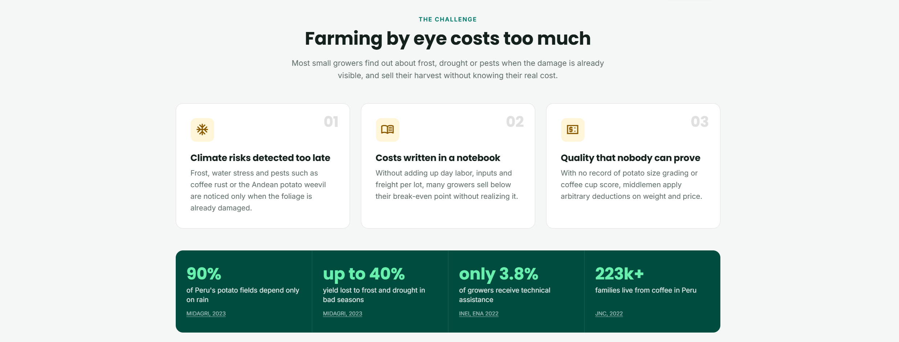
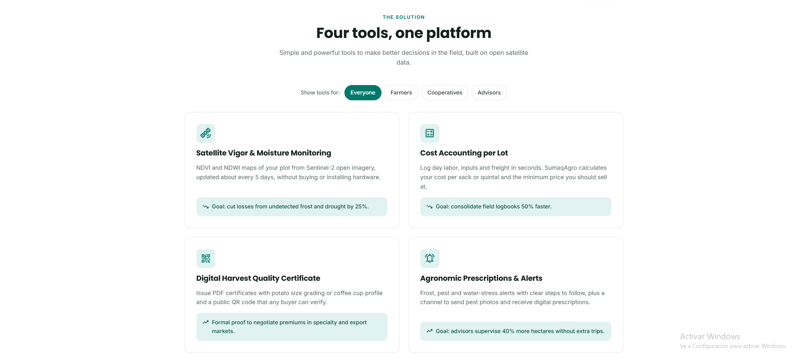
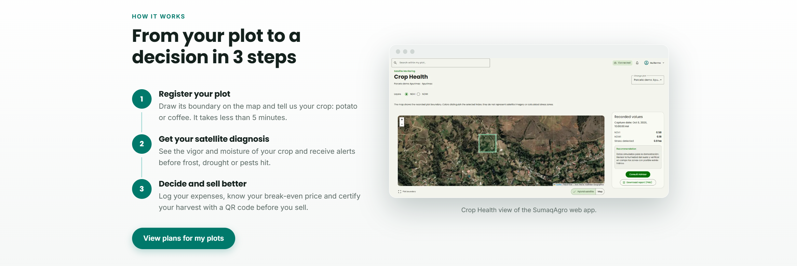
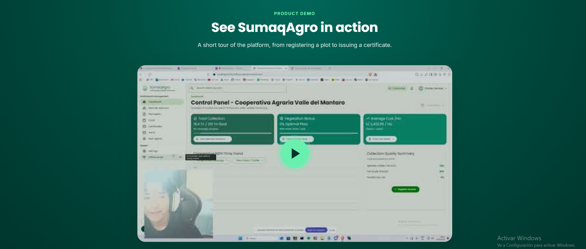
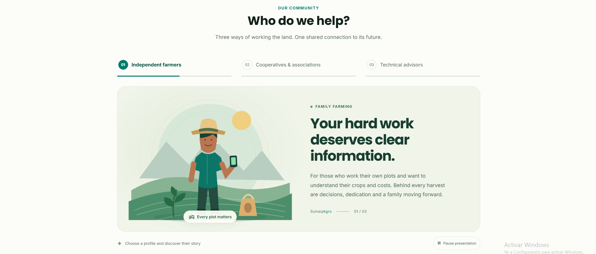
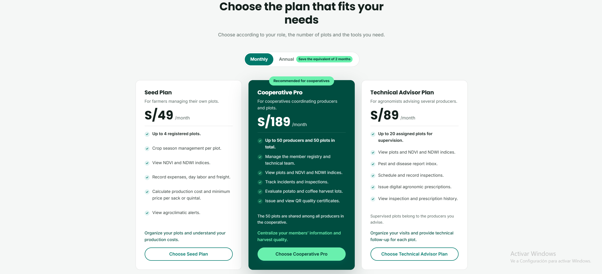
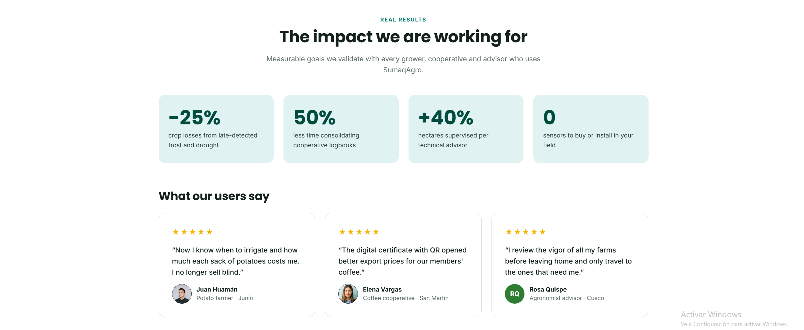
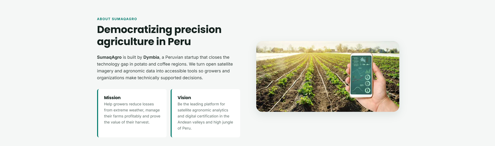

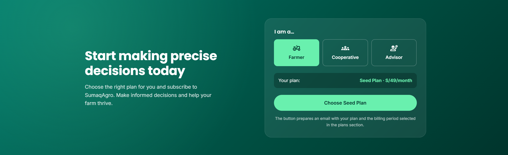
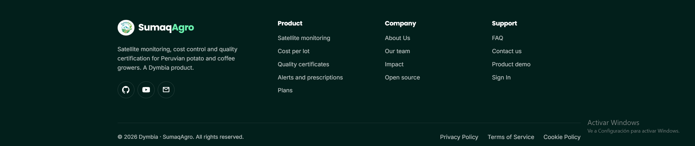

**Mobile View:**

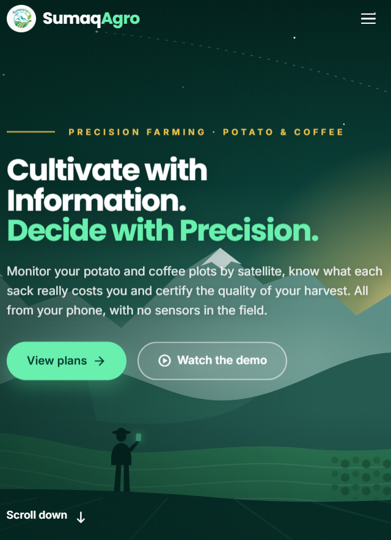
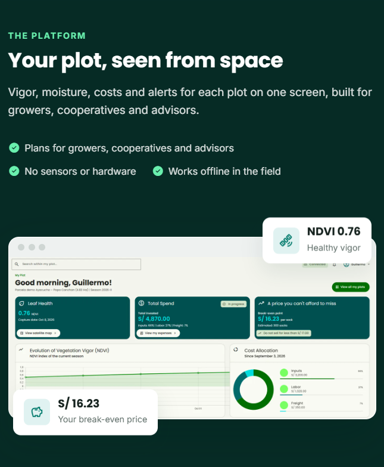
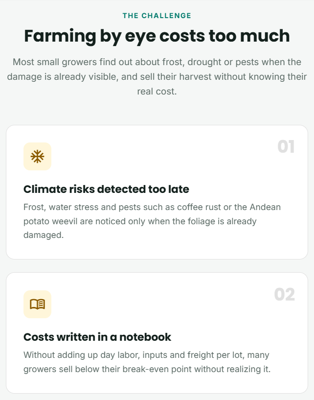
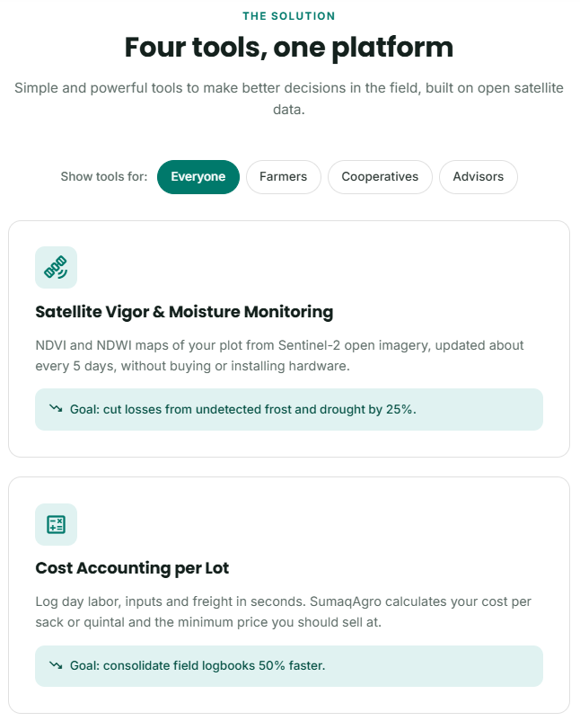
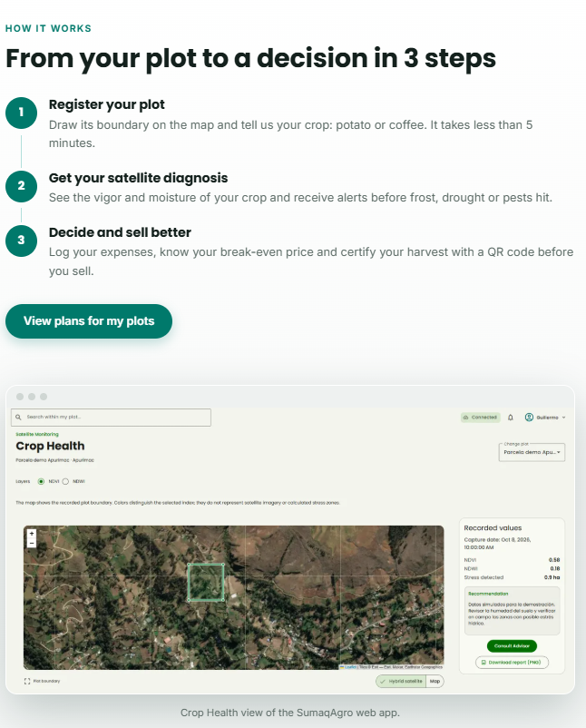
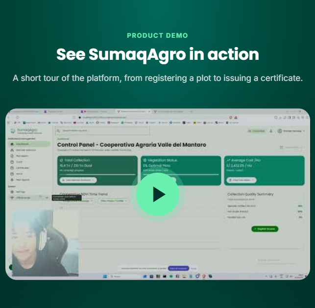
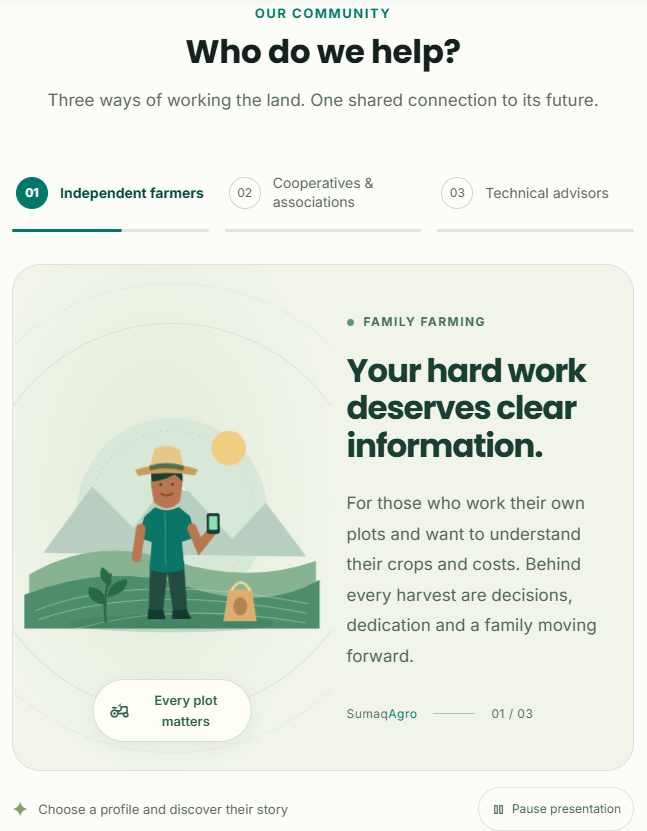
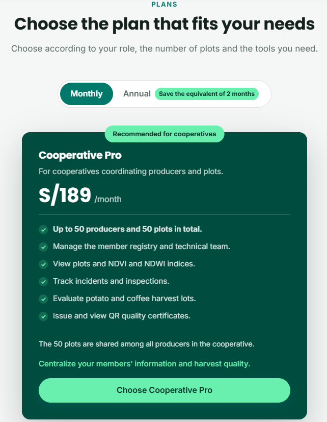
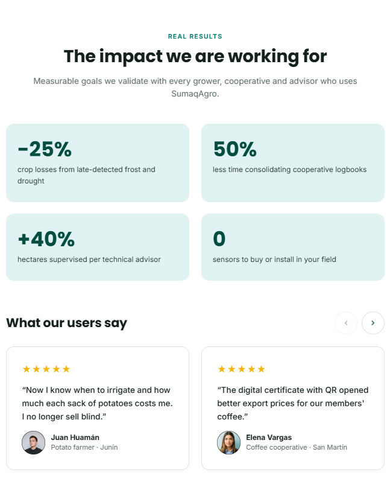
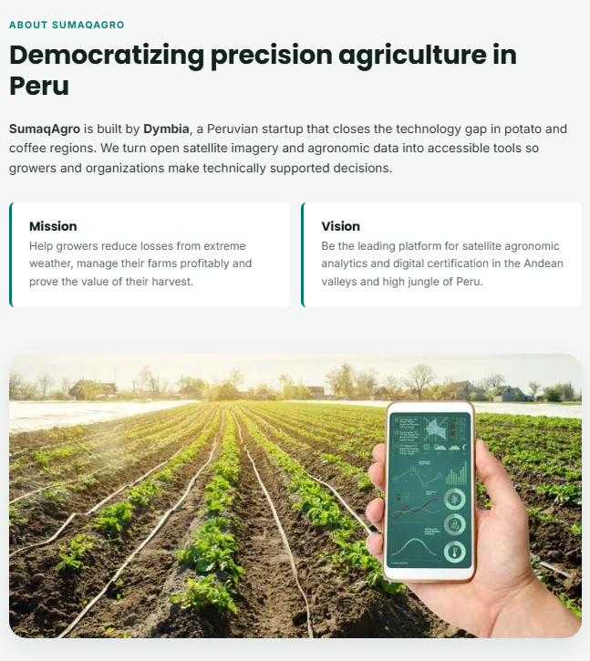
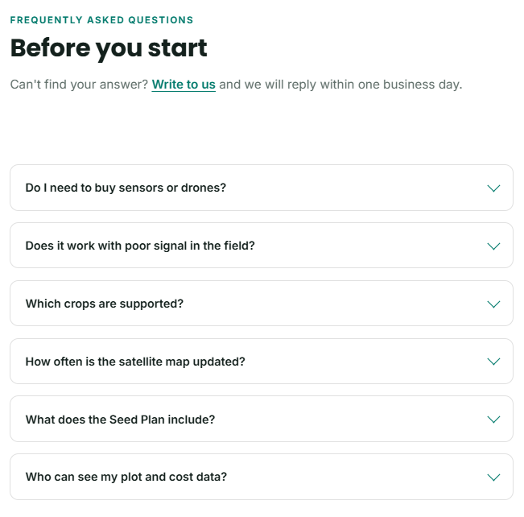
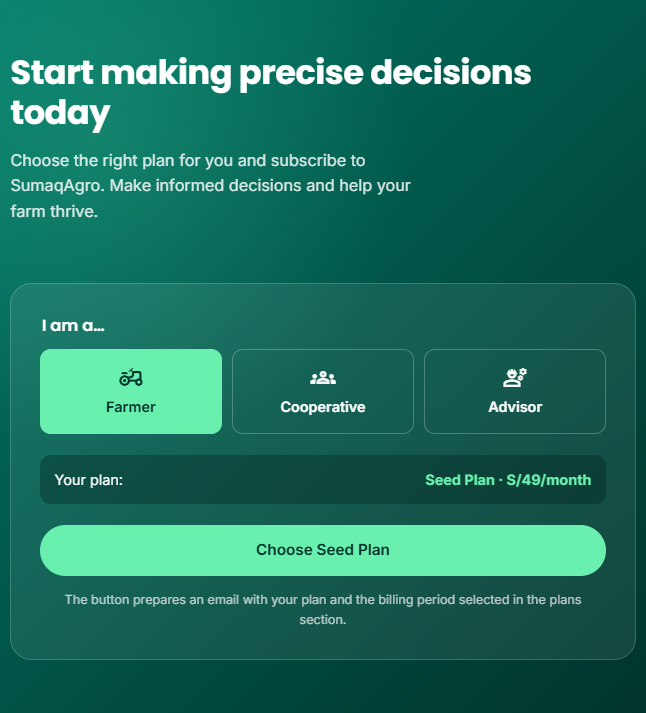
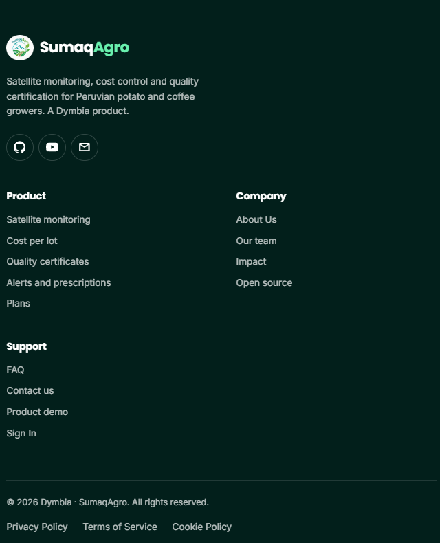

**Evidencia Funcional: Video Demostrativo de Navegación**
Para evidenciar el correcto comportamiento de los componentes interactivos, el menú de navegación fijo (*sticky navbar*), el desplazamiento suave (*smooth scroll*) hacia las anclas de las secciones y el intercambio dinámico de idioma, se ha registrado la navegación real del producto operando en su entorno de producción.

* **Vista Previa del Video:**
  

* **Enlace de Reproducción (Microsoft Stream):**
  [Video "Video de Exposición AV1"](https://goo.su/pK90M9)

---

#### 5.2.1.6. Services Documentation Evidence for Sprint Review

Durante el presente Sprint no se elaboró documentación de servicios web específicos, debido a que el alcance y los esfuerzos del equipo se concentraron de manera exclusiva en el diseño, desarrollo y despliegue continuo del Landing Page institucional.

---

#### 5.2.1.7. Software Deployment Evidence for Sprint Review

Para este sprint se realizó el despliegue de la **Landing Page**.

**1. Despliegue en Producción mediante Cloudflare Pages (Landing Pages)**

Tal como se detalló anteriormente en la sección **5.1.4. Software Deployment Configuration**, el despliegue principal de la Landing Page se ejecutó a través de **Cloudflare Pages**, garantizando una canalización de entrega continua automatizada (*Continuous Deployment*).

A través de la integración mediante *webhooks* con el repositorio en GitHub, cada actualización o *commit* verificado en la rama principal (`main`) dispara de forma automática la compilación y distribución del portal en la red global *Edge* de Cloudflare. Este proceso asegura un entorno de despliegue ágil, con alta disponibilidad y acceso inmediato bajo protocolo seguro `HTTPS`.


**2. Despliegue mediante GitHub Pages (Landing Page)**

A pesar de que el despliegue principal se gestionó a través de Cloudflare Pages, se configuró adicionalmente el despliegue de la landing page en GitHub Pages con el propósito de contar con un entorno alternativo de respaldo y validación continua. La evidencia del proceso es la siguiente:

*   **Paso 1 (Preparación):** Se accedió a la configuración del repositorio (`Settings` > `Pages`) para establecer la fuente de publicación.


*   **Paso 2 (Configuración):** En la sección *Build and deployment*, se seleccionó la rama `main` y la carpeta raíz `/ (root)` como origen del código.


*   **Paso 3 (Publicación):** El sistema finalizó el proceso de compilación con éxito, confirmando el despliegue con el mensaje *"Your site is live"* y otorgando la URL pública.


---

##### Enlaces Oficiales del Landing Page

| Recurso / Plataforma | Descripción | Dirección / Enlace Oficial                                                                                                                                                                                     |
| :--- | :--- |:---------------------------------------------------------------------------------------------------------------------------------------------------------------------------------------------------------------|
| **Repositorio GitHub** | Código fuente del sitio estático (HTML5, CSS3, JavaScript) | [https://dymbia-aplicaciones-web.github.io/sumaqAgro-landing-page](https://dymbia-aplicaciones-web.github.io/sumaqAgro-landing-page)                                                                                 |
| **Cloudflare Pages** | Portal oficial publicado y activo en producción | [https://sumaqagro-landing-page.pages.dev](https://sumaqagro-website.vercel.app/)                                                                                                                           |


---

#### 5.2.1.8. Team Collaboration Insights during Sprint

Durante la ejecución de este Sprint, se emplearon las analíticas de **GitHub Insights** para auditar y monitorear la dinámica colaborativa del equipo **Dymbia**. Se registró una participación equitativa y constante de todos los integrantes en sus roles asignados, destacando un enfoque ágil basado en la revisión cruzada de código. Aunque las modificaciones en la Landing Page se concentraron en ajustes menores de contenido, diseño e internacionalización, la comunicación fluida, el alineamiento en las ceremonias y la retroalimentación constructiva permitieron mantener un flujo de trabajo altamente eficiente, garantizando la integración continua y el cumplimiento oportuno de los entregables del Sprint.


---

### 5.2.2. Sprint 2

El **Sprint 2** representa la transición de la Landing Page hacia el MVP frontend de **SumaqAgro**, implementado en **Vue Framework**, con **PrimeVue**, siguiendo Material Design, **Leaflet.js**, **Composition API de Vue** y una API de prueba con **json-server**. Se mantiene la organización en cuatro capas: *domain/model*, *application*, *infrastructure* y *presentation*. El alcance revisado comprende consulta de parcelas e índices registrados, alertas regionales almacenadas, reportes textuales, bandeja, inspecciones y recetas consultables.


#### 5.2.2.1. Sprint Planning 2

En esta sección se conserva la planificación original del **Sprint 2**, realizada el 2 de octubre de 2026, y se ajusta su contenido a las seis Historias de Usuario revisadas del **EPIC-06 (Salud del Cultivo)**: US-44, US-45, US-48, US-49, US-50 y US-51.

| Sprint # | Sprint 2                                                                                                                                                                                                                                                                                                                                                                                                                                                                                                                                                                                                                                                                                                                          |
| ------ |-----------------------------------------------------------------------------------------------------------------------------------------------------------------------------------------------------------------------------------------------------------------------------------------------------------------------------------------------------------------------------------------------------------------------------------------------------------------------------------------------------------------------------------------------------------------------------------------------------------------------------------------------------------------------------------------------------------------------------------|
| **Sprint Planning Background** |                                                                                                                                                                                                                                                                                                                                                                                                                                                                                                                                                                                                                                                                                                                                   |
| Date | 2026-10-02                                                                                                                                                                                                                                                                                                                                                                                                                                                                                                                                                                                                                                                                                                                        |
| Time | 10:00 AM                                                                                                                                                                                                                                                                                                                                                                                                                                                                                                                                                                                                                                                                                                                          |
| Location | Discord / GitHub                                                                                                                                                                                                                                                                                                                                                                                                                                                                                                                                                                                                                                                                                                                  |
| Prepared By | Tejada Pumacayo, Yamil Jared                                                                                                                                                                                                                                                                                                                                                                                                                                                                                                                                                                                                                                                                                                      |
| Attendees (to planning meeting) | Tejada Pumacayo, Yamil Jared / Duarte Ruffner, Drago Derick / Sanca Condori, Miguel / Solorzano Sullca, Benjamin / Vargas Enriquez, Jose Carlos                                                                                                                                                                                                                                                                                                                                                                                                                                                                                                                                                                                   |
| Sprint 1 Review Summary | Se completó y desplegó exitosamente la versión v1.0.0 del Landing Page en Cloudflare Pages (16 SP), validando la propuesta de valor, planes comerciales, perfiles de los fundadores y políticas legales.                                                                                                                                                                                                                                                                                                                                                                                                                                                                                                                          |
| Sprint 1 Retrospective Summary | Se identificó la necesidad de definir anticipadamente las modelos JavaScript de dominio (DDD) y los contratos mock en `json-server` para acelerar la construcción paralela de componentes de Vue.                                                                                                                                                                                                                                                                                                                                                                                                                                                                                                                |
| **Sprint Goal & User Stories** |                                                                                                                                                                                                                                                                                                                                                                                                                                                                                                                                                                                                                                                                                                                                   |
| Sprint 2 Goal | Our focus is on delivering a demonstrable Crop Health frontend MVP for SumaqAgro using Vue, PrimeVue, Leaflet.js, Vue Composition API and a fake REST API. Producers and agricultural engineers will consult plot boundaries and recorded NDVI/NDWI values, view stored regional alerts, submit textual pest reports, manage a simple inbox, schedule and complete field inspections, and issue and consult agronomic prescriptions. This will be confirmed through verified user flows, clear loading, empty and error states, and consistent demo data. Public deployment requires separate evidence; live satellite processing, weather forecasts, photo uploads, external messaging and signed prescription PDFs remain future work. |
| Sprint 2 Velocity | 32 Story Points                                                                                                                                                                                                                                                                                                                                                                                                                                                                                                                                                                                                                                                                                                                   |
| Sum of Story Points | 32 Story Points                                                                                                                                                                                                                                                                                                                                                                                                                                                                                                                                                                                                                                                                                                                   |

---


#### 5.2.2.2. Aspect Leaders and Collaborators

En esta sección se presenta la matriz **Leadership-and-Collaboration Matrix (LACX)** correspondiente al **Sprint 2**, conservando la asignación de líderes y colaboradores proporcionada por el equipo y ajustando los cinco aspectos técnicos al alcance frontend revisado.

Bajo este modelo, cada integrante tiene una responsabilidad prevista como **Aspect Leader (L)** y participa como **Collaborator (C)** en los demás aspectos. La matriz representa la distribución de planificación; la contribución efectiva debe respaldarse con commits, revisiones y acuerdos del equipo.

##### Leadership-and-Collaboration Matrix (LACX) — Sprint 2

| Team Member (Last Name, First Name) | GitHub Username | Aspect 1: Domain Models & Validation (US-48, US-50, US-51) | Aspect 2: Leaflet Plot Viewer & PNG Report (US-44) | Aspect 3: Vue Reactive State & Fake REST API Integration (US-45, US-49) | Aspect 4: Reports, Inspections & Prescription Forms UI (US-48, US-50, US-51) | Aspect 5: i18n & Vue Router (US-44, US-45, US-49) |
| ------ |---------------| ------ | ------ | ------ | ------ | ------ |
| **Duarte Ruffner, Drago Derick** | `Drago0724`     | **L** | **C** | **C** | **C** | **C** |
| **Sanca Condori, Miguel** | `MiguelSanca`   | **C** | **C** | **L** | **C** | **C** |
| **Solorzano Sullca, Benjamin** | `benjass2`      | **C** | **C** | **C** | **L** | **C** |
| **Vargas Enriquez, Jose Carlos** | `JoseAngelKyo`  | **C** | **C** | **C** | **C** | **L** |
| **Tejada Pumacayo, Yamil Jared** | `YamilTejada`   | **C** | **L** | **C** | **C** | **C** |

***Leyenda: L = Leader (Líder del Aspecto Técnico) | C = Collaborator (Colaborador en el Desarrollo)***

---


#### 5.2.2.3. Sprint Backlog 2

En esta sección se detalla la descomposición técnica de las seis historias revisadas del **EPIC-06** en **23 tareas**. Se conservan los IDs, responsables y estimaciones del documento original: **88 horas históricas**, sujetas a revisión para el alcance ajustado. Los títulos y descripciones se actualizaron el 9 de octubre de 2026; no se presentan como acuerdos retrospectivos de la reunión original. El estado **Implementado** indica soporte existente en el código y no equivale automáticamente a **Done** ni a aceptación de la historia; **Parcial**, **Pendiente** y **Pendiente de validación** identifican el trabajo restante. Antes del cierre deben prepararse alertas demo, corregirse las relaciones de parcelas y socios y documentarse el circuito productor–ingeniero–productor. US-16 queda fuera de esta revisión.

| User Story ID | User Story Title                                          | Task ID    | Task Title                                     | Task Description                                                                                                  | Estimation (Hours) | Assigned To                  | Status   |
| ------------- | --------------------------------------------------------- | ---------- | ---------------------------------------------- | ----------------------------------------------------------------------------------------------------------------- | ------------------ | ---------------------------- | -------- |
| **US-44** | Consulta geográfica de parcelas e índices NDVI y NDWI | **TSK-01** | Inicialización del visor Leaflet | Integrar Leaflet y sus tipados; inicializar y destruir el mapa en el ciclo de vida del componente. | 4 h | Tejada Pumacayo, Yamil Jared | Implementado |
| **US-44** | Consulta geográfica de parcelas e índices NDVI y NDWI | **TSK-02** | Polígono registrado y selección de parcela | Dibujar los límites existentes, ajustar el encuadre y mantener la selección compartida sin crear geometrías ficticias. | 4 h | Tejada Pumacayo, Yamil Jared | Implementado |
| **US-44** | Consulta geográfica de parcelas e índices NDVI y NDWI | **TSK-03** | Selector de índice y fondo del mapa | Alternar NDVI/NDWI para el color del contorno y Satélite híbrido/Mapa para el fondo, sin afirmar que son mapas de calor. | 4 h | Tejada Pumacayo, Yamil Jared | Implementado |
| **US-44** | Consulta geográfica de parcelas e índices NDVI y NDWI | **TSK-04** | Panel de observación y ficha PNG | Mostrar fecha, índices, área de estrés y recomendación; gestionar ausencia/error y descargar una ficha PNG solo con datos válidos. | 3 h | Tejada Pumacayo, Yamil Jared | Implementado |
| **US-45** | Consulta de alertas agroclimáticas registradas por región | **TSK-05** | Modelo de alerta agroclimática | Definir AgroclimaticAlert con región, severidad, fecha, fuente, título y descripción; validar sus datos. | 3 h | Duarte Ruffner, Drago Derick | Implementado |
| **US-45** | Consulta de alertas agroclimáticas registradas por región | **TSK-06** | Endpoint, assembler y consulta por región | Consultar agroclimatic-alerts mediante fetch y transformar las respuestas para la parcela seleccionada. | 3 h | Sanca Condori, Miguel | Implementado |
| **US-45** | Consulta de alertas agroclimáticas registradas por región | **TSK-07** | Tarjetas regionales y estados de consulta | Mostrar alertas con distinción de severidad y separar carga, lista vacía y fallo de consulta. | 4 h | Sanca Condori, Miguel | Implementado |
| **US-45** | Consulta de alertas agroclimáticas registradas por región | **TSK-08** | Datos y demostración de alertas regionales | Preparar alertas simuladas para regiones de parcelas demo y documentar cambio de región, lista vacía y error. | 3 h | Sanca Condori, Miguel | Pendiente |
| **US-48** | Registro de reportes textuales de plagas o enfermedades | **TSK-09** | Modelo y comando de reporte textual | Definir PestReport y RecordPestReportCommand para parcela, productor, descripción y severidad; estado inicial Pendiente. | 4 h | Duarte Ruffner, Drago Derick | Implementado |
| **US-48** | Registro de reportes textuales de plagas o enfermedades | **TSK-10** | Formulario reactivo de reporte | Seleccionar parcela propia e ingresar descripción y severidad; validar longitud mínima y bloquear envíos inválidos o repetidos. | 5 h | Solorzano Sullca, Benjamin | Implementado |
| **US-48** | Registro de reportes textuales de plagas o enfermedades | **TSK-11** | Confirmación y reinicio del formulario | Mostrar confirmación tras el POST exitoso, ofrecer acceso a la bandeja y reiniciar el estado de envío sin errores rojos residuales. | 4 h | Solorzano Sullca, Benjamin | Implementado |
| **US-48** | Registro de reportes textuales de plagas o enfermedades | **TSK-12** | Conservación de datos tras error | Conservar los campos si falla el guardado y permitir reintentar, sin anunciar persistencia offline ni sincronización automática. | 4 h | Solorzano Sullca, Benjamin | Implementado |
| **US-49** | Consulta y gestión básica de la Bandeja de Plagas | **TSK-13** | Estado reactivo y ámbito de reportes | Gestionar la bandeja con el estado reactivo de Vue y limitar registros a parcelas disponibles para la sesión demo; cancelar lecturas obsoletas. | 4 h | Sanca Condori, Miguel | Implementado |
| **US-49** | Consulta y gestión básica de la Bandeja de Plagas | **TSK-14** | Bandeja sencilla con tarjetas | Mostrar parcela, descripción, severidad y estado; ordenar por ID descendente y ofrecer navegación a reportes, inspecciones y recetas. | 4 h | Sanca Condori, Miguel | Implementado |
| **US-49** | Consulta y gestión básica de la Bandeja de Plagas | **TSK-15** | Eliminación confirmada y retroalimentación | Permitir al productor eliminar reportes propios pendientes sin visitas ni recetas; conservar registros si cancela o falla la API. | 4 h | Vargas Enriquez, Jose Carlos | Implementado |
| **US-50** | Programación y registro de inspecciones de campo | **TSK-16** | Modelo y validaciones de inspección | Definir FieldInspection con estados Programada/Completada, fecha, notas e identidad del inspector; controlar fecha y duplicados. | 3 h | Duarte Ruffner, Drago Derick | Implementado |
| **US-50** | Programación y registro de inspecciones de campo | **TSK-17** | Formulario y listado de visitas | Programar una visita con fecha y hora futuras mediante datetime-local; mostrar las visitas y acceso a la bandeja. | 4 h | Solorzano Sullca, Benjamin | Implementado |
| **US-50** | Programación y registro de inspecciones de campo | **TSK-18** | Finalización y sincronización de inspección | Guardar resultados, marcar visita Completada y reporte Inspeccionado; ofrecer reintento de sincronización si falla el segundo guardado. | 3 h | Vargas Enriquez, Jose Carlos | Implementado |
| **US-51** | Emisión y consulta de recetas agronómicas | **TSK-19** | Modelo de receta agronómica | Definir TechnicalPrescription e IssueTechnicalPrescriptionCommand con reporte, emisor, producto, instrucciones y fecha. | 4 h | Duarte Ruffner, Drago Derick | Implementado |
| **US-51** | Emisión y consulta de recetas agronómicas | **TSK-20** | Formulario y guardado de receta | Registrar producto, dosis, instrucciones y fecha válida únicamente para reportes inspeccionados y el emisor disponible en sesión. | 5 h | Solorzano Sullca, Benjamin | Implementado |
| **US-51** | Emisión y consulta de recetas agronómicas | **TSK-21** | Consulta del historial de recetas | Mostrar las recetas del ámbito disponible con producto, reporte, emisor, fecha e instrucciones y retorno a la bandeja. | 3 h | Solorzano Sullca, Benjamin | Implementado |
| **US-51** | Emisión y consulta de recetas agronómicas | **TSK-22** | Demostración integrada de asistencia técnica | Verificar con datos coherentes el circuito productor–ingeniero: reporte, visita, resultados y receta visible para el productor. | 4 h | Solorzano Sullca, Benjamin | Pendiente de validación |
| **US-51** | Emisión y consulta de recetas agronómicas | **TSK-23** | Rutas, traducciones y datos relacionados | Mantener rutas y diccionarios ES/EN; preparar relaciones consistentes entre parcelas, socios, ingeniero, reportes, visitas y recetas. | 5 h | Vargas Enriquez, Jose Carlos | Parcial |

#### 5.2.2.4. Development Evidence for Sprint Review

En esta sección se presenta la evidencia de los commits de la Web Application de SumaqAgro correspondientes al **Sprint 2**, registrados el **9 de octubre de 2026**. Los cambios incluyen la estructura inicial de la aplicación Vue, las entidades y assemblers de Salud del Cultivo, los componentes de consulta y asistencia agronómica, la configuración de idiomas, Pinia y rutas, los estilos globales y la documentación del repositorio.

A continuación, se detalla la evidencia de los commits mostrados en el historial proporcionado:

| Repository | Branch | Commit Id | Commit Message | Commit Message Body | Commited on (Date) |
| :--- | :--- | :--- | :--- | :--- | :--- |
| Web Application de SumaqAgro | `---` | `baff3f1` | `docs(license): add documentation license` | `---` | 09/10/2026 |
| Web Application de SumaqAgro | `---` | `09b3ced` | `docs(contributing): add documentation contributing` | `---` | 09/10/2026 |
| Web Application de SumaqAgro | `---` | `36488ef` | `docs(changelog): add documentation changelog` | `---` | 09/10/2026 |
| Web Application de SumaqAgro | `develop` | `04b0469` | `Merge branch 'feature/configuration' into develop` | `---` | 09/10/2026 |
| Web Application de SumaqAgro | `---` | `0d409a4` | `feat: add global styles and design tokens for SumaqAgro` | `---` | 09/10/2026 |
| Web Application de SumaqAgro | `---` | `1cb473c` | `feat: add i18n configuration, Pinia store setup, and router with lazy-loaded components` | `---` | 09/10/2026 |
| Web Application de SumaqAgro | `develop` | `b73aab5` | `Merge branch 'feature/crop-health' into develop` | `---` | 09/10/2026 |
| Web Application de SumaqAgro | `---` | `0322455` | `feat: add environment configuration files for development and production` | `---` | 09/10/2026 |
| Web Application de SumaqAgro | `---` | `44d176f` | `feat: add components for plot selection, field inspections, technical prescriptions, and agricultural alerts` | `---` | 09/10/2026 |
| Web Application de SumaqAgro | `---` | `879012b` | `feat: add assemblers for agroclimatic alerts, pest reports, satellite observations, and technical prescriptions` | `---` | 09/10/2026 |
| Web Application de SumaqAgro | `---` | `3d07bbd` | `feat: add entity classes for agroclimatic alerts, field inspections, pest reports, satellite observations, and validation rules` | `---` | 09/10/2026 |
| Web Application de SumaqAgro | `---` | `c17e659` | `refactor: replace HelloWorld component with layout structure and remove unused files` | `---` | 09/10/2026 |
| Web Application de SumaqAgro | `---` | `eb93fc2` | `initial commit` | `---` | 09/10/2026 |

*Nota: la captura no muestra el nombre exacto del repositorio, las ramas de los commits individuales ni sus cuerpos. Se utiliza la denominación del producto para el repositorio y `---` para los datos no visibles; `develop` corresponde a la rama de destino indicada en los mensajes de merge.*

#### 5.2.2.5. Execution Evidence for Sprint Review

En esta sección se presentan las evidencias de ejecución de la Web Application de SumaqAgro desarrollada durante el Sprint 2. Las capturas muestran las interfaces y los flujos de uso de la aplicación en un entorno local, utilizando datos de demostración.

Las evidencias se organizan en tres segmentos según el perfil del usuario: agricultor independiente, director de cooperativa e ingeniero agrónomo. A continuación, se documenta el primer segmento, correspondiente al agricultor independiente.

---

##### 1. Agricultor independiente

El perfil del agricultor independiente, representado por Guillermo, reúne las interfaces para consultar el estado de sus cultivos, revisar los gastos de campaña, gestionar sus parcelas y acceder a la asistencia agronómica. Las capturas presentan la navegación de la aplicación con el idioma inglés seleccionado.

###### 1.1. Dashboard principal — Mi parcela

La pantalla My Plot presenta un resumen de la parcela seleccionada y de su campaña agrícola. Se muestran el índice NDVI registrado, la inversión acumulada y el precio de equilibrio por saco. Además, incluye un gráfico de evolución del vigor vegetal y la distribución de costos entre insumos, mano de obra y transporte.

En la evidencia se observa la parcela de demostración de Ayacucho, con un NDVI de 0.76, una inversión de S/ 4,870.00 y un punto de equilibrio de S/ 16.23 por saco.

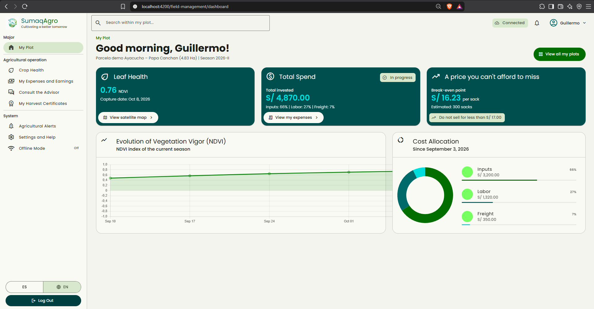

###### 1.2. Salud del cultivo — Parcela de Apurímac

La pantalla Crop Health muestra los límites de la parcela de Apurímac sobre un mapa con fondo satelital. El usuario dispone de un selector de parcela, controles de zoom y opciones para alternar entre NDVI y NDWI, así como entre las vistas de satélite híbrido y mapa.

El panel lateral presenta la fecha de captura y los valores de demostración: NDVI de 0.58, NDWI de 0.18 y 0.9 hectáreas de estrés registrado. También se muestran una recomendación y los botones para consultar al asesor y descargar una ficha en formato PNG. El texto de la interfaz aclara que el color del polígono identifica el índice seleccionado y no representa un mapa de calor calculado.

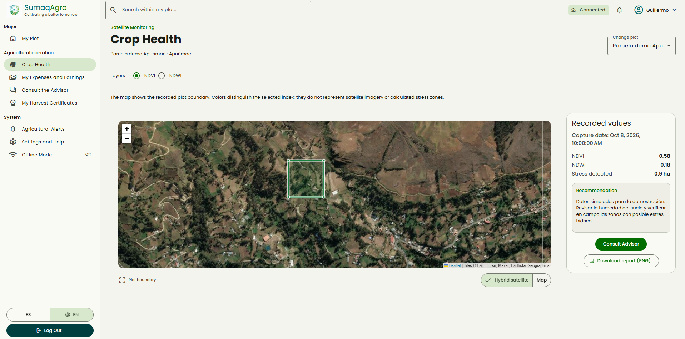

###### 1.3. Gastos de campaña y precio de equilibrio

La pantalla My Expenses and Earnings organiza los gastos de la campaña por categorías y presenta una tabla con la fecha, el tipo de gasto, la descripción, la cantidad, el precio unitario y el total de cada registro.

Para la parcela de Apurímac se muestra una inversión de S/ 4,670.00, distribuida en S/ 3,000.00 de insumos, S/ 1,320.00 de mano de obra y S/ 350.00 de transporte. El panel de equilibrio presenta un rendimiento esperado de 280 sacos y un precio mínimo calculado de S/ 16.68 por saco. La interfaz incluye las acciones para registrar gastos y actualizar el rendimiento esperado.
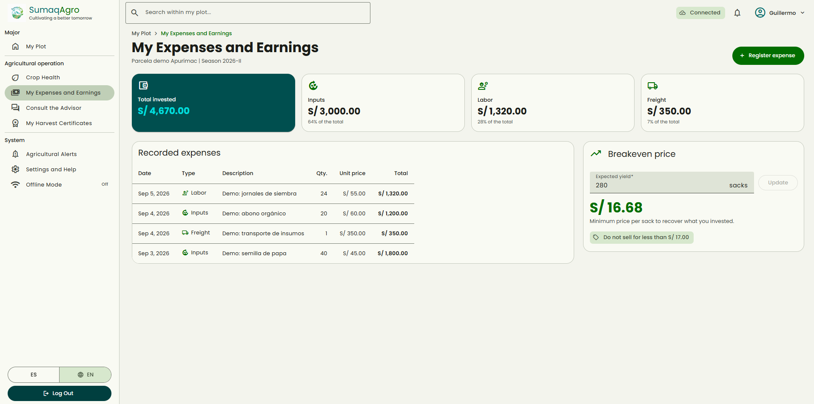

###### 1.4. Bandeja de reportes de plagas

La pantalla Diagnosis Inbox presenta los reportes asociados a las parcelas del agricultor. Cada tarjeta identifica la parcela, el número del reporte, su estado, la descripción de los síntomas y la severidad.

La captura muestra el reporte #1 de la parcela de Apurímac, con estado Pending y severidad Low. También se observan las acciones para agregar un reporte, eliminar el registro y acceder a las inspecciones de campo o al historial de recetas.

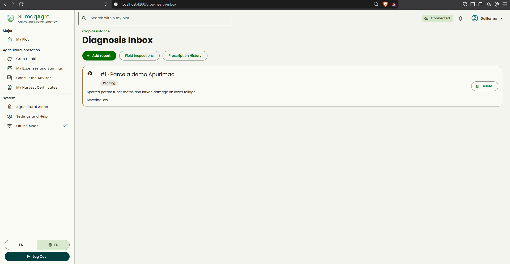

###### 1.5. Consulta de certificados de cosecha

La pantalla Official Quality and Origin Certificates presenta un certificado asociado al lote BATCH-2026-08. La tarjeta muestra el cultivo, el predio de origen, la fecha de emisión y la distribución de la clasificación técnica de la cosecha.

La interfaz ofrece las opciones para mostrar el código QR al comprador, descargar el certificado en PDF y consultar su registro web. Esta captura documenta la presentación del certificado y sus acciones disponibles.
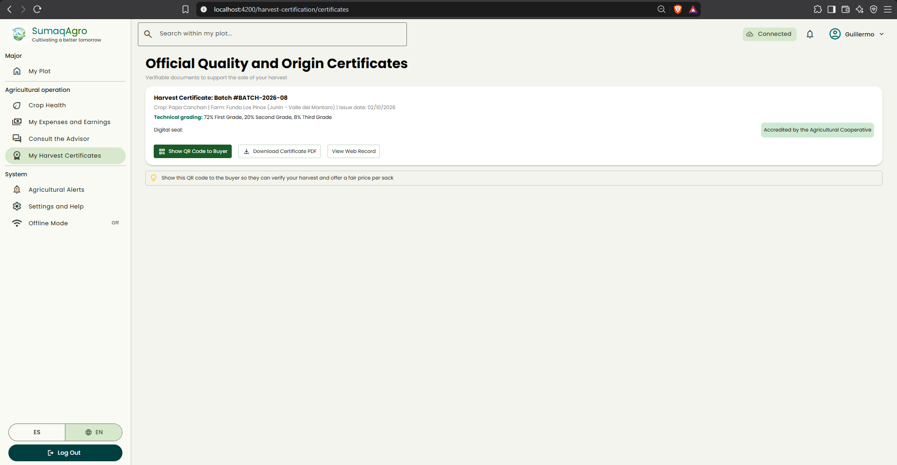

###### 1.6. Consulta de alertas agrícolas

La pantalla Agricultural Alerts permite seleccionar una parcela y consultar las alertas correspondientes a su región. En la captura se encuentra seleccionada la parcela de Ayacucho y se presenta el mensaje “No alerts are recorded for this region”.

Esta evidencia muestra el estado de la interfaz cuando no existen alertas registradas para la región consultada.

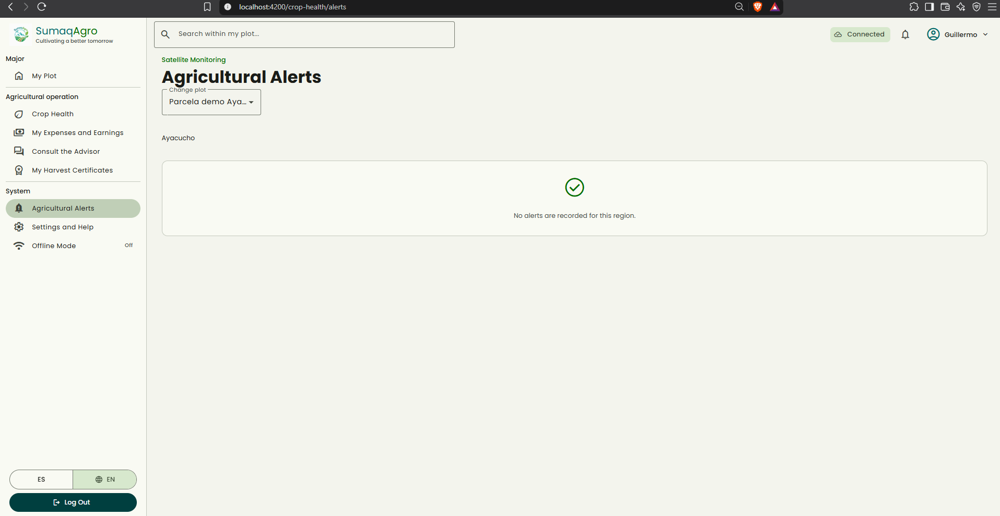

###### 1.7. Configuración de la cuenta

La pantalla Account Settings and Farmer Support presenta los datos de contacto del agricultor, mediante campos de teléfono y correo electrónico, junto con el botón Save.

La sección de seguridad muestra los campos de contraseña deshabilitados y un mensaje que indica que el cambio de contraseña estará disponible cuando se incorpore la autenticación de la plataforma.

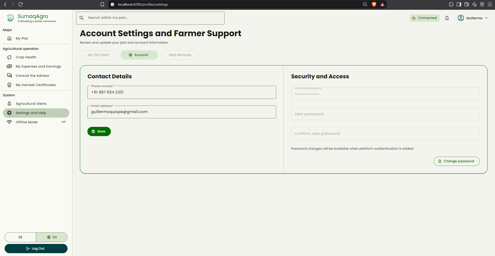

###### 1.8. Consulta de parcelas registradas

La pantalla My Registered Plots presenta las parcelas del agricultor mediante tarjetas con su nombre, cultivo, superficie, ubicación y acceso al monitoreo.

En la evidencia se muestran las parcelas de demostración de Ayacucho y Apurímac, además de Parcela San Jerónimo – Lote 1, con superficies de 4.83, 4.82 y 2.81 hectáreas, respectivamente. La interfaz también informa que se han utilizado los tres espacios del plan gratuito.

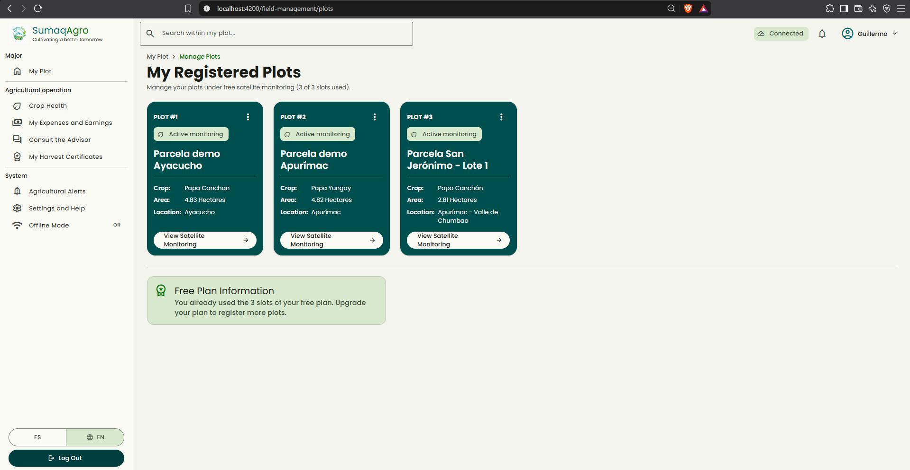

###### 1.9. Registro de una nueva parcela — Datos del cultivo

El primer paso del registro presenta un formulario para ingresar el nombre de la parcela, el tipo y la variedad del cultivo, la región o valle, la fecha estimada de siembra, el rendimiento esperado y el área declarada.

La captura muestra el registro de Parcela San Jerónimo – Lote 1, con cultivo Papa Canchán, ubicación en Apurímac – Valle de Chumbao, rendimiento esperado de 450 sacos y área declarada de 1.5 hectáreas. El botón Next permite continuar hacia la delimitación del terreno.

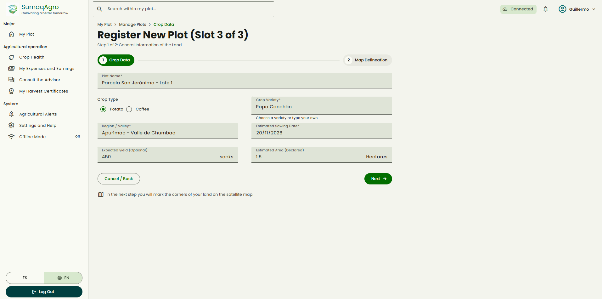

###### 1.10. Delimitación geográfica y cálculo de superficie

El segundo paso presenta un mapa para marcar los vértices del terreno. El panel lateral muestra las coordenadas registradas, el estado del polígono y la superficie calculada.

En la captura se observa un perímetro cerrado de cuatro vértices y un área calculada de 2.81 hectáreas, diferenciada del área declarada de 1.5 hectáreas. La interfaz incluye controles para deshacer el último punto, limpiar el mapa y guardar la parcela, además de opciones para ingresar coordenadas o solicitar la ubicación GPS del dispositivo.

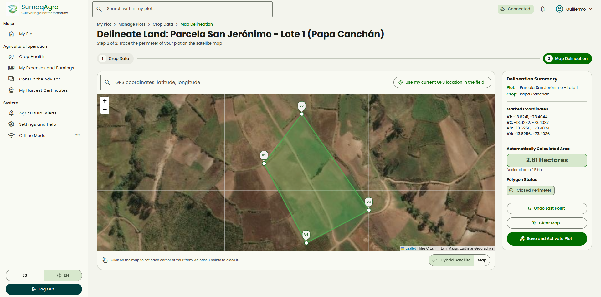

###### 1.11. Confirmación del registro de parcela

Tras guardar la delimitación, la aplicación presenta el cuadro de confirmación “Plot Saved Successfully!”. Este resume el nombre de la parcela, el cultivo, el área calculada y los espacios utilizados del plan.

La evidencia muestra la parcela San Jerónimo – Lote 1, con cultivo Papa Canchán y superficie de 2.81 hectáreas. El diálogo ofrece accesos para consultar la salud del cultivo o regresar a la gestión de parcelas. El indicador de sincronización satelital forma parte de la presentación de la demo.

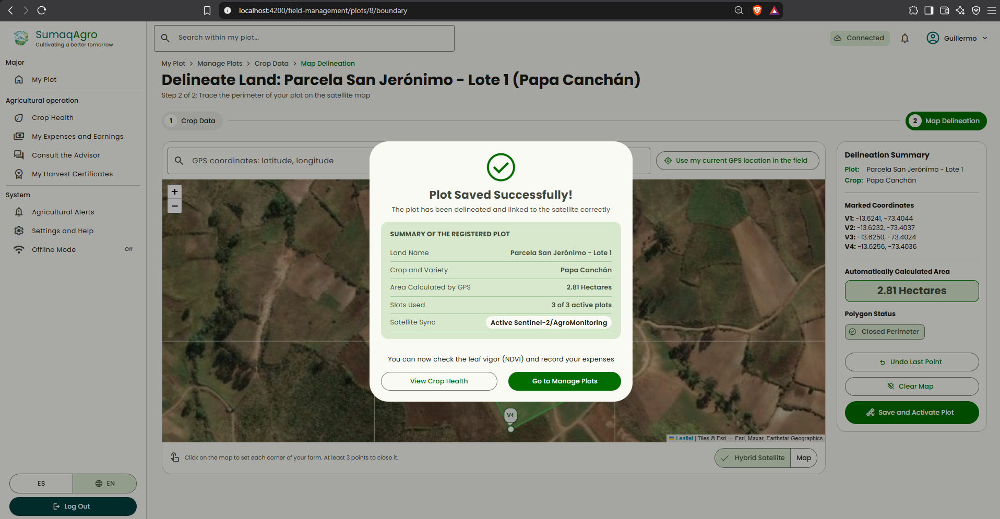

###### 1.12. Salud del cultivo — Selección de NDWI

La última captura muestra la parcela de Ayacucho con la opción NDWI seleccionada. El límite de la parcela se presenta en azul sobre el fondo satelital, mientras el panel lateral conserva los valores registrados: NDVI de 0.76, NDWI de 0.42 y 0.3 hectáreas de estrés registrado.

Esta evidencia documenta la selección del índice NDWI y la consulta de los datos simulados de la parcela, junto con las acciones de consulta al asesor y descarga de la ficha PNG.

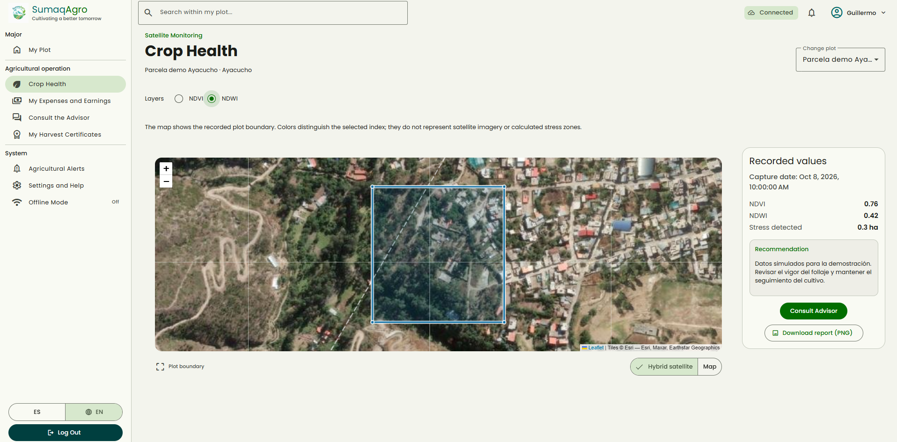


---

##### 2. Director de cooperativa

El perfil del director de cooperativa, representado por Cristian Santana, presenta una interfaz orientada a la supervisión de socios, parcelas, costos y calidad de la producción. Este segmento continúa en desarrollo; la evidencia documenta el avance de su panel y las opciones de navegación disponibles.

###### 2.1. Panel de control de la cooperativa

La pantalla Panel de Control – Cooperativa Agraria Valle del Mantaro muestra un resumen de 3 socios activos y 7.8 hectáreas bajo monitoreo. Incluye tarjetas de acopio total, estado vegetativo y costo promedio por hectárea, junto con accesos al padrón de socios, mapa de riesgo y matriz de costos.

En la captura se presenta un acopio de 19.4 toneladas, frente a una meta de 210 toneladas, y un costo promedio de S/ 2,432.05 por hectárea. También se observa un espacio para la tendencia temporal del NDVI, todavía sin una serie dibujada, y un resumen de calidad de 4 lotes evaluados.

El menú lateral organiza los accesos a padrón, salud de parcelas, costos, certificados, alertas y reportes de plagas. Los indicadores corresponden al entorno de demostración; la integración y validación de los flujos de este perfil siguen en desarrollo.

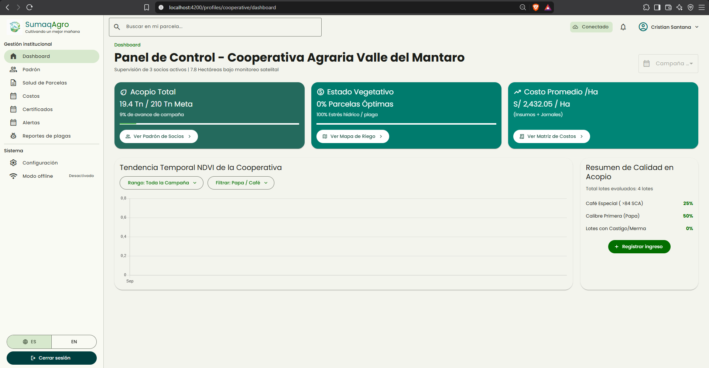

---

##### 3. Ingeniero agrónomo

El perfil del ingeniero agrónomo, representado por Ing. Juan A. Morales, presenta una interfaz orientada a la atención de reportes de plagas, inspecciones de campo y prescripciones técnicas. Este segmento continúa en desarrollo; la captura muestra su navegación y el estado inicial de la bandeja de atención.

###### 3.1. Bandeja de diagnóstico

La pantalla Diagnosis Inbox presenta la bandeja de reportes del ingeniero agrónomo. En la evidencia se muestra el mensaje “No reports”, correspondiente al estado de la interfaz cuando no hay reportes disponibles para mostrar.

La pantalla incluye accesos a Field Inspections y Prescription History. El menú lateral reúne las opciones de reportes de plagas, inspecciones, prescripciones técnicas, salud del cultivo y alertas agrícolas.

Esta captura documenta la estructura del perfil y su estado vacío. La evidencia de atención de casos, registro de inspecciones y emisión de prescripciones se incorporará conforme avance el desarrollo.
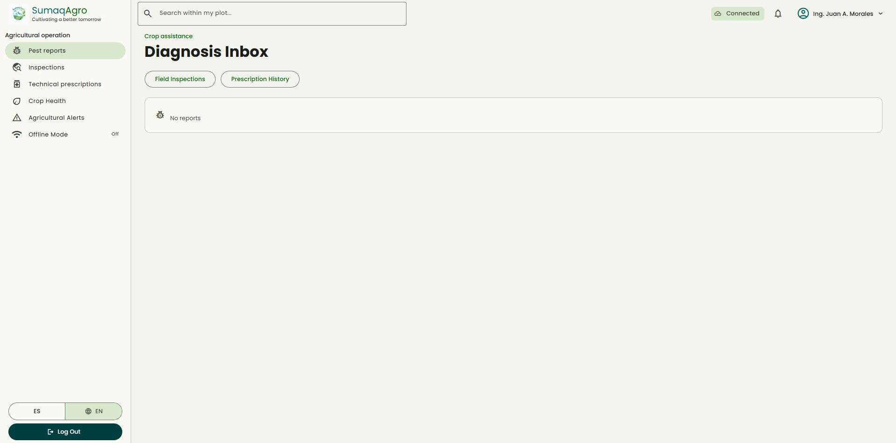

##### Evidencia Funcional: Video Demostrativo de Navegación

Para evidenciar el funcionamiento de la Web Application de SumaqAgro, se presenta un video demostrativo de la navegación entre las vistas de Vue y la interacción con los componentes de la aplicación. El recorrido muestra el dashboard del agricultor independiente, la gestión y delimitación de parcelas, la consulta de indicadores NDVI/NDWI, los gastos de campaña y la bandeja de reportes de plagas. También presenta el cambio de idioma y los avances de las interfaces del director de cooperativa y del ingeniero agrónomo.

* **Enlace de Reproducción (Microsoft Stream):** [Video "Video de Exposición AV1"](https://upcedupe-my.sharepoint.com/personal/u202422128_upc_edu_pe/_layouts/15/stream.aspx?id=%2Fpersonal%2Fu202422128%5Fupc%5Fedu%5Fpe%2FDocuments%2FRecording%2D20261009%5F092557%2Ewebm&nav=eyJyZWZlcnJhbEluZm8iOnsicmVmZXJyYWxBcHAiOiJTdHJlYW1XZWJBcHAiLCJyZWZlcnJhbFZpZXciOiJTaGFyZURpYWxvZy1MaW5rIiwicmVmZXJyYWxBcHBQbGF0Zm9ybSI6IldlYiIsInJlZmVycmFsTW9kZSI6InZpZXcifX0&ga=1&referrer=StreamWebApp%2EWeb&referrerScenario=AddressBarCopied%2Eview%2E418bacb5%2D22ff%2D4d75%2Daa54%2Db24e02149c8b)


#### 5.2.2.6. Services Documentation Evidence for Sprint Review


En esta sección se presenta la documentación de los servicios utilizados por la Web Application de **SumaqAgro** durante el **Sprint 2**. Para esta iteración se empleó una **Fake REST API implementada con `json-server`**, que administra los datos de demostración almacenados en `server/db.json`.

La API de demostración puede iniciarse directamente con:

```bash
npx json-server --watch server/db.json --routes server/routes.json --port 3000
```

El archivo `server/routes.json` establece el prefijo de acceso a los recursos:

```json
{
  "/api/v1/*": "/$1"
}
```

La conexión local de demostración y la configuración actual del proyecto se distinguen de la siguiente manera:

| Entorno | URL base | Archivo de configuración |
| :--- | :--- | :--- |
| API de demostración local | `http://localhost:3000/api/v1` | `server/db.json` y `server/routes.json` |
| Backend real (configuración actual) | `/api/v1` | `.env.development` y `.env.production` |

La aplicación Vue se ejecuta en una terminal independiente mediante `npm run dev`.

##### Documentación de endpoints

Los endpoints se organizan según los Bounded Contexts del proyecto. Las rutas indicadas son relativas a la URL base y los métodos corresponden a las operaciones expuestas por las fachadas de infraestructura del frontend.

| Bounded Context | Endpoint | Métodos HTTP | Descripción |
| :--- | :--- | :--- | :--- |
| Profiles | `/profiles` | GET, PUT | Consulta y actualización del perfil del agricultor. |
| Profiles | `/cooperatives` | GET, PUT | Consulta y actualización de la cooperativa. |
| Profiles | `/cooperative-members` | GET | Consulta de socios de una cooperativa. |
| Profiles | `/cooperative-dashboards` | GET | Consulta de los datos del panel institucional. |
| Profiles | `/agronomist-assignments` | GET, POST, PUT, DELETE | Consulta y gestión de asignaciones de ingenieros agrónomos. |
| Field Management | `/field-plots` | GET, POST, PUT, DELETE | Consulta, registro, actualización y eliminación de parcelas. |
| Field Management | `/crop-campaigns` | GET, POST, PUT | Consulta, registro y actualización de campañas agrícolas. |
| Field Management | `/campaign-ledgers` | GET, POST, PUT | Consulta, registro y actualización del libro de gastos de una campaña. |
| Crop Health | `/satellite-observations` | GET | Consulta de observaciones e indicadores registrados por parcela. |
| Crop Health | `/agroclimatic-alerts` | GET | Consulta de alertas agroclimáticas por región. |
| Crop Health | `/climate-forecasts` | GET | Consulta de pronósticos climáticos por región. |
| Crop Health | `/pest-reports` | GET, POST, PUT, DELETE | Consulta, registro, actualización y eliminación de reportes de plagas. |
| Crop Health | `/field-inspections` | GET, POST, PUT | Consulta, programación y actualización de inspecciones de campo. |
| Crop Health | `/technical-prescriptions` | GET, POST | Consulta y emisión de prescripciones técnicas. |
| Harvest Certification | `/harvest-batches` | GET, POST, PUT | Consulta, registro y actualización de lotes de cosecha. |
| Harvest Certification | `/quality-certificates` | GET, POST | Consulta y emisión de certificados de calidad, incluyendo búsqueda por token. |

Las operaciones sobre registros individuales utilizan el identificador del recurso en la ruta, por ejemplo, `PUT /api/v1/pest-reports/{id}` y `DELETE /api/v1/pest-reports/{id}`.

La trazabilidad pública se construye en Vue mediante la consulta del certificado por su token y del lote de cosecha asociado. En la implementación actual no se utiliza una colección independiente `/public-traceability` en `server/db.json`.

##### Consultas mediante parámetros

El frontend utiliza parámetros de consulta para recuperar los registros asociados a un propietario, parcela, campaña, región o reporte.

| Petición | Descripción |
| :--- | :--- |
| `GET /api/v1/field-plots?ownerUserId=1` | Consulta las parcelas de un propietario. |
| `GET /api/v1/crop-campaigns?plotId=1` | Consulta las campañas de una parcela. |
| `GET /api/v1/campaign-ledgers?campaignId=1` | Consulta el libro de gastos de una campaña. |
| `GET /api/v1/satellite-observations?plotId=1` | Consulta las observaciones registradas de una parcela. |
| `GET /api/v1/pest-reports?plotId=1` | Consulta los reportes de plagas de una parcela. |
| `GET /api/v1/agroclimatic-alerts?region=Ayacucho` | Consulta las alertas registradas para Ayacucho. |
| `GET /api/v1/field-inspections?reportId=1` | Consulta las inspecciones asociadas a un reporte. |
| `GET /api/v1/technical-prescriptions?reportId=1` | Consulta las prescripciones asociadas a un reporte. |

##### Estructura de los datos intercambiados

Los recursos se intercambian en formato **JSON**. Las consultas a colecciones retornan arreglos, mientras que la consulta mediante `/{id}` retorna un objeto individual. Cuando una consulta no contiene registros, la API retorna un arreglo vacío `[]`.

El siguiente objeto corresponde a un registro de demostración existente en la colección `satellite-observations` de `server/db.json`:

```json
{
  "id": 1,
  "plotId": 1,
  "date": "2026-09-12T10:00:00Z",
  "ndviMean": 0.74,
  "ndwiMean": 0.65,
  "surfaceTempKelvin": 295.15,
  "cloudCoveragePercent": 5,
  "stressAreaHectares": 0.4,
  "recommendation": "Check the area for signs of the onset of wilting."
}
```

Este registro relaciona una observación con una parcela e incluye la fecha de captura, los indicadores NDVI y NDWI, la temperatura superficial, la cobertura nubosa, el área de estrés y una recomendación.

Los valores son datos simulados para la demostración. En el archivo revisado, las colecciones `agroclimatic-alerts`, `climate-forecasts`, `field-inspections` y `technical-prescriptions` se encuentran vacías.

##### Integración con el frontend Vue

La comunicación HTTP de Vue se implementa mediante Axios. La clase compartida `BaseApi`, definida en `src/shared/infrastructure/base-api.js`, crea el cliente con `axios.create()` y obtiene la URL base desde `import.meta.env.VITE_SUMAQAGRO_PLATFORM_API_URL`. Las fachadas de infraestructura agrupan las operaciones de acceso a datos de sus respectivos contextos.

La clase compartida `BaseEndpoint` implementa las operaciones generales de consulta, creación, actualización y eliminación. Los **assemblers** convierten los recursos JSON recibidos en entidades de dominio y transforman las entidades en recursos para enviarlos a la API.

Por ejemplo, el método `CropHealthApi.getObservationsByPlot(plotId)` delega la consulta al endpoint de observaciones satelitales. Este envía una petición GET con el parámetro `plotId` y transforma los registros recibidos en entidades `SatelliteObservation`.

La documentación presentada corresponde a la configuración y los contratos implementados en el proyecto para la Fake REST API del Sprint 2.

---


#### 5.2.2.7. Software Deployment Evidence for Sprint Review

Durante el **Sprint 2**, el equipo **Dymbia** publicó la **Web Application de SumaqAgro**, desarrollada en **Vue**, en **Firebase Hosting**, y utilizó una **Fake REST API** con `json-server` publicada en **Render** para los datos de demostración.

El proceso incluyó la configuración de Firebase Hosting, la organización del código en GitHub y la definición de los comandos de compilación, ejecución y conexión con los servicios.

El alcance de publicación de esta sección comprende la **Web Application** y la **Fake REST API** del Sprint 2. El backend definitivo en **C# y ASP.NET Core**, con **MySQL** y despliegue en **Railway**, corresponde al Sprint 3.

##### Despliegue de la Web Application en Firebase Hosting

  Se configuró el proyecto **`sumaqagro-appweb`** en Firebase y se habilitó **Firebase Hosting** para publicar los archivos generados por Vue.

La vinculación del proyecto local se encuentra definida en `.firebaserc`. Por su parte, `firebase.json` establece el directorio de publicación `dist/` y una redirección hacia `index.html`, necesaria para que Vue gestione sus rutas internas al ingresar directamente a una vista o recargar la página.

El procedimiento de despliegue documentado en el repositorio utiliza **Firebase CLI**. La preparación del entorno requiere instalar la herramienta y autenticar una cuenta con acceso al proyecto:

```bash
npm install -g firebase-tools
firebase login
```

Posteriormente, la aplicación se compila y publica mediante:

```bash
npm run build
firebase deploy --only hosting
```

La Web Application dispone de los siguientes dominios:

| Tipo | Dirección |
| :--- | :--- |
| Dominio principal | https://sumaqagro-appweb.web.app |
| Dominio alternativo | https://sumaqagro-appweb.firebaseapp.com |

###### Evidencia de publicación en Firebase Hosting

La captura del panel de Firebase Hosting muestra el proyecto `sumaqagro-appweb`, sus dominios y el historial de versiones publicadas. Se observan publicaciones realizadas el **8 y 9 de octubre de 2026**, con la versión **`4e43fc`** identificada como la versión actual en la evidencia.

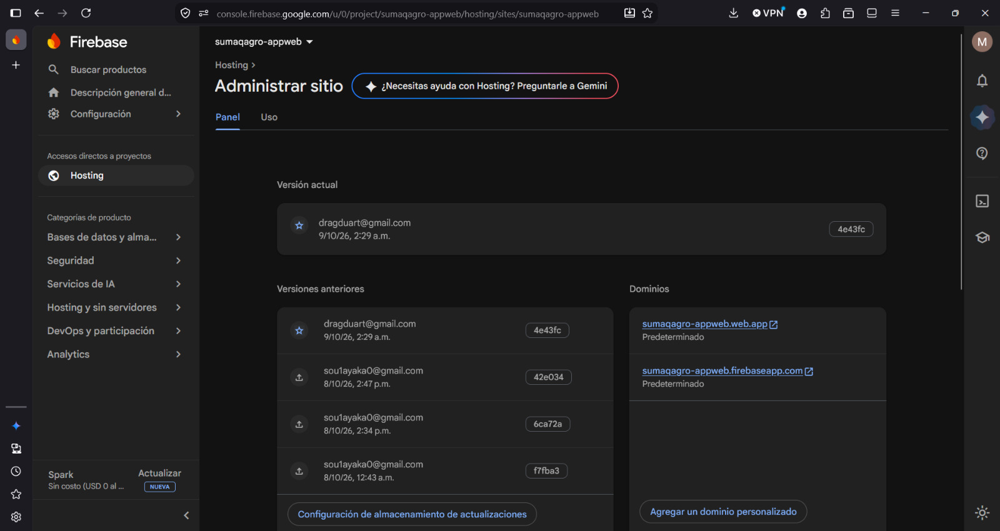

##### Despliegue de la Fake REST API en Render

Para el Sprint 2 se utilizó una **Fake REST API** con `json-server`, publicada en **Render**, como soporte de los datos de demostración de la Web Application de Aplicaciones Web.

| Parámetro | Configuración |
| :--- | :--- |
| Tipo de servicio | Web Service |
| Nombre | `sumaqAgro-fake-api` |
| Repositorio de la Web Application | `dymbia-aplicaciones-web/sumaq-agro-web-app` |
| Rama | `develop` |
| Entorno de ejecución | Node |
| Comando de instalación | `npm install --include=dev` |
| Comando de inicio | `npx json-server server/db.json --routes server/routes.json --host 0.0.0.0 --port $PORT` |
| Tipo de instancia | Free |
| Actualización | Auto-Deploy |

La Fake REST API utiliza `server/db.json` para los datos de demostración y `server/routes.json` para exponer los recursos bajo el prefijo `/api/v1`. El comando de inicio utiliza el puerto asignado por Render.

**URL base:** https://sumaqagro-fake-api.onrender.com/api/v1

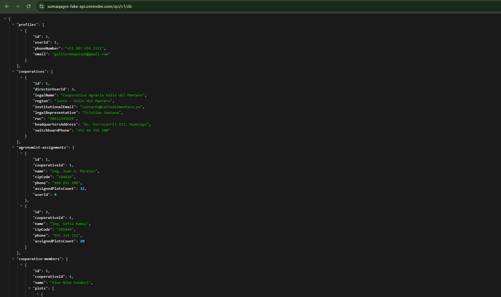

###### Evidencia de publicación en Render

La captura del panel de Render muestra el servicio en estado **Live**, la rama `develop` y el historial de despliegues automáticos de la Fake REST API utilizada durante esta etapa.

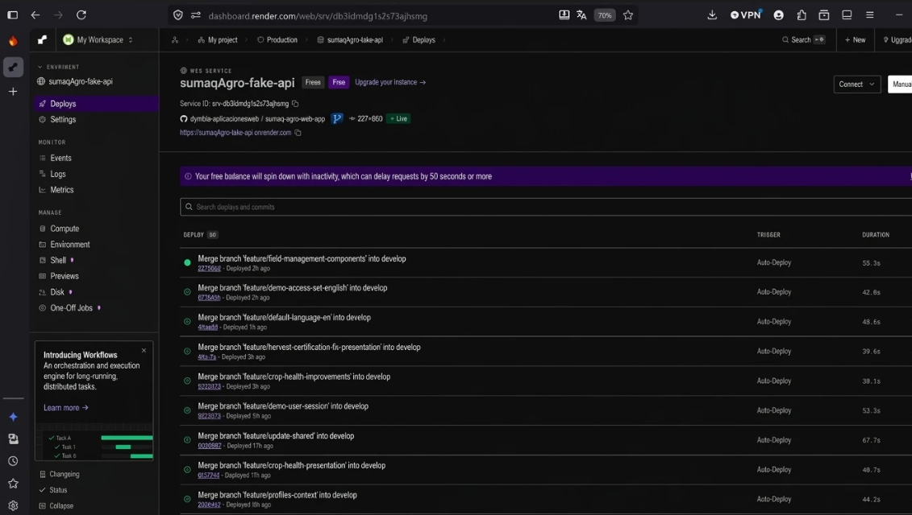

La Fake REST API corresponde al Sprint 2. La versión final utiliza el backend real desarrollado en **C# con ASP.NET Core**, persistencia en **MySQL** y despliegue en **Railway**, documentado en el Sprint 3.

##### Integración del frontend con la API

Vue utiliza Axios y obtiene la URL base de la variable `VITE_SUMAQAGRO_PLATFORM_API_URL`, definida en `.env.development` y `.env.production`. En la configuración actual del proyecto, ambos archivos establecen:

```dotenv
VITE_SUMAQAGRO_PLATFORM_API_URL="/api/v1"
```

La clase `BaseApi` lee esta variable mediante `import.meta.env.VITE_SUMAQAGRO_PLATFORM_API_URL` y configura el cliente con `axios.create()`. Durante el desarrollo, `vite.config.js` redirige `/api` al backend en `http://127.0.0.1:5192`. En la ejecución mediante Docker, Nginx dirige las peticiones `/api` al backend indicado por `BACKEND_URL`.

Vite carga `.env.development` al ejecutar `npm run dev` y `.env.production` al compilar con `npm run build`. Firebase Hosting publica los archivos generados en `dist/`; la integración del contenedor del frontend con el backend real se documenta junto al despliegue en Railway del Sprint 3.

---


#### 5.2.2.8. Team Collaboration Insights during Sprint


En esta sección se describe la colaboración del equipo **Dymbia** durante la implementación de la **Web Application de SumaqAgro** correspondiente al **Sprint 2**. Se presentan las evidencias de participación mediante el historial de commits y los analíticos de contribución disponibles en GitHub.

Las actividades se distribuyeron entre la configuración de Vue, los componentes compartidos, el modelado de entidades, la integración con la Fake REST API y el desarrollo de las interfaces de los Bounded Contexts **Profiles**, **Field Management**, **Crop Health** y **Harvest Certification**.

El trabajo se organizó mediante ramas `feature/*`, cuyas implementaciones se integraron en `develop`. Posteriormente, la versión del producto se consolidó en `main` mediante la integración de la rama `release/v1.0.0`. Este flujo permitió desarrollar funcionalidades en paralelo y mantener la trazabilidad de las entregas.


En la imagen se evidencia las contribuciones registradas por cada integrante. Esta evidencia se utiliza para identificar la participación del equipo en la implementación y complementar la distribución de responsabilidades definida en la matriz Leadership-and-Collaboration Matrix del sprint.

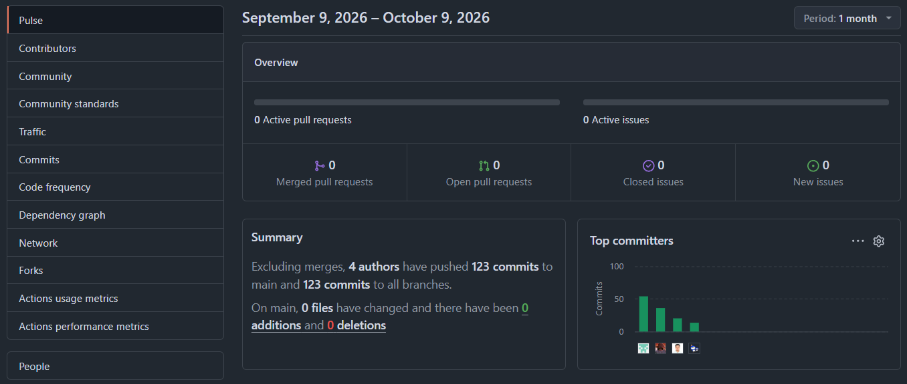

### 5.2.3. Sprint 3

El Sprint 3 marca el inicio del desarrollo de los RESTful Web Services de SumaqAgro, construidos con C#, .NET, ASP.NET Core, Entity Framework Core y MySQL, y documentados mediante OpenAPI con Scalar. El backend se organiza por Bounded Contexts (IAM, Profiles, Subscriptions, Farming, Crop y Certification) y, dentro de cada uno, en las capas domain, application, infrastructure e interfaces, siguiendo los patrones tácticos de Domain-Driven Design: agregados, value objects, comandos, consultas, eventos de dominio, puertos de repositorio y fachadas de contexto (ACL). En paralelo, la Web Application en Vue 3 evolucionó hacia su segunda versión con los flujos de autenticación, suscripción, perfil y cooperativa, y la Landing Page se reestructuró en su tercera versión. El sprint abarca las semanas 9 a 12 del ciclo y culmina con la entrega AV2.

#### 5.2.3.1. Sprint Planning 3

En esta sección se especifican los aspectos principales de la reunión de planificación del Sprint 3 (Sprint Planning Meeting) del equipo Dymbia. La reunión se realizó al inicio de la iteración registrada en Jira (19 de octubre al 13 de noviembre de 2026). El equipo revisó los resultados del Sprint 2, acordó las mejoras de su forma de trabajo y seleccionó del Product Backlog las historias de usuario y técnicas necesarias para reemplazar la Fake REST API por un backend propio con persistencia real.  

| Sprint # | Sprint 3 |
| :--- | :--- |
| **Sprint Planning Background** | |
| Date | 2026-10-19 |
| Time | 10:00 AM |
| Location | Discord / GitHub / Jira Software |
| Prepared By | Sanca Condori, Miguel |
| Attendees (to planning meeting) | Vargas Enrique, Jose vargas / Sanca Condori, Miguel / Solorzano Sullca, Benjamin / Tejada Pumacayo, Yamil Jared / Duarte Ruffner, Drago Derick |
| Sprint 2 Review Summary | Se publicó la primera versión de la Web Application en Vue (`v1.0.0`, y su *patch* `v1.0.1` con el CHANGELOG y la guía de contribución) en Firebase Hosting, conectada a una Fake REST API (`json-server`) desplegada en Render. Asimismo, se publicó la nueva versión de la Landing Page (`v2.0.0` y `v2.0.1`) con las secciones reorganizadas, contenido i18n en español e inglés y la sección del video About-the-Team. Se demostraron los flujos de Crop Health (visor Leaflet con NDVI/NDWI, alertas regionales, reportes de plagas, bandeja, inspecciones y recetas agronómicas) y las vistas iniciales de Field Management, Profiles y Harvest Certification. Quedaron pendientes la preparación de alertas demo por región (TSK-08), la validación integrada del circuito productor–ingeniero (TSK-22) y la consistencia de los datos relacionados (TSK-23). |
| Sprint 2 Retrospective Summary | El equipo valoró la organización por Bounded Contexts y el uso de GitFlow con Conventional Commits. Como oportunidades de mejora se identificó que la Fake REST API no permite validar reglas de negocio ni seguridad, que los datos demo entre contextos eran inconsistentes y que la integración de ramas se concentró al final del sprint. Se acordó: (1) modelar primero el dominio de cada contexto en el backend antes de exponer endpoints, (2) mantener el modelo de dominio independiente de la configuración de persistencia mediante puertos de repositorio y mapeos Fluent API de Entity Framework Core, (3) integrar a `develop` cada funcionalidad terminada sin esperar al cierre y (4) asignar a cada nuevo integrante un Bounded Context completo para acelerar su incorporación. |
| **Sprint Goal & User Stories** | |
| Sprint 3 Goal | Our focus is on delivering the first deployed version of the SumaqAgro RESTful Web Services, built with ASP.NET Core, Entity Framework Core and MySQL and documented with OpenAPI/Scalar, and connecting it to a new version of the Vue Web Application. Users will sign up, sign in and sign out with JWT-based authentication, producers will register plots with validated GPS boundaries and open crop campaigns, farmers will report pests and consult regional agroclimatic alerts, users will update their profiles and register cooperatives, and collection centers will register harvest batches, all stored in a real database instead of the fake API. We believe it delivers a secure and persistent foundation for the platform. This will be confirmed when the Web Services v1.0.0 and the Web App v2.0.0 are publicly deployed, every endpoint is documented in Scalar, and these flows work end to end. |
| Sprint 3 Velocity | 111 Story Points |
| Sum of Story Points | 111 Story Points |

A continuación, se detallan las historias de usuario y técnicas comprometidas en el Sprint 3, tal como fueron registradas en el tablero de Jira, agrupadas por el Bounded Context que las implementa:

| Bounded Context | Story ID | Título | Story Points |
| :--- | :---: | :--- | :---: |
| IAM | **US-10** | Registro de usuario en la plataforma (Sign Up) | 3 |
| IAM | **US-11** | Inicio de sesión seguro (Sign In) | 3 |
| IAM | **US-14** | Cierre de sesión seguro (Sign Out) | 2 |
| IAM | **TS-02** | Servicio de autenticación JWT y autenticación JWT Bearer de ASP.NET Core | 8 |
| Subscriptions | **US-12** | Consulta de catálogo de planes durante Onboarding | 2 |
| Subscriptions | **US-22** | Control de cuota de parcelas según el plan | 2 |
| Profiles | **US-16** | Actualización de perfil y datos de contacto | 3 |
| Profiles | **US-17** | Registro e institucionalización de Cooperativa | 5 |
| Profiles | **US-18** | Adición de socios al padrón de la cooperativa | 5 |
| Profiles | **US-21** | Directorio consolidado de miembros y predios | 3 |
| Farming | **US-29** | Delimitación de polígono mediante coordenadas GPS | 8 |
| Farming | **US-32** | Apertura de nueva campaña agrícola | 3 |
| Farming | **US-33** | Seleccionar tipo de cultivo (Papa / Café) | 3 |
| Farming | **US-34** | Especificación de variedad de semilla utilizada | 3 |
| Farming | **US-37** | Registro de egresos en insumos y fertilizantes | 3 |
| Farming | **US-38** | Registro de egresos en jornales y mano de obra | 3 |
| Farming | **US-39** | Registro de egresos en transporte y flete rural | 3 |
| Crop | **TS-01** | Integración con API externa de AgroMonitoring | 8 |
| Crop | **US-42** | Programación de consulta de telemetría satelital | 5 |
| Crop | **US-43** | Ingesta de imágenes satelitales y descarte por nubes | 5 |
| Crop | **US-45** | Consulta de alertas agroclimáticas registradas por región | 5 |
| Crop | **US-48** | Registro de reportes textuales de plagas o enfermedades | 5 |
| Crop | **US-52** | Confirmación de aplicación de tratamiento fitosanitario | 3 |
| Certification | **US-54** | Registro de lote de cosecha ingresado a acopio | 3 |
| Certification | **US-56** | Extracción y registro de muestra representativa | 3 |
| Certification | **US-59** | Asignación de score de calidad global del lote | 5 |
| Transversal | **TS-06** | Documentación de API RESTful con OpenAPI y Scalar | 5 |
| Transversal | **US-05** | Demostración del producto mediante video | 2 |
| **Total** | | | **111** |

Asimismo, el equipo acordó las versiones que cada producto debe alcanzar al cierre del Sprint 3, aplicando **Semantic Versioning 2.0.0** y publicándolas mediante ramas `release/*` integradas en `main`:

| Producto | Repositorio | Versión al cierre del Sprint 2 | Versión objetivo del Sprint 3 |
| :--- | :--- | :---: | :---: |
| Report | `dymbia-aplicaciones-web/sumaq-agro-report` | 2.0.0 | 3.0.0 |
| Landing Page (Website) | `dymbia-aplicaciones-web/sumaq-agro-website` | 2.0.1 | 3.0.0 |
| Web Application | `dymbia-aplicaciones-web/sumaq-agro-web-app` | 1.0.1 | 2.0.0 |
| RESTful Web Services | `dymbia-aplicaciones-web/sumaq-agro-platform` | — | 1.0.0 |

#### 5.2.3.2. Aspect Leaders and Collaborators

En esta sección se presenta la matriz **Leadership-and-Collaboration Matrix (LACX)** correspondiente al **Sprint 3**. Dado que el alcance de esta iteración se centra en los RESTful Web Services, los aspectos considerados corresponden a los **Bounded Contexts** del backend, junto con su contraparte en la Web Application. Esta organización permite que cada integrante asuma la responsabilidad completa de un contexto (dominio, persistencia, servicios de aplicación, endpoints REST y documentación OpenAPI), lo cual también facilitó la incorporación de los dos nuevos integrantes del equipo.

Los aspectos considerados en el Sprint 3 son los siguientes:

* **Aspect 1 — IAM & Subscriptions:** registro e inicio de sesión con JWT, protección de rutas con autenticación JWT Bearer de ASP.NET Core, catálogo de planes y suscripción (US-10, US-11, US-14, US-12, TS-02).
* **Aspect 2 — Farming & Shared Kernel:** parcelas, linderos GPS, cuota de parcelas, campañas agrícolas y egresos, además del *shared kernel* (manejo de errores, patrón `Result`, auditoría con Entity Framework Core, configuración e internacionalización de mensajes) (US-22, US-29, US-32, US-33, US-34, US-37, US-38, US-39).
* **Aspect 3 — Crop & AgroMonitoring:** observaciones satelitales, integración con AgroMonitoring, alertas agroclimáticas, reportes de plagas, inspecciones y recetas técnicas (TS-01, US-42, US-43, US-45, US-48, US-52).
* **Aspect 4 — Profiles & Cooperatives:** perfiles de usuario, cooperativas, padrón de socios, asignación de agrónomos y fachada del contexto para otros Bounded Contexts (US-16, US-17, US-18, US-21).
* **Aspect 5 — Certification:** lotes de cosecha, pesaje, muestreo, calificación de calidad, certificados y trazabilidad pública (US-54, US-56, US-59).

La documentación OpenAPI (TS-06) y el video demostrativo (US-05) son responsabilidad compartida: cada líder documenta en Scalar los endpoints de su aspecto.

##### Leadership-and-Collaboration Matrix (LACX) — Sprint 3

| Team Member (Last Name, First Name) | GitHub Username | Aspect 1: IAM & Subscriptions | Aspect 2: Farming & Shared Kernel | Aspect 3: Crop & AgroMonitoring | Aspect 4: Profiles & Cooperatives | Aspect 5: Certification |
| :--- | :---: | :---: | :---: | :---: | :---: | :---: |
| **Vargas Enrique, Jose vargas** | `JoseAngelKyo` | **C** | **C** | **C** | **C** | **L** |
| **Sanca Condori, Miguel** | `MiguelSanca` | **C** | **L** | **C** | **C** | **C** |
| **Solorzano Sullca, Benjamin** | `benjass2` | **L** | **C** | **C** | **C** | **C** |
| **Tejada Pumacayo, Yamil Jared** | `YamilTejada` | **C** | **C** | **L** | **C** | **C** |
| **Duarte Ruffner, Drago Derick** | `Drago0724` | **C** | **C** | **C** | **L** | **C** |

*Leyenda: **L** = Leader (Líder del Aspecto Técnico) | **C** = Collaborator (Colaborador en el Desarrollo)*

#### 5.2.3.3. Sprint Backlog 3

El objetivo principal del **Sprint 3** es construir y documentar la primera versión de los RESTful Web Services de SumaqAgro con persistencia en MySQL y autenticación JWT, y adaptar la Web Application a los nuevos flujos de autenticación, suscripción, perfil y cooperativa. Las historias seleccionadas se descompusieron en **52 tareas** (201 horas), complementadas con **3 tareas transversales** (12 horas), sumando una estimación total de **213 horas**. El seguimiento se realizó en el tablero de Jira Software del proyecto.

**URL Público del Tablero:**
[Tablero Jira - SumaqAgro (Sprint 3)](https://sumaq-agro.atlassian.net/jira/software/c/projects/DSB/boards/2)

| Sprint # | Sprint 3 | | | | | | |
| :--- | :--- | :--- | :--- | :--- | :---: | :--- | :---: |
| **Story Id** | **Story Title** | **Task Id** | **Task Title** | **Task Description** | **Estimation (Hours)** | **Assigned To** | **Status** |
| **TS-02** | Servicio de autenticación JWT en .NET | **TSK-01** | Configuración base del backend | Crear el proyecto .NET en C#, organizar las dependencias NuGet y centralizar las versiones. | 3 h | Solorzano Sullca, Benjamin | Done |
| **TS-02** | Servicio de autenticación JWT en .NET | **TSK-02** | Modelo de usuario y roles | Modelar el agregado `User`, la entidad `Role` y sus repositorios; sembrar los roles soportados al iniciar. | 5 h | Solorzano Sullca, Benjamin | Done |
| **TS-02** | Servicio de autenticación JWT en .NET | **TSK-03** | Protección de rutas con JWT | Implementar el servicio de tokens JWT y la autenticación JWT Bearer de ASP.NET Core para proteger los endpoints. | 5 h | Solorzano Sullca, Benjamin | Done |
| **US-10** | Registro de usuario en la plataforma (Sign Up) | **TSK-04** | Endpoint de registro | Implementar el comando de registro con contraseña cifrada (BCrypt), crear el perfil inicial y exponer `POST /api/v1/users`. | 4 h | Solorzano Sullca, Benjamin | Done |
| **US-10** | Registro de usuario en la plataforma (Sign Up) | **TSK-05** | Vista de registro en la Web App | Construir en Vue el formulario de registro con nombres del perfil, confirmación de contraseña y traducciones. | 4 h | Solorzano Sullca, Benjamin | Done |
| **US-11** | Inicio de sesión seguro (Sign In) | **TSK-06** | Endpoint de inicio de sesión | Implementar el comando de inicio de sesión y exponer `POST /api/v1/tokens` que devuelve el token JWT. | 3 h | Solorzano Sullca, Benjamin | Done |
| **US-11** | Inicio de sesión seguro (Sign In) | **TSK-07** | Sesión y guards en la Web App | Implementar en Vue el store de autenticación, el interceptor HTTP, los guards de navegación por sesión y rol y la vista de inicio de sesión. | 5 h | Solorzano Sullca, Benjamin | Done |
| **US-14** | Cierre de sesión seguro (Sign Out) | **TSK-08** | Cierre de sesión | Separar el cierre de sesión del estado del layout, invalidar sesiones expiradas o rechazadas y limpiar el almacenamiento local. | 2 h | Solorzano Sullca, Benjamin | Done |
| **US-12** | Consulta de catálogo de planes durante Onboarding | **TSK-09** | Modelo de suscripciones en la Web App | Definir las entidades `Plan`, `Subscription` y `Payment`, sus comandos, assemblers, endpoints y el store de suscripciones. | 6 h | Drago Derick Duarte Ruffner | Done |
| **US-12** | Consulta de catálogo de planes durante Onboarding | **TSK-10** | Vistas de catálogo y checkout | Construir el catálogo de planes, el flujo de selección y pago y el historial de facturación. | 5 h | Jose Varga Enrique | Done |
| **US-12** | Consulta de catálogo de planes durante Onboarding | **TSK-11** | Catálogo de planes en el backend | Modelar `Plan`, `Subscription` y `SubscriptionPeriod`, sembrar los planes y exponer el catálogo, la suscripción vigente y el checkout. | 5 h | Solorzano Sullca, Benjamin | To-Review |
| **US-22** | Control de cuota de parcelas según el plan | **TSK-12** | Validación de cuota en el backend | Rechazar el registro de parcelas cuando el propietario alcanza la cuota de su plan. | 2 h | Sanca Condori, Miguel | Done |
| **US-22** | Control de cuota de parcelas según el plan | **TSK-13** | Cuota activa en la Web App | Usar la cuota de la suscripción activa al registrar parcelas y restringir el acceso sin suscripción vigente. | 3 h | Solorzano Sullca, Benjamin | Done |
| **US-16** | Actualización de perfil y datos de contacto | **TSK-14** | Agregado y persistencia de perfiles | Definir los value objects y el agregado `Profile` con su repositorio y persistencia mediante Entity Framework Core. | 5 h | Drago Derick Duarte Ruffner | Done |
| **US-16** | Actualización de perfil y datos de contacto | **TSK-15** | Endpoints de perfil | Exponer `GET` y `PUT /api/v1/profiles/user/{userId}` con sus recursos y assemblers. | 3 h | Drago Derick Duarte Ruffner | Done |
| **US-16** | Actualización de perfil y datos de contacto | **TSK-16** | Edición de cuenta en la Web App | Permitir la edición en línea de los datos personales y de contacto del productor, con pruebas unitarias. | 3 h | Solorzano Sullca, Benjamin | Done |
| **US-17** | Registro e institucionalización de Cooperativa | **TSK-17** | Agregado Cooperative | Modelar el agregado `Cooperative` con socios e invitaciones y su repositorio. | 4 h | Drago Derick Duarte Ruffner | Done |
| **US-17** | Registro e institucionalización de Cooperativa | **TSK-18** | Endpoint de cooperativas | Exponer `POST /api/v1/cooperatives` con sus recursos de solicitud y respuesta. | 3 h | Drago Derick Duarte Ruffner | Done |
| **US-17** | Registro e institucionalización de Cooperativa | **TSK-19** | Flujo de registro de cooperativa | Construir en la Web App el flujo de registro de la cooperativa con validaciones. | 3 h | Solorzano Sullca, Benjamin | Done |
| **US-18** | Adición de socios al padrón de la cooperativa | **TSK-20** | Endpoints de socios e invitaciones | Exponer `POST /api/v1/cooperatives/{cooperativeId}/members` y `/invitations`. | 4 h | Drago Derick Duarte Ruffner | Done |
| **US-18** | Adición de socios al padrón de la cooperativa | **TSK-21** | Registro de socios en la Web App | Registrar socios, editar sus datos y vincular cuentas demo de productores. | 4 h | Solorzano Sullca, Benjamin | Done |
| **US-21** | Directorio consolidado de miembros y predios | **TSK-22** | Asignación de agrónomos y fachada | Implementar `AgronomistAssignment`, sus endpoints y la fachada `ProfilesContextFacade` para otros contextos. | 5 h | Drago Derick Duarte Ruffner | Done |
| **US-21** | Directorio consolidado de miembros y predios | **TSK-23** | Expedientes de socios | Mostrar expedientes navegables de socios con parcelas vinculadas, certificados e historial de acopio. | 4 h | Solorzano Sullca, Benjamin | Done |
| **US-21** | Directorio consolidado de miembros y predios | **TSK-24** | Consulta del directorio en el backend | Exponer la consulta del directorio consolidado de socios y parcelas de una cooperativa. | 3 h | Drago Derick Duarte Ruffner | To-do |
| **US-29** | Delimitación de polígono mediante coordenadas GPS | **TSK-25** | Agregado FieldPlot | Modelar `FieldPlot` y `PlotStatus`, sus consultas, servicios y `POST`/`GET /api/v1/field-plots`. | 5 h | Sanca Condori, Miguel | Done |
| **US-29** | Delimitación de polígono mediante coordenadas GPS | **TSK-26** | Linderos GPS | Definir `GeoCoordinate` y `PlotBoundary`, calcular el área y exponer `PUT /api/v1/field-plots/{fieldPlotId}/boundary`. | 5 h | Sanca Condori, Miguel | Done |
| **US-29** | Delimitación de polígono mediante coordenadas GPS | **TSK-27** | Línea base de suelo | Registrar textura y línea base de suelo de la parcela mediante `PUT /api/v1/field-plots/{fieldPlotId}/soil-baseline`. | 3 h | Sanca Condori, Miguel | Done |
| **US-32** | Apertura de nueva campaña agrícola | **TSK-28** | Agregado CropCampaign | Modelar `CropCampaign` con fecha de siembra y cierre, su repositorio y adaptador de persistencia con Entity Framework Core que publica eventos. | 4 h | Sanca Condori, Miguel | Done |
| **US-32** | Apertura de nueva campaña agrícola | **TSK-29** | Endpoints de campañas | Exponer `POST /api/v1/crop-campaigns`, consultas, cierres y campañas por parcela validando una sola campaña en curso. | 4 h | Sanca Condori, Miguel | Done |
| **US-33** | Seleccionar tipo de cultivo (Papa / Café) | **TSK-30** | Tipo de cultivo | Definir `CropType` y permitir seleccionarlo mediante `PATCH /api/v1/crop-campaigns/{cropCampaignId}`. | 2 h | Sanca Condori, Miguel | Done |
| **US-34** | Especificación de variedad de semilla utilizada | **TSK-31** | Variedad de semilla | Definir `SeedVariety` con su convertidor y permitir especificarla en la campaña en curso. | 2 h | Sanca Condori, Miguel | Done |
| **US-37** | Registro de egresos en insumos y fertilizantes | **TSK-32** | Libro de campaña en el backend | Modelar `CampaignLedger` y `ExpenseEntry` con su persistencia. | 5 h | Sanca Condori, Miguel | To-do |
| **US-38** | Registro de egresos en jornales y mano de obra | **TSK-33** | Endpoint de egresos por categoría | Exponer el registro de egresos por categoría (insumos, mano de obra y transporte) en la campaña. | 4 h | Sanca Condori, Miguel | To-do |
| **US-39** | Registro de egresos en transporte y flete rural | **TSK-34** | Costos de campaña en la Web App | Calcular costos de campaña y precio de equilibrio desde las entidades y el store. | 3 h | Sanca Condori, Miguel | Done |
| **TS-01** | Integración con API externa de AgroMonitoring | **TSK-35** | Registro de polígonos en AgroMonitoring | Implementar el servicio de monitoreo que registra en AgroMonitoring el polígono delimitado y lo vincula a la parcela. | 5 h | Sanca Condori, Miguel | Done |
| **TS-01** | Integración con API externa de AgroMonitoring | **TSK-36** | Importación de imágenes satelitales | Implementar `AgroMonitoringSatelliteImagery` y el comando de importación de observaciones. | 5 h | Tejada Pumacayo, Yamil Jared | To-Review |
| **US-42** | Programación de consulta de telemetría satelital | **TSK-37** | Consulta programada | Programar la consulta periódica de nuevas imágenes para las parcelas vinculadas. | 3 h | Tejada Pumacayo, Yamil Jared | To-do |
| **US-43** | Ingesta de imágenes satelitales y descarte por nubes | **TSK-38** | Agregado SatelliteObservation | Modelar la observación con `NDVI`, `NDWI` y `Percentage`, su persistencia y `GET` de observaciones. | 5 h | Tejada Pumacayo, Yamil Jared | Done |
| **US-43** | Ingesta de imágenes satelitales y descarte por nubes | **TSK-39** | Descarte por nubosidad | Evitar importaciones duplicadas mediante clave de importación y descartar imágenes con nubosidad alta. | 3 h | Tejada Pumacayo, Yamil Jared | To-Review |
| **US-45** | Consulta de alertas agroclimáticas registradas por región | **TSK-40** | Alertas y pronósticos | Implementar `AgroclimaticAlert` y `ClimateForecast` con persistencia y consulta por región. | 5 h | Tejada Pumacayo, Yamil Jared | Done |
| **US-45** | Consulta de alertas agroclimáticas registradas por región | **TSK-41** | Boletines regionales | Publicar y consultar boletines regionales mediante `/api/v1/regional-bulletins`. | 4 h | Tejada Pumacayo, Yamil Jared | Done |
| **US-48** | Registro de reportes textuales de plagas o enfermedades | **TSK-42** | Agregado PestReport | Modelar el reporte con transiciones de estado, excepciones, evento `PestReportRecordedEvent` y persistencia. | 4 h | Tejada Pumacayo, Yamil Jared | Done |
| **US-48** | Registro de reportes textuales de plagas o enfermedades | **TSK-43** | Endpoints de reportes | Exponer `POST`, `GET` y `DELETE /api/v1/pest-reports`. | 3 h | Tejada Pumacayo, Yamil Jared | Done |
| **US-52** | Confirmación de aplicación de tratamiento fitosanitario | **TSK-44** | Inspecciones de campo | Programar y completar inspecciones mediante `/api/v1/field-inspections`. | 4 h | Tejada Pumacayo, Yamil Jared | Done |
| **US-52** | Confirmación de aplicación de tratamiento fitosanitario | **TSK-45** | Recetas y confirmación de aplicación | Emitir recetas técnicas y confirmar su aplicación con `PATCH /api/v1/technical-prescriptions/{id}/application`. | 4 h | Tejada Pumacayo, Yamil Jared | Done |
| **US-54** | Registro de lote de cosecha ingresado a acopio | **TSK-46** | Agregado HarvestBatch | Modelar el lote, su pesaje, persistencia y adaptador de persistencia con Entity Framework Core que publica eventos. | 5 h | Jose Varga Enrique | To-Review |
| **US-54** | Registro de lote de cosecha ingresado a acopio | **TSK-47** | Endpoints de lotes | Exponer `HarvestBatchesController` para registrar y consultar lotes. | 3 h | Jose Varga Enrique | To-Review |
| **US-56** | Extracción y registro de muestra representativa | **TSK-48** | Registro de muestra | Implementar el comando de muestreo del lote y su validación. | 3 h | Jose Varga Enrique | To-Review |
| **US-59** | Asignación de score de calidad global del lote | **TSK-49** | Calificación de calidad | Implementar la graduación de papa y la catación de café, el evento `BatchGradedEvent` y su manejador. | 4 h | Jose Varga Enrique | To-Review |
| **US-59** | Asignación de score de calidad global del lote | **TSK-50** | Certificados y trazabilidad | Implementar `QualityCertificate`, la generación de PDF/QR y la consulta pública de trazabilidad. | 5 h | Jose Varga Enrique | To-Review |
| **TS-06** | Documentación de API RESTful con OpenAPI y Scalar | **TSK-51** | Documentación OpenAPI | Configurar OpenAPI con Scalar en ASP.NET Core y documentar los endpoints de cada contexto. | 4 h | Tejada Pumacayo, Yamil Jared | Done |
| **US-05** | Demostración del producto mediante video | **TSK-52** | Video demostrativo | Grabar y editar el video de demostración de los flujos implementados en el sprint. | 2 h | Sanca Condori, Miguel | To-do |

Adicionalmente, se registraron tareas transversales que no dependen de una historia en particular, pero que son necesarias para satisfacer restricciones generales del backend:

| Task Id | Task Title | Task Description | Estimation (Hours) | Assigned To | Status |
| :---: | :--- | :--- | :---: | :--- | :---: |
| **TSK-T1** | Shared kernel | Implementar el patrón `Result`, el manejo estructurado de errores, el *exception handler* global, los *assemblers* de `ProblemDetail`, la auditoría con Entity Framework Core y la estrategia de nombres en *snake case* con tablas en plural. | 6 h | Sanca Condori, Miguel | Done |
| **TSK-T2** | Configuración por entornos e i18n | Definir las propiedades por entorno y los mensajes de error en inglés y español. | 2 h | Sanca Condori, Miguel | Done |
| **TSK-T3** | Separación dominio–persistencia | Mantener los agregados independientes de la configuración de persistencia mediante puertos de repositorio, mapeos Fluent API de Entity Framework Core y publicación de eventos de dominio. | 4 h | Sanca Condori, Miguel | Done |

---

#### 5.2.3.4. Development Evidence for Sprint Review

En esta sección se presentan los avances de implementación del **Sprint 3**. El desarrollo de los **RESTful Web Services** se concentra en el repositorio `sumaq-agro-platform`, con **C#, ASP.NET Core, Entity Framework Core y MySQL**, organizado en los contextos **IAM**, **Profiles**, **Subscriptions**, **Farming**, **Crop** y **Certification**. Los contratos HTTP se documentan mediante **OpenAPI con Scalar**. En la **Web Application**, alojada en `sumaq-agro-web-app`, se implementaron los flujos de autenticación, suscripción, cuenta de usuario y cooperativa y su integración mediante Axios con el backend real. La Fake REST API corresponde al soporte de demostración del Sprint 2 y no al backend de esta iteración. En la **Landing Page** (`sumaq-agro-website`) se trabajó en la estructura con *partials* reutilizables para el encabezado y el pie de página, los íconos SVG y el contenido de los integrantes del equipo.

El equipo trabajó bajo **GitFlow**: cada funcionalidad se desarrolló en una rama `feature/<bounded-context>-<funcionalidad>` creada desde `develop` y se integró nuevamente en `develop` mediante *merge*. Todos los mensajes siguen el estándar **Conventional Commits** en inglés, con el *scope* del Bounded Context o agregado modificado. Los mensajes se conservan literalmente como están registrados en Git.

A continuación se presenta una selección de commits del repositorio de RESTful Web Services, con aportes de los integrantes del equipo. Esta selección documenta avances de implementación; el conteo de contribuciones del periodo se presenta en la sección 5.2.3.8:

Repository
`dymbia-aplicaciones-web/sumaq-agro-platform`

| Repository | Branch | CommitID | Commit message | Commit message body | Commit on (Date) |
| :--- | :--- | :--- | :--- | :--- | :--- |
| `dymbia-aplicaciones-web/sumaq-agro-platform` | No determinada | `216d19c2610dd8525aa4c917a5df1a56aa8ff886` | chore: initialize SumaqAgro backend project | — | 2026-11-11 23:23:48-05:00 |
| `dymbia-aplicaciones-web/sumaq-agro-platform` | `feature/add-docs` | `a93385f924f452da99caa85792ce078db86f712a` | chore: add CHANGELOG.md to document project updates and structure | — | 2026-11-11 23:29:45-05:00 |
| `dymbia-aplicaciones-web/sumaq-agro-platform` | `feature/add-docs` | `e2a84904a5b9ff9ab092efb610274db6542414a5` | chore: add LICENSE.md and configuration files for project setup | — | 2026-11-11 23:31:46-05:00 |
| `dymbia-aplicaciones-web/sumaq-agro-platform` | `feature/add-docs` | `49628a7499f0b00ad99810c2dcda01b3e9537f1b` | docs: add CONTRIBUTING.md to outline development guidelines and workflow | — | 2026-11-12 00:28:22-05:00 |
| `dymbia-aplicaciones-web/sumaq-agro-platform` | `develop` | `3746a1b990d45408a53579025eceaf2fd6f46938` | Merge branch 'feature/add-docs' into develop | — | 2026-11-12 18:30:02-05:00 |
| `dymbia-aplicaciones-web/sumaq-agro-platform` | `feature/platform` | `3e126df5b1b6a4b185b69c008796a2c4e8501e04` | chore(platform): add gitignore | — | 2026-11-13 12:36:36-05:00 |
| `dymbia-aplicaciones-web/sumaq-agro-platform` | `feature/platform` | `bb6e3182758f34e2d7d340f575b8fa81688cbb1c` | chore(platform): add initial SumaqAgro backend structure | — | 2026-11-13 12:40:20-05:00 |
| `dymbia-aplicaciones-web/sumaq-agro-platform` | `feature/platform` | `89cd52f1866028c7299c187d046556e1fa180d39` | docs(platform): add bounded context documentation placeholders | — | 2026-11-13 12:41:50-05:00 |
| `dymbia-aplicaciones-web/sumaq-agro-platform` | `develop` | `66e952e4984230bde130fffbf7649fe4904c1bdc` | Merge branch 'feature/platform' into develop | — | 2026-11-13 12:43:38-05:00 |
| `dymbia-aplicaciones-web/sumaq-agro-platform` | `feature/shared` | `8e1ed2f7c48ba9534d6e3fcdb7a96df70480e7ba` | chore(shared): scaffold shared folder structure | — | 2026-11-13 12:51:23-05:00 |
| `dymbia-aplicaciones-web/sumaq-agro-platform` | `feature/shared` | `0216944ad9de745e5ba31ad5372e16d2c83e5654` | feat(shared): add application contracts and models | — | 2026-11-13 12:55:40-05:00 |
| `dymbia-aplicaciones-web/sumaq-agro-platform` | `feature/shared` | `55e0f88b2cec8a0cf414f42392356aa627a288b1` | feat(shared): add persistence contracts | — | 2026-11-13 12:57:01-05:00 |
| `dymbia-aplicaciones-web/sumaq-agro-platform` | `feature/shared` | `aede6168be10f7a3c0669b6756ec3d13651d4e7c` | feat(shared): add core domain models | — | 2026-11-13 12:58:58-05:00 |
| `dymbia-aplicaciones-web/sumaq-agro-platform` | `feature/shared` | `cfdcc4b94139fcc724c439688ebb70c58c1b831f` | feat(shared): add domain events and value object contracts | — | 2026-11-13 12:59:08-05:00 |
| `dymbia-aplicaciones-web/sumaq-agro-platform` | `feature/shared` | `7d9ce4bbb73bfa5cb59265d8b9a53c7a18802e81` | feat(shared): add ASP.NET Core routing conventions | — | 2026-11-13 13:04:52-05:00 |
| `dymbia-aplicaciones-web/sumaq-agro-platform` | `feature/shared` | `501e17771e9c1fc5a4ba86a5d1323d7e2cd5a91f` | feat(shared): add OpenAPI bearer support | — | 2026-11-13 13:05:06-05:00 |
| `dymbia-aplicaciones-web/sumaq-agro-platform` | `feature/shared` | `95b5dc82eb8536514513b16d4a5f809694b5b84a` | feat(shared): add mediator behaviors | — | 2026-11-13 13:05:15-05:00 |
| `dymbia-aplicaciones-web/sumaq-agro-platform` | `feature/shared` | `8dc00b1a1704d920198ddb9f3b0eecf26fa212d2` | feat(shared): configure Entity Framework persistence | — | 2026-11-13 13:05:25-05:00 |
| `dymbia-aplicaciones-web/sumaq-agro-platform` | `feature/shared` | `f908f3200e9c3c653393f1779f9292cb2fd9b159` | feat(shared): add persistence interceptors | — | 2026-11-13 13:05:33-05:00 |
| `dymbia-aplicaciones-web/sumaq-agro-platform` | `feature/shared` | `e59878e7afaa385746df60f4e5c6c6b569c1c37b` | feat(shared): implement persistence repositories | — | 2026-11-13 13:05:42-05:00 |
| `dymbia-aplicaciones-web/sumaq-agro-platform` | `feature/shared` | `8ead3e64c12fc897bec056dd242215f37a1cc0a0` | feat(shared): add global exception handling | — | 2026-11-13 13:05:55-05:00 |
| `dymbia-aplicaciones-web/sumaq-agro-platform` | `feature/shared` | `2cd85cf3a20cb79a2c0311bcac4764fe4f8270eb` | feat(shared): add middleware extensions | — | 2026-11-13 13:06:03-05:00 |
| `dymbia-aplicaciones-web/sumaq-agro-platform` | `feature/shared` | `d30252e8420b1fefcdb3c5735fc4f8e3791d8274` | feat(shared): add localized error resources | — | 2026-11-13 13:15:20-05:00 |
| `dymbia-aplicaciones-web/sumaq-agro-platform` | `feature/shared` | `1dd5c7ed8224597dd248d99cbae4562baf911646` | feat(shared): add common REST responses | — | 2026-11-13 13:15:27-05:00 |
| `dymbia-aplicaciones-web/sumaq-agro-platform` | `develop` | `070af61b27bb787ba5a0579de23f58ba0f15c217` | Merge branch 'feature/shared' into develop | — | 2026-11-13 13:21:24-05:00 |
| `dymbia-aplicaciones-web/sumaq-agro-platform` | `feature/Identity-and-Access-Management` | `0a5115bcb32ebbe4724eb902ac06424339bae2cd` | feat(iam): add command service contracts | — | 2026-11-13 14:07:22-05:00 |
| `dymbia-aplicaciones-web/sumaq-agro-platform` | `feature/Identity-and-Access-Management` | `62dbb04a85127659af7789cab72a64bded4fbab9` | feat(iam): implement registration and sign-in services | — | 2026-11-13 14:07:25-05:00 |
| `dymbia-aplicaciones-web/sumaq-agro-platform` | `feature/Identity-and-Access-Management` | `e288be46ba69e6958ff410c809e129def3cfde5f` | feat(iam-application): add event handlers | — | 2026-11-13 14:09:56-05:00 |
| `dymbia-aplicaciones-web/sumaq-agro-platform` | `feature/Identity-and-Access-Management` | `7c42649be93a4679091985660d708d925e6c99ea` | feat(iam-application): add outbound service contracts | — | 2026-11-13 14:11:21-05:00 |
| `dymbia-aplicaciones-web/sumaq-agro-platform` | `feature/Identity-and-Access-Management` | `063a8598e7feac826eca981921c559303321c7cc` | feat(iam): add user aggregate | — | 2026-11-13 14:19:45-05:00 |
| `dymbia-aplicaciones-web/sumaq-agro-platform` | `feature/Identity-and-Access-Management` | `a9580a18cb0d9dc6b4e19bcdaeb2b4dbb76c3105` | feat(iam): add domain commands | — | 2026-11-13 14:24:04-05:00 |
| `dymbia-aplicaciones-web/sumaq-agro-platform` | `feature/Identity-and-Access-Management` | `8c6bf759cb295d18128954af3b81587f73b5ef71` | feat(iam): add domain errors | — | 2026-11-13 14:25:21-05:00 |
| `dymbia-aplicaciones-web/sumaq-agro-platform` | `feature/Identity-and-Access-Management` | `2306d9a14a13df15b0ba016b452836c294d68503` | feat(iam): add domain events | — | 2026-11-13 14:31:41-05:00 |
| `dymbia-aplicaciones-web/sumaq-agro-platform` | `feature/Identity-and-Access-Management` | `7332f09af0103ca5f32ca0ccece34e7df1443b6e` | feat(iam): add email address value object | — | 2026-11-13 14:34:48-05:00 |
| `dymbia-aplicaciones-web/sumaq-agro-platform` | `feature/Identity-and-Access-Management` | `03a51c8bf10744b8c481b5cc1b1b6981a7dd93f7` | feat(iam): add repository contract | — | 2026-11-13 14:35:48-05:00 |
| `dymbia-aplicaciones-web/sumaq-agro-platform` | `feature/Identity-and-Access-Management` | `371a62774070abe530a0093987052c4d6327572a` | feat(iam): add password hashing service | — | 2026-11-13 14:39:21-05:00 |
| `dymbia-aplicaciones-web/sumaq-agro-platform` | `feature/Identity-and-Access-Management` | `a0dba7fe20e71dd86dcce29b21b9bbf8dafeccf2` | feat(iam): add user persistence configuration | — | 2026-11-13 14:48:06-05:00 |
| `dymbia-aplicaciones-web/sumaq-agro-platform` | `feature/Identity-and-Access-Management` | `19ea2cf7240dbb7dfc8d6ab488393bb6f2199f93` | feat(iam): implement user repository | — | 2026-11-13 14:48:53-05:00 |
| `dymbia-aplicaciones-web/sumaq-agro-platform` | `feature/Identity-and-Access-Management` | `9dfaa04361868a4c0f4a6b01248818ba3b516573` | feat(iam): add JWT token service | — | 2026-11-13 14:52:48-05:00 |
| `dymbia-aplicaciones-web/sumaq-agro-platform` | `feature/Identity-and-Access-Management` | `61f50da7f2d7f6018861412a2dd6fccd46c51574` | feat(iam): add authentication REST resources | — | 2026-11-13 14:57:43-05:00 |
| `dymbia-aplicaciones-web/sumaq-agro-platform` | `feature/Identity-and-Access-Management` | `8c68a3dac8c7e52c8c8d8edbcc3cf1da6eeeb1a1` | feat(iam): add authentication controllers | — | 2026-11-13 14:58:51-05:00 |
| `dymbia-aplicaciones-web/sumaq-agro-platform` | `feature/Identity-and-Access-Management` | `d94cc8ceda47c7e214c74b319d02d3c309252752` | feat(iam): add REST resource assembler | — | 2026-11-13 15:00:12-05:00 |
| `dymbia-aplicaciones-web/sumaq-agro-platform` | `feature/Identity-and-Access-Management` | `1a1309ddc92ea4ee62874f52350054a29d9251dc` | feat(iam): configure identity services and authentication | — | 2026-11-13 15:06:34-05:00 |
| `dymbia-aplicaciones-web/sumaq-agro-platform` | `develop` | `5a68247d96bad4146abd074831e8217a11f2bf64` | Merge branch 'feature/Identity-and-Access-Management' into develop | — | 2026-11-13 15:07:49-05:00 |
| `dymbia-aplicaciones-web/sumaq-agro-platform` | `feature/Profiles-and-Cooperatives` | `bcd650c80a913206dc6857307c18c8ab26da62f5` | feat(profiles): add application context facade | — | 2026-11-13 15:14:01-05:00 |
| `dymbia-aplicaciones-web/sumaq-agro-platform` | `feature/Profiles-and-Cooperatives` | `a356898b9fb4f1aabafa2e48030d22795d7852a9` | feat(profiles): add command service contracts | — | 2026-11-13 15:15:08-05:00 |
| `dymbia-aplicaciones-web/sumaq-agro-platform` | `feature/Profiles-and-Cooperatives` | `5360ea3fe43f7e94870b6c38ce6924f5ecb18d08` | feat(profiles): add query service contracts | — | 2026-11-13 15:19:12-05:00 |
| `dymbia-aplicaciones-web/sumaq-agro-platform` | `feature/Profiles-and-Cooperatives` | `323beb05fab1bca56617490d7b584fd3279d7750` | feat(profiles): add command service implementations | — | 2026-11-13 15:21:46-05:00 |
| `dymbia-aplicaciones-web/sumaq-agro-platform` | `feature/Profiles-and-Cooperatives` | `3d0ea970d66e8b1891eb6f617208d9e885cad45c` | feat(profiles): add query service implementations | — | 2026-11-13 15:23:31-05:00 |
| `dymbia-aplicaciones-web/sumaq-agro-platform` | `feature/Profiles-and-Cooperatives` | `dedf6759ac66c3c4563868f2cd73a083178c4fc8` | feat(profiles): add persistence configuration | — | 2026-11-13 15:26:49-05:00 |
| `dymbia-aplicaciones-web/sumaq-agro-platform` | `feature/Profiles-and-Cooperatives` | `c10c3be17f2167a03a2686697894739662cc4f53` | feat(profiles): implement profiles repository | — | 2026-11-13 15:30:04-05:00 |
| `dymbia-aplicaciones-web/sumaq-agro-platform` | `feature/Profiles-and-Cooperatives` | `221f9ba83642510af5b1ac4630f04c0de7425b6d` | feat(profiles): add context facade contract | — | 2026-11-13 15:30:55-05:00 |
| `dymbia-aplicaciones-web/sumaq-agro-platform` | `feature/Profiles-and-Cooperatives` | `2db3bd617729ea4b8548e67335ccba4b61405966` | feat(profiles): add REST resources | — | 2026-11-13 15:30:58-05:00 |
| `dymbia-aplicaciones-web/sumaq-agro-platform` | `feature/Profiles-and-Cooperatives` | `544841152fdeba96e96725252b307a123f37ac28` | feat(profiles): add REST resource assembler | — | 2026-11-13 15:42:03-05:00 |
| `dymbia-aplicaciones-web/sumaq-agro-platform` | `feature/Profiles-and-Cooperatives` | `4fc4ff2bed1f848d8f75340d5651bddeab8f7616` | feat(profiles): add REST controllers | — | 2026-11-13 15:42:05-05:00 |
| `dymbia-aplicaciones-web/sumaq-agro-platform` | `feature/Profiles-and-Cooperatives` | `39da0c8d30cab8970b1f32f7ad8361665b0de481` | feat(profiles): add domain aggregates | — | 2026-11-13 15:44:59-05:00 |
| `dymbia-aplicaciones-web/sumaq-agro-platform` | `feature/Profiles-and-Cooperatives` | `b04211c2b90684d63508de21fc84aa11623b05e5` | feat(profiles): add domain entities | — | 2026-11-13 15:46:59-05:00 |
| `dymbia-aplicaciones-web/sumaq-agro-platform` | `feature/Profiles-and-Cooperatives` | `d3ecf8b61bd3fb55de2c39cfdc1d122cb8419298` | feat(profiles): add domain commands | — | 2026-11-13 15:51:40-05:00 |
| `dymbia-aplicaciones-web/sumaq-agro-platform` | `feature/Profiles-and-Cooperatives` | `f81901de13d08c36ad209208919b2b60b8f13b42` | feat(profiles): add domain queries | — | 2026-11-13 15:53:28-05:00 |
| `dymbia-aplicaciones-web/sumaq-agro-platform` | `feature/Profiles-and-Cooperatives` | `8becd367d1c1f3f1d6fdf75c370675319e1d8606` | feat(profiles): add domain errors | — | 2026-11-13 15:54:10-05:00 |
| `dymbia-aplicaciones-web/sumaq-agro-platform` | `feature/Profiles-and-Cooperatives` | `b0e4692e3d977d9d7556c4c1c50f58b263f190d2` | feat(profiles): add domain value objects | — | 2026-11-13 15:55:41-05:00 |
| `dymbia-aplicaciones-web/sumaq-agro-platform` | `feature/Profiles-and-Cooperatives` | `6b50a79cb4e5d4e38645e78ec87ad1f477f65907` | feat(profiles): add repository contract | — | 2026-11-13 15:57:01-05:00 |
| `dymbia-aplicaciones-web/sumaq-agro-platform` | `feature/Profiles-and-Cooperatives` | `9ea590e985807bb02845c52e5c9e7e12e5f62c75` | feat(profiles): configure application and persistence services | — | 2026-11-13 16:03:18-05:00 |
| `dymbia-aplicaciones-web/sumaq-agro-platform` | `feature/Profiles-and-Cooperatives` | `55e8a9ccbb55d740631d4c77ec54596bb22ad5a8` | feat(profiles): create initial profiles on user registration | — | 2026-11-13 16:03:29-05:00 |
| `dymbia-aplicaciones-web/sumaq-agro-platform` | `develop` | `027803867e5b6653faffe6538185cf175e240d1e` | Merge branch 'feature/Profiles-and-Cooperatives' into develop | — | 2026-11-13 16:03:42-05:00 |
| `dymbia-aplicaciones-web/sumaq-agro-platform` | `feature/certification-context` | `70b0c168ffe1a9df73ffc5718cf053066536510f` | feat(harvest): add HarvestSample entity with validation | — | 2026-11-13 21:53:11-05:00 |
| `dymbia-aplicaciones-web/sumaq-agro-platform` | `feature/certification-context` | `15932d8ac9b5f7e3a558c15cb77d9bf9834b6588` | feat(certification): add CertificationErrors class for error handling | — | 2026-11-13 21:58:18-05:00 |
| `dymbia-aplicaciones-web/sumaq-agro-platform` | `feature/certification-context` | `caeffe840df12d06091b556e7e20b68c991a5c93` | feat(queries): add query classes for quality certificate and harvest batch retrieval | — | 2026-11-13 22:00:58-05:00 |
| `dymbia-aplicaciones-web/sumaq-agro-platform` | `feature/bounded-context-corp` | `565a4686b452a86ff72eecdf4adeb53a02f5a4a3` | docs: add crop management and monitoring documentation | — | 2026-11-13 22:13:09-05:00 |
| `dymbia-aplicaciones-web/sumaq-agro-platform` | `feature/certification-context` | `f0cd67d7b18941a0957c2480b867e8929b517ca9` | feat(certification): add CertificateHash and PotatoCaliberDistribution value objects | — | 2026-11-13 22:14:30-05:00 |
| `dymbia-aplicaciones-web/sumaq-agro-platform` | `feature/bounded-context-corp` | `a0e5825c1d4bab0ec5d8d74cf4a9aeb4bd3ffdc3` | feat(crop): implement command and monitoring services for crop management | — | 2026-11-13 22:15:52-05:00 |
| `dymbia-aplicaciones-web/sumaq-agro-platform` | `feature/certification-context` | `f72e892bb233f2f2a9be9695aa30f98ab866bddf` | feat(certification): add HarvestBatch and QualityCertificate aggregates with validation methods | — | 2026-11-13 22:16:50-05:00 |
| `dymbia-aplicaciones-web/sumaq-agro-platform` | `feature/certification-context` | `7350b5a5a4d2fd69150df02dc0bf2a0c693210e3` | feat(certification): add CupCoffeeCommand and GradePotatoCalibersCommand records | — | 2026-11-13 22:19:14-05:00 |
| `dymbia-aplicaciones-web/sumaq-agro-platform` | `feature/certification-context` | `9ca880e7ae10b4cbf83cee28ad3d29670d05bff4` | feat(certification): add IssueQualityCertificateCommand and RegisterHarvestBatchCommand records | — | 2026-11-13 22:20:15-05:00 |
| `dymbia-aplicaciones-web/sumaq-agro-platform` | `feature/certification-context` | `456ee0e2542e02d302411031104cddb1b26f9009` | feat(certification): add RevokeQualityCertificateCommand, SampleHarvestBatchCommand, and WeighHarvestBatchCommand records | — | 2026-11-13 22:21:13-05:00 |
| `dymbia-aplicaciones-web/sumaq-agro-platform` | `feature/bounded-context-corp` | `279bc355681959be273711d1730552e93ba1cda7` | feat(crop): add domain models for agroclimatic alerts, climate forecasts, field inspections, pest reports, regional bulletins, satellite observations, and technical prescriptions | — | 2026-11-13 22:21:16-05:00 |
| `dymbia-aplicaciones-web/sumaq-agro-platform` | `feature/bounded-context-corp` | `c4fada14c467cb8107ab16b1cb144223add2a357` | feat(crop): add command records for managing agroclimatic operations | — | 2026-11-13 22:21:24-05:00 |
| `dymbia-aplicaciones-web/sumaq-agro-platform` | `feature/bounded-context-corp` | `fa474d2b2780eea4c4a06be81c091662542b8fda` | feat(crop): add command records for managing agroclimatic operations | — | 2026-11-13 22:21:28-05:00 |
| `dymbia-aplicaciones-web/sumaq-agro-platform` | `feature/certification-context` | `a3144e6af718bf51d8bfa3d28020df8fda14f220` | feat(certification): add ICertificationRepository interface with methods for managing HarvestBatch and QualityCertificate | — | 2026-11-13 22:22:59-05:00 |
| `dymbia-aplicaciones-web/sumaq-agro-platform` | `feature/bounded-context-corp` | `4681de08f27e337638164c3594d8d4f98ad4e6f1` | feat(crop): add query records for inspections, prescriptions, alerts, bulletins, forecasts, and reports | — | 2026-11-13 22:25:46-05:00 |
| `dymbia-aplicaciones-web/sumaq-agro-platform` | `feature/bounded-context-corp` | `dfcf9b5242a967267775e7990a09b86208b77ebd` | feat(crop): add ICropRepository interface for managing crop-related data | — | 2026-11-13 22:25:54-05:00 |
| `dymbia-aplicaciones-web/sumaq-agro-platform` | `feature/bounded-context-corp` | `185b1f6fe551db2921042e7d28565aa74ca2af91` | feat(crop): add ICropRepository interface for managing crop-related data | — | 2026-11-13 22:25:59-05:00 |
| `dymbia-aplicaciones-web/sumaq-agro-platform` | `feature/certification-context` | `bcbda45f1abb3f24cc4c4516c7ba9b0d21bb1460` | feat(certification): add HarvestBatch and QualityCertificate entity configurations for EF Core | — | 2026-11-13 22:26:00-05:00 |
| `dymbia-aplicaciones-web/sumaq-agro-platform` | `feature/certification-context` | `fa0d0d6f24b4b1189e698346dc9a7e8ffb56044d` | feat(certification): implement CertificationRepository for managing HarvestBatch and QualityCertificate entities | — | 2026-11-13 22:26:44-05:00 |
| `dymbia-aplicaciones-web/sumaq-agro-platform` | `feature/farming` | `2f33b726426845fea53505b0b95de71485b665bd` | feat(farming): add CropCampaign, FieldPlot, CropSeason, and PlotBoundary aggregates and value objects | — | 2026-11-13 22:28:23-05:00 |
| `dymbia-aplicaciones-web/sumaq-agro-platform` | `feature/farming` | `8884cf4f477966753fd2694694f346dd131f18ba` | feat(farming): add IFarmingCommandService interface for field plot and crop campaign commands | — | 2026-11-13 22:28:39-05:00 |
| `dymbia-aplicaciones-web/sumaq-agro-platform` | `feature/farming` | `433d0578e2a58ef23b8d95f4ab5bf5103d5c5345` | feat(farming): add command records for crop campaign and field plot management | — | 2026-11-13 22:28:51-05:00 |
| `dymbia-aplicaciones-web/sumaq-agro-platform` | `feature/farming` | `66615e5dea3c2aec0dce32a870567bb46be5495f` | feat(farming): implement FarmingCommandService for field plot and crop campaign management | — | 2026-11-13 22:29:12-05:00 |
| `dymbia-aplicaciones-web/sumaq-agro-platform` | `feature/farming` | `da8d7f0de414cc9e6135d4c1bcd1c5eef5c89f5d` | feat(farming): add IPolygonMonitoring interface for plot boundary management | — | 2026-11-13 22:29:20-05:00 |
| `dymbia-aplicaciones-web/sumaq-agro-platform` | `feature/bounded-context-corp` | `bf6d8d26377fb7969aca750cf89d4c8ccb188eb6` | refactor(queries): rename query and value object files for consistency | — | 2026-11-13 22:29:22-05:00 |
| `dymbia-aplicaciones-web/sumaq-agro-platform` | `feature/farming` | `f92aeef8d97974470bdce351b2676828a789d5af` | feat(farming): implement FarmingQueryService for querying field plots and crop campaigns | — | 2026-11-13 22:29:28-05:00 |
| `dymbia-aplicaciones-web/sumaq-agro-platform` | `feature/farming` | `607002fb13626c5b872401d195bf6b4ca5132174` | feat(farming): add IFarmingQueryService interface for querying field plots and crop campaigns | — | 2026-11-13 22:29:34-05:00 |
| `dymbia-aplicaciones-web/sumaq-agro-platform` | `feature/bounded-context-corp` | `fce08bf78f48d85c482f1fada29614340b3f76bc` | feat(crop): add entity configurations for pest reports, inspections, prescriptions, bulletins, observations, forecasts, and alerts | — | 2026-11-13 22:29:46-05:00 |
| `dymbia-aplicaciones-web/sumaq-agro-platform` | `feature/farming` | `6c501291cdde9343557cbf477d13599198f55027` | feat(farming): add FarmingErrors class for error handling in field plots and crop campaigns | — | 2026-11-13 22:29:50-05:00 |
| `dymbia-aplicaciones-web/sumaq-agro-platform` | `feature/bounded-context-corp` | `a9b1dda65e881b8f509b78ccb39e81e9de7147d8` | feat(crop): implement CropRepository for managing pest reports, inspections, prescriptions, observations, forecasts, alerts, and bulletins | — | 2026-11-13 22:29:53-05:00 |
| `dymbia-aplicaciones-web/sumaq-agro-platform` | `feature/farming` | `af4c92e677d1cbab18cc97b5ffa12d3e8c5890ce` | feat(farming): add query records for retrieving crop campaigns and field plots by various identifiers | — | 2026-11-13 22:29:57-05:00 |
| `dymbia-aplicaciones-web/sumaq-agro-platform` | `feature/farming` | `1b3c9c231a021c195068fa6eff58386d69f852b2` | feat(farming): add IFarmingRepository interface for managing field plots and crop campaigns | — | 2026-11-13 22:30:05-05:00 |
| `dymbia-aplicaciones-web/sumaq-agro-platform` | `feature/farming` | `54566086bf2493843cc6f9d3fde93ed9f38df6d8` | feat(farming): add configurations for FieldPlot and CropCampaign entities | — | 2026-11-13 22:30:14-05:00 |
| `dymbia-aplicaciones-web/sumaq-agro-platform` | `feature/farming` | `48ef1fd9e3d61504e9b93e240e6aca7edf452fbd` | feat(farming): implement FarmingRepository for managing field plots and crop campaigns | — | 2026-11-13 22:30:21-05:00 |
| `dymbia-aplicaciones-web/sumaq-agro-platform` | `feature/farming` | `44fdd66d8e70b0aaca190ee830c994b7902c228a` | feat(farming): add resource models for field plots and crop campaigns | — | 2026-11-13 22:30:29-05:00 |
| `dymbia-aplicaciones-web/sumaq-agro-platform` | `feature/farming` | `bd83b15f86015c24acf5005d0178d314fb3feec1` | feat(farming): add assemblers for CropCampaign and FieldPlot resources | — | 2026-11-13 22:30:36-05:00 |
| `dymbia-aplicaciones-web/sumaq-agro-platform` | `feature/farming` | `93f4cb1b1df581bf4c27495ce824afabd7d63586` | feat(farming): implement PolygonMonitoring service for managing polygon data | — | 2026-11-13 22:30:44-05:00 |
| `dymbia-aplicaciones-web/sumaq-agro-platform` | `develop` | `c39ae9dd8ababe3d17ce90fea7b86491a48871a3` | Merge branch 'feature/farming' into develop | — | 2026-11-13 22:31:16-05:00 |
| `dymbia-aplicaciones-web/sumaq-agro-platform` | `feature/certification-context` | `f9b98b1196377caeef9b3ab64f48dea622c49a01` | feat(certification): add CertificationResourceAssembler for command and resource transformations | — | 2026-11-13 22:32:41-05:00 |
| `dymbia-aplicaciones-web/sumaq-agro-platform` | `feature/certification-context` | `578036a674862b74dc3707ba96b41426c88489bc` | feat(certification): add CupCoffee and ExtractSample records for coffee certification | — | 2026-11-13 22:34:40-05:00 |
| `dymbia-aplicaciones-web/sumaq-agro-platform` | `feature/certification-context` | `0392cab2c6df1e9919e7f1eaa982ec5d1289ba8b` | feat(certification): add GradePotato and HarvestBatchResource records for certification processing | — | 2026-11-13 22:35:41-05:00 |
| `dymbia-aplicaciones-web/sumaq-agro-platform` | `feature/certification-context` | `d967d3a14fb876dd73778395da3cbc48abe7f306` | feat(certification): add IssueCertificate record for certificate issuance | — | 2026-11-13 22:36:14-05:00 |
| `dymbia-aplicaciones-web/sumaq-agro-platform` | `feature/bounded-context-corp` | `e9de4158f631f7317022d5e57effe22289cc7947` | feat(crop): add resource records for agroclimatic alerts, climate forecasts, pest reports, field inspections, and technical prescriptions | — | 2026-11-13 22:36:21-05:00 |
| `dymbia-aplicaciones-web/sumaq-agro-platform` | `feature/bounded-context-corp` | `64988ab2171be478c3352f3de9642a0eb99ab8b1` | feat(crop): add controllers for agroclimatic alerts, climate forecasts, field inspections, pest reports, regional bulletins, satellite observations, and technical prescriptions | — | 2026-11-13 22:36:27-05:00 |
| `dymbia-aplicaciones-web/sumaq-agro-platform` | `feature/certification-context` | `68189ab12861f0ae3ebfe33bacad627c06248079` | feat(certification): add QualityCertificateResource record for quality certificate representation | — | 2026-11-13 22:36:49-05:00 |
| `dymbia-aplicaciones-web/sumaq-agro-platform` | `feature/bounded-context-corp` | `f8dd32a3078e8613d0255cdcdd5a379b02a3bd6d` | Merge branch 'develop' into feature/bounded-context-corp | — | 2026-11-13 22:37:28-05:00 |
| `dymbia-aplicaciones-web/sumaq-agro-platform` | `feature/certification-context` | `30f9eb3092421c1ac35f538beeeb9c8363ae5a9e` | feat(certification): add RegisterBatch record for batch registration | — | 2026-11-13 22:37:47-05:00 |
| `dymbia-aplicaciones-web/sumaq-agro-platform` | `develop` | `7a717742d5bd54b436dad3c6aa148bf57050de06` | Merge branch 'feature/bounded-context-corp' into develop | — | 2026-11-13 22:38:09-05:00 |
| `dymbia-aplicaciones-web/sumaq-agro-platform` | `feature/suscriptions` | `dae27b3b896d2c6189f698b63e42924933faacd3` | feat(subscriptions): add BillingCycle enum for subscription billing periods | — | 2026-11-13 22:38:27-05:00 |
| `dymbia-aplicaciones-web/sumaq-agro-platform` | `feature/suscriptions` | `de7ad1136e015d6fec31f80cd5d09473fe4207bc` | feat(subscriptions): add Payment and Plan entities for subscription management | — | 2026-11-13 22:38:48-05:00 |
| `dymbia-aplicaciones-web/sumaq-agro-platform` | `feature/certification-context` | `ae74c1516334ad33b430b938c4d57693abdfd427` | feat(certification): add TraceabilityResource and WeighBatch records for certification data | — | 2026-11-13 22:38:50-05:00 |
| `dymbia-aplicaciones-web/sumaq-agro-platform` | `feature/suscriptions` | `683f6a693d6e1960a533b3c755d71af067d521aa` | feat(subscriptions): add commands and queries for subscription management | — | 2026-11-13 22:39:28-05:00 |
| `dymbia-aplicaciones-web/sumaq-agro-platform` | `feature/suscriptions` | `c891c02e3c3582f946517a002bb932b3b481503f` | refactor(subscriptions): rename command and query files for clarity | — | 2026-11-13 22:41:51-05:00 |
| `dymbia-aplicaciones-web/sumaq-agro-platform` | `feature/suscriptions` | `dc0bc2099648f522cbad6d995f7eeebb6c128b12` | feat(subscriptions): add SubscriptionErrors class for error handling in subscriptions | — | 2026-11-13 22:42:14-05:00 |
| `dymbia-aplicaciones-web/sumaq-agro-platform` | `feature/certification-context` | `22ba40b18835c50afe9389e91b5e5bf289af8b57` | feat(certification): add ICertificationService interface for harvest batch operations | — | 2026-11-13 22:42:20-05:00 |
| `dymbia-aplicaciones-web/sumaq-agro-platform` | `feature/suscriptions` | `3b06c9d3663237a2d6efbd8919f72f1020199d72` | feat(subscriptions): add Subscription class for managing subscription details | — | 2026-11-13 22:42:42-05:00 |
| `dymbia-aplicaciones-web/sumaq-agro-platform` | `feature/suscriptions` | `e1a3dd5f4a888a8d334fdd32c0f9cc65a7d5cac0` | feat(subscriptions): add ISubscriptionsRepository interface for subscription data access | — | 2026-11-13 22:43:05-05:00 |
| `dymbia-aplicaciones-web/sumaq-agro-platform` | `feature/certification-context` | `3f6581d64869b0d6196fd2ab35edd61b66645660` | feat(certification): implement CertificationService for managing harvest batches and quality certificates | — | 2026-11-13 22:43:14-05:00 |
| `dymbia-aplicaciones-web/sumaq-agro-platform` | `feature/certification-context` | `1bd9758cece144976dd5ca204f9f61f274f6754c` | feat(certification): add CertificationQueryService and TraceabilityQueryService for querying batches and certificates | — | 2026-11-13 22:44:30-05:00 |
| `dymbia-aplicaciones-web/sumaq-agro-platform` | `feature/suscriptions` | `b7112681e879f0e2a42386cdb9c754d1267073c2` | feat(subscriptions): add entity configurations and repository for subscription management | — | 2026-11-13 22:45:07-05:00 |
| `dymbia-aplicaciones-web/sumaq-agro-platform` | `feature/certification-context` | `a5456c0e51a6ae6a460d19da585d540fcbb1949b` | feat(certification): add ICertificationQueryService interface for querying harvest batches and quality certificates | — | 2026-11-13 22:45:16-05:00 |
| `dymbia-aplicaciones-web/sumaq-agro-platform` | `feature/suscriptions` | `139c2ed47ad7123f8e5ed99e6d2c45530fdd16dd` | feat(subscriptions): add ICheckoutService interface for payment processing | — | 2026-11-13 22:45:55-05:00 |
| `dymbia-aplicaciones-web/sumaq-agro-platform` | `feature/certification-context` | `15fc221ed18c8256672193d7b1d3257d086bfd34` | feat(certification): add ITraceabilityQueryService interface for verifying certificate traceability | — | 2026-11-13 22:45:58-05:00 |
| `dymbia-aplicaciones-web/sumaq-agro-platform` | `feature/suscriptions` | `03c9ba1b606a672391486e3773a710db61a719c7` | feat(subscriptions): add ISubscriptionsQueryService interface for querying subscriptions | — | 2026-11-13 22:46:11-05:00 |
| `dymbia-aplicaciones-web/sumaq-agro-platform` | `feature/suscriptions` | `fb2fa647d0bc8103e34116ca965bfa9ad8044b7d` | feat(subscriptions): implement CheckoutService for payment processing | — | 2026-11-13 22:46:28-05:00 |
| `dymbia-aplicaciones-web/sumaq-agro-platform` | `feature/suscriptions` | `83e5de277686631ff9943a60489a74292c91ca1f` | feat(subscriptions): add resource models for checkout, payment, plan, and subscription | — | 2026-11-13 22:47:39-05:00 |
| `dymbia-aplicaciones-web/sumaq-agro-platform` | `feature/suscriptions` | `14801b338983dd45227bbe9c4c5a13ce42f8b39d` | feat(subscriptions): add SubscriptionResourceAssembler for resource transformation | — | 2026-11-13 22:47:57-05:00 |
| `dymbia-aplicaciones-web/sumaq-agro-platform` | `feature/suscriptions` | `1714db12194f2f9a08bf6add6875d813c97f5ac4` | feat(subscriptions): add PlansController and update SubscriptionsController for plan listing and checkout | — | 2026-11-13 22:48:51-05:00 |
| `dymbia-aplicaciones-web/sumaq-agro-platform` | `feature/suscriptions` | `f780a0df89a2abcb8938a5d356dfe00524d004bf` | refactor(resources): rename resource files for improved organization | — | 2026-11-13 22:49:02-05:00 |
| `dymbia-aplicaciones-web/sumaq-agro-platform` | `feature/suscriptions` | `c87e000206d156370964e04ca7265db17a6f272f` | Merge branch 'develop' into feature/suscriptions | — | 2026-11-13 22:49:39-05:00 |
| `dymbia-aplicaciones-web/sumaq-agro-platform` | `develop` | `abfeeb85391117b20ebabc2340a7ce1cafc214dc` | Merge branch 'feature/suscriptions' into develop | — | 2026-11-13 22:49:57-05:00 |


#### 5.2.3.5. Execution Evidence for Sprint Review

Durante el Sprint 3 se actualizó la Landing Page y se desarrollaron en la Web Application los flujos de ingreso, registro por rol, suscripciones y gestión de cooperativas. En paralelo, el equipo implementó los servicios ASP.NET Core para sustituir la API simulada del Sprint 2. Las capturas de esta sección muestran las vistas públicas que se pudieron comprobar en Cloudflare Pages y Firebase Hosting.

##### Landing Page

La pantalla de inicio presenta la propuesta de valor de SumaqAgro para productores de papa y café. Desde **View plans** se consulta el catálogo, y **Sign In** abre el acceso a la aplicación web. La versión publicada muestra tres planes, para agricultores independientes, cooperativas y asesores técnicos. Los botones de selección de plan preparan un correo de consulta.

La portada presenta la propuesta de SumaqAgro y ofrece acceso a los planes y a la demostración.


La vista previa del panel acompaña una explicación de los riesgos agrícolas, los costos y la falta de trazabilidad.

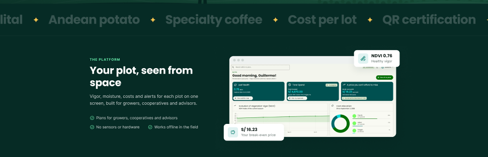
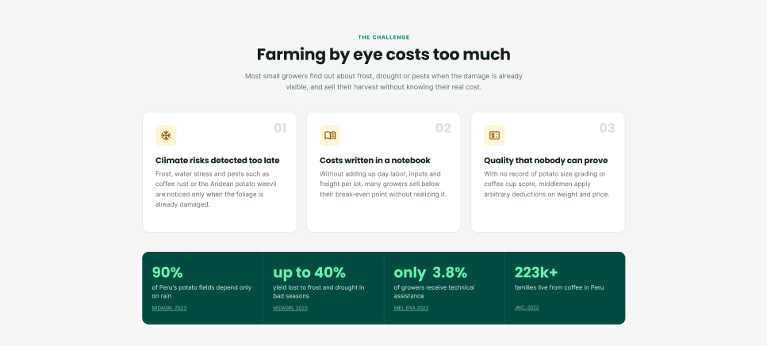

Cuatro herramientas reúnen el monitoreo satelital, el registro de costos, la certificación y las alertas.

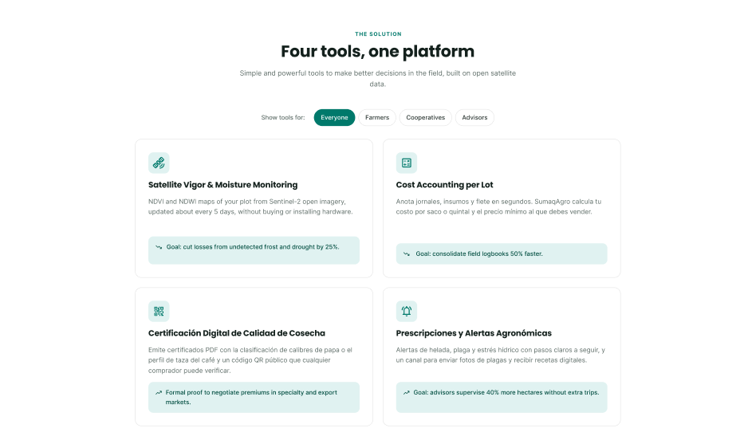

La sección explica el uso de SumaqAgro en tres pasos e incluye un video demostrativo.

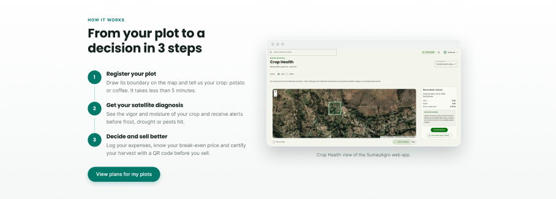
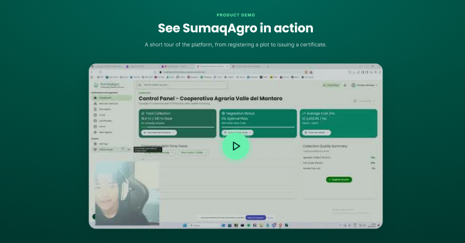

Las pestañas presentan a los agricultores independientes, las cooperativas y los asesores técnicos.

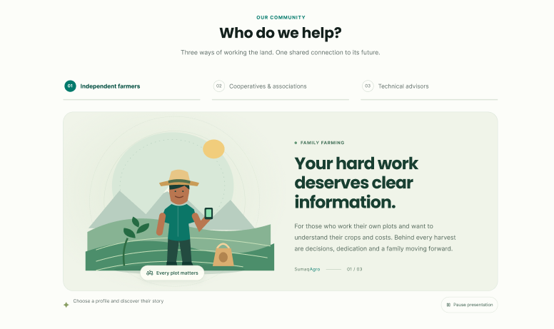

El catálogo compara los tres planes y permite alternar entre facturación mensual y anual.

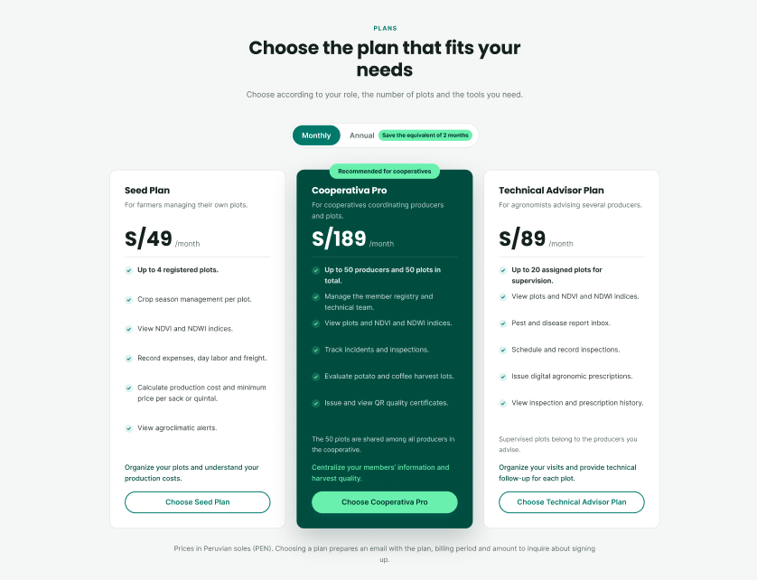

La sección reúne las metas de impacto del proyecto y los testimonios publicados.


La presentación de Dymbia reúne su misión, su visión y los perfiles del equipo.


El espacio para conocer a Dymbia aparece junto a las preguntas frecuentes sobre el producto.


El llamado a la acción sugiere un plan según el perfil y el pie de página reúne los enlaces de contacto y soporte.


##### Web Application

El enlace de acceso de la Landing Page lleva a la pantalla de **inicio de sesión**, que ofrece ingreso con correo y contraseña y acceso al registro. En **Create your account**, el visitante puede seleccionar su rol de agricultor, directivo de cooperativa o asesor técnico. Las capturas corresponden a la navegación pública hasta los formularios, antes del envío de datos.

Formulario de inicio de sesión con correo y contraseña.


Bandeja de diagnóstico para consultar reportes de plagas.


Formulario de registro de una cooperativa.


Suscripción al plan Cooperativa Pro e historial de pagos.


Vista general del mapa satelital de salud del cultivo.


Panel del agricultor con indicadores del cultivo y costos de producción.


Vista satelital con el lindero de la parcela seleccionada.


Listado de parcelas registradas y espacios disponibles del plan.


Listado de campañas agrícolas y su estado.


Vista de consulta al asesor y seguimiento de reportes de plagas.


Sección de certificados oficiales por lote de cosecha.


Vista de alertas, pronósticos y boletines por región.


Configuración de la cuenta del agricultor con datos de contacto, seguridad y preferencias.


Suscripción al plan Semilla e historial de pagos.


#### 5.2.3.6. Services Documentation Evidence for Sprint Review

Los RESTful Web Services de SumaqAgro están desarrollados con ASP.NET Core y C# sobre .NET 10. El backend utiliza Microsoft.AspNetCore.OpenApi para generar los contratos HTTP y Scalar como interfaz interactiva para consultar y probar los endpoints. La tabla presenta las operaciones principales del sprint. Los fragmentos JSON son ejemplos abreviados con datos ficticios. La columna de entrada identifica parámetros de ruta, filtros de consulta y campos principales del cuerpo. El esquema completo de cada recurso se consulta en OpenAPI.


- **Repositorio de Web Services:** [sumaq-agro-platform](https://github.com/dymbia-aplicaciones-web/sumaq-agro-platform).
- **Entorno de despliegue:** backend de SumaqAgro desplegado en Railway mediante Docker.
- **Documentación para ejecución local:** [Scalar local](http://localhost:5192/scalar/v1) y [OpenAPI JSON local](http://localhost:5192/openapi/v1.json).

##### Operaciones por Bounded Context

Las rutas de la tabla son relativas a `/api/v1`. Las operaciones protegidas usan el encabezado `Authorization: Bearer <token>`, obtenido mediante `POST /tokens`. Los cuerpos de las solicitudes se envían en JSON.

| Contexto y acción | Verbo y ruta | Entrada | Ejemplo de respuesta |
| :--- | :--- | :--- | :--- |
| IAM · Registrar cuenta | `POST /users` | `email`, `password`, `roles` y `profile` con nombres y apellidos | `201` con la cuenta creada, por ejemplo `{"id":10,"roles":["ROLE_FARMER"]}`. |
| IAM · Iniciar sesión | `POST /tokens` | `email` y `password` | `200` con el usuario y su JWT, por ejemplo `{"id":10,"token":"<jwt>"}`. |
| Subscriptions · Consultar catálogo | `GET /plans` | Sin parámetros | `200` con planes, por ejemplo `[{"code":"SEED","monthlyPrice":49,"currency":"PEN"}]`. |
| Subscriptions · Consultar suscripción | `GET /subscriptions/me` | Cuenta autenticada | `200` con la suscripción, por ejemplo `{"planCode":"SEED","status":"ACTIVE"}`, o `204` si no existe. |
| Subscriptions · Registrar checkout | `POST /subscriptions/me/checkout` | `planCode`, `billingCycle` y `simulatedOutcome` opcional | `201` con el pago de demostración, por ejemplo `{"status":"COMPLETED","amount":49}`. El pago es simulado. |
| Subscriptions · Consultar pagos | `GET /subscriptions/me/payments` | Cuenta autenticada | `200` con el historial, por ejemplo `[]` para una cuenta sin pagos. |
| Subscriptions · Cancelar suscripción | `POST /subscriptions/me/cancel` | Cuenta autenticada | `200` con la suscripción actualizada, por ejemplo `{"id":5,"status":"CANCELLED"}`. |
| Profiles · Buscar perfil | `GET /profiles?userId=10` | `userId` como filtro | `200` con perfiles, por ejemplo `[{"id":7,"userId":10}]`. |
| Profiles · Consultar perfil | `GET /profiles/{profileId}` | `profileId` en la ruta | `200` con el perfil, por ejemplo `{"id":7,"firstName":"Ana"}`. |
| Profiles · Actualizar perfil | `PUT /profiles/{profileId}` | `profileId` y cuerpo con datos personales o de contacto | `200` con el perfil actualizado, por ejemplo `{"id":7,"firstName":"Ana"}`. |
| Profiles · Registrar cooperativa | `POST /cooperatives` | `ruc`, `businessName`, `region`, `managerUserId` y datos institucionales | `201` con la cooperativa creada, por ejemplo `{"id":4,"businessName":"Cooperativa Demo"}`. |
| Profiles · Agregar socio | `POST /cooperatives/{cooperativeId}/members` | `cooperativeId` y datos de identificación del socio | `201` con el socio registrado, por ejemplo `{"id":9,"cooperativeId":4}`. |
| Profiles · Consultar cooperativas | `GET /cooperatives?directorUserId=10` | Filtro opcional `directorUserId` | `200` con la lista, por ejemplo `[{"id":4,"managerUserId":10}]`. |
| Profiles · Consultar padrón | `GET /cooperatives/{cooperativeId}/members` | `cooperativeId` en la ruta | `200` con los socios, por ejemplo `[]` para una cooperativa sin socios. |
| Profiles · Consultar asignaciones | `GET /agronomist-assignments?plotId=8` | Filtros opcionales `plotId`, `agronomistUserId`, `producerUserId` y `cooperativeId` | `200` con las asignaciones que coinciden, por ejemplo `[]` si la parcela todavía no tiene asesor. |
| Farming · Registrar parcela | `POST /field-plots` | `ownerUserId`, `name`, `region`, `areaHectares` y referencias cooperativas si aplican | `201` con la parcela creada, por ejemplo `{"id":8,"name":"Parcela Demo"}`. |
| Farming · Listar parcelas del titular | `GET /field-plots?ownerUserId=10` | `ownerUserId` | `200` con las parcelas, por ejemplo `[{"id":8,"ownerUserId":10}]`. |
| Farming · Consultar parcela | `GET /field-plots/{fieldPlotId}` | `fieldPlotId` en la ruta | `200` con los datos de la parcela, por ejemplo `{"id":8,"areaHectares":1.2}`. |
| Farming · Delimitar parcela | `PUT /field-plots/{fieldPlotId}/polygon` | `fieldPlotId` y lista `coordinates` | `200` con la parcela y su lindero. Cada elemento de `boundary` contiene `latitude` y `longitude`. |
| Farming · Abrir campaña | `POST /crop-campaigns` | `fieldPlotId`, `season`, `cropType`, `seedVariety`, `customSeedVariety` y `sowingDate` | `201` con la campaña creada, por ejemplo `{"id":12,"fieldPlotId":8}`. |
| Farming · Listar campañas de una parcela | `GET /field-plots/{fieldPlotId}/crop-campaigns` | `fieldPlotId` en la ruta | `200` con las campañas, por ejemplo `[{"id":12,"fieldPlotId":8}]`. |
| Crop · Consultar observaciones | `GET /satellite-observations?plotId=8` | `plotId` | `200` con observaciones registradas, por ejemplo `[{"plotId":8,"ndviMean":0.58,"ndwiMean":0.18}]`. |
| Crop · Consultar alertas | `GET /agroclimatic-alerts?region=Apurimac` | `region` | `200` con alertas de la región, por ejemplo `[]` cuando no hay registros. |
| Crop · Registrar reporte de plaga | `POST /pest-reports` | `plotId`, `reporterId`, `description` y `severity` | `201` con el reporte, por ejemplo `{"id":21,"plotId":8,"status":"PENDING"}`. |
| Crop · Consultar reportes | `GET /pest-reports?plotId=8` | `plotId` | `200` con los reportes de la parcela, por ejemplo `[{"id":21,"plotId":8}]`. |
| Crop · Eliminar reporte | `DELETE /pest-reports/{pestReportId}` | `pestReportId` en la ruta | `200` con un mensaje en el campo `message` cuando se elimina el reporte. |
| Crop · Programar inspección | `POST /field-inspections` | `pestReportId`, `agronomistId` y `scheduledAt` | `201` con la inspección creada, por ejemplo `{"id":22,"pestReportId":21}`. |
| Crop · Completar inspección | `PATCH /field-inspections/{fieldInspectionId}/completion` | `fieldInspectionId` y cuerpo con `findings` | `200` con la inspección actualizada, por ejemplo `{"id":22,"findings":"Manchas en cinco plantas"}`. |
| Crop · Emitir receta técnica | `POST /technical-prescriptions` | `pestReportId`, `agronomistId`, `product`, `dosage`, `instructions` y `applicationDate` | `201` con la receta registrada, por ejemplo `{"id":23,"pestReportId":21}`. |
| Certification · Registrar lote | `POST /harvest-batches` | `batchCode`, `cooperativeId`, `memberId`, `plotId`, `cropType` y `harvestedOn` | `201` con el lote, por ejemplo `{"id":30,"batchCode":"LOTE-DEMO","status":"PENDING"}`. |
| Certification · Registrar pesaje | `POST /harvest-batches/{harvestBatchId}/weight` | `harvestBatchId`, `grossWeightKg` y `tareKg` | `200` con el lote actualizado, por ejemplo `{"id":30,"netWeightKg":95}`. |
| Certification · Emitir certificado | `POST /quality-certificates` | Cuerpo con `certificateNumber`, `harvestBatchId` e `issuedByUserId` | `201` con el certificado y su huella, por ejemplo `{"certificateNumber":"CERT-DEMO","certificateHash":"…"}`. |
| Certification · Verificar trazabilidad | `GET /public/traceability?number=CERT-DEMO&hash=<hash>` | Número y huella del certificado | `200` con el resultado de la verificación, por ejemplo `{"certificateNumber":"CERT-DEMO","authentic":true}`. |

Los contratos se contrastaron con el código disponible para la revisión de AV2. Parte de las operaciones de Subscriptions y Certification se desarrolló en ramas del sprint y su integración en `develop` aparece después del corte del 13 de noviembre. La tabla documenta su implementación en el código y su disponibilidad pública queda por validar.


##### Interacción con Scalar

Para comprobar el contrato con datos de muestra, ejecutar **Tokens** (`POST /api/v1/tokens`) en Scalar, enviar el correo y la contraseña de una cuenta de prueba y comprobar que la respuesta sea `200` con un JWT. Después, configurar la autorización Bearer y ejecutar **Field Plots** con el `fieldPlotId` de una parcela de demostración, comprobando que la respuesta `200` incluya sus datos. Las capturas deben mostrar los parámetros, el código HTTP y el cuerpo de respuesta, con las credenciales y el token ocultos.

La documentación se consulta en [Scalar local](http://localhost:5192/scalar/v1). A continuación, se presentan las evidencias de autenticación y consulta de parcelas mediante Scalar.


#### 5.2.3.7. Software Deployment Evidence for Sprint Review


La entrega de AV2 comprende tres productos: la Landing Page, la Web Application desarrollada en Vue y los RESTful Web Services implementados con ASP.NET Core. El frontend y el backend se despliegan en Railway mediante Docker, junto con un servicio MySQL para la persistencia de datos. La Landing Page proporciona el enlace de acceso a la Web Application.

##### Landing Page en Cloudflare Pages

1. Se reorganizó el sitio estático bajo el directorio `public/`, con sus páginas legales, estilos, scripts y recursos.
2. El código de la Landing Page se mantiene en el repositorio [sumaq-agro-website](https://github.com/dymbia-aplicaciones-web/sumaq-agro-website), correspondiente al proyecto de Aplicaciones Web.
3. Se comprobó el acceso al [sitio publicado](https://sumaqagro-website.vercel.app/) y el destino de **Sign In**, que conduce a Firebase Hosting. A continuación, se presenta la evidencia del despliegue de la Landing Page.


##### Web Application en Firebase Hosting

1. El proyecto `sumaqagro-appweb` está vinculado mediante `.firebaserc`. La compilación con `npm run build` genera el contenido en `dist/`, directorio indicado en `firebase.json`.
2. La publicación usa `firebase deploy --only hosting`. Firebase redirige las rutas internas a `index.html`, de modo que Vue Router resuelva la navegación de la aplicación.
3. El código se mantiene en el repositorio [sumaq-agro-web-app](https://github.com/dymbia-aplicaciones-web/sumaq-agro-web-app). La aplicación se publica en [Firebase Hosting](https://sumaqagro-appweb.web.app/). A continuación, se presenta la evidencia del despliegue.


##### RESTful Web Services en Railway

1. El repositorio [sumaq-agro-platform](https://github.com/dymbia-aplicaciones-web/sumaq-agro-platform) incorpora un `Dockerfile` para desplegar el backend en Railway. La primera etapa utiliza el SDK de .NET 10 y ejecuta `dotnet publish` en configuración Release. La segunda utiliza ASP.NET Core 10 y ejecuta `SumaqAgro.Platform.dll`, escuchando en `0.0.0.0` mediante la variable `PORT`, con `8080` como valor predeterminado.
2. La configuración de producción utiliza `ASPNETCORE_ENVIRONMENT=Production`. Las variables de entorno permiten configurar la conexión MySQL mediante `ConnectionStrings__DefaultConnection`, la firma JWT mediante `Jwt__SigningKey` y los orígenes permitidos mediante `Cors__AllowedOrigins__0`. La opción `Database__ApplyMigrations=true` permite aplicar las migraciones al iniciar el servicio.
3. El backend se conecta al servicio MySQL del proyecto de Railway. La documentación interactiva se consulta mediante [Scalar local](http://localhost:5192/scalar/v1), habilitado únicamente en Development. A continuación, se presenta la evidencia del despliegue en Railway, con el estado del servicio y su información de publicación.


#### 5.2.3.8. Team Collaboration Insights during Sprint

El equipo organizó la implementación de los servicios por Bounded Context, según la matriz LACX de la sección 5.2.3.2. El trabajo en la aplicación web incluyó autenticación, cambios de perfil, suscripciones, cooperativas y ajustes en los flujos de Crop. La Landing Page concentró cambios de estructura, componentes compartidos y contenido del equipo. Los historiales de GitHub permiten seguir esos cambios por producto y los gráficos de **Insights → Contributors** muestran la actividad de la rama predeterminada.

| Integrante | Landing Page | Web Application | Web Services |
| :--- | ---: | ---: | ---: |
| Benjamin Solorzano | 17 | 98 | 41 |
| Miguel Sanca | 0 | 24 | 80 |
| Yamil Tejada | 0 | 11 | 83 |
| Jose Vargas | 0 | 5 | 23 |
| Drago Duarte| 0 | 27 | 55 |
| **Total** | **17** | **165** | **282** |

El cuadro cuenta los commits alcanzables desde la rama remota `develop` cuya fecha de commit está entre el 19 de octubre y el 13 de noviembre de 2026, hora de Lima. El conteo excluye los *merge commits* y puede incluir cambios integrados después del cierre. Se obtuvo con `git shortlog -sn --no-merges --since="2026-10-19 00:00 -0500" --until="2026-11-13 23:59 -0500" origin/develop`. El conteo mide aportes registrados en Git. Los gráficos públicos pueden diferir por la rama y el intervalo que muestran.

##### Landing Page


El historial registra la reorganización de las vistas y recursos compartidos y la actualización de los perfiles del equipo. La autoría de los 17 commits del periodo en `develop` figura a nombre de Benjamin Solorzano. [Historial de commits](https://github.com/dymbia-aplicaciones-web/sumaq-agro-website/commits/develop/) · [Insights de colaboradores](https://github.com/dymbia-aplicaciones-web/sumaq-agro-website/graphs/contributors?from=15%2F8%2F2026)
##### Web Application

Los cinco integrantes registraron commits en la rama de integración durante el sprint. El historial permite seguir el trabajo de los formularios de acceso, el catálogo de suscripciones y las vistas de cooperativa, así como la integración con el backend desarrollado en ASP.NET Core. [Historial de commits](https://github.com/dymbia-aplicaciones-web/sumaq-agro-web-app/commits/develop/) · [Insights de colaboradores](https://github.com/dymbia-aplicaciones-web/sumaq-agro-web-app/graphs/contributors?from=15%2F8%2F2026)

##### RESTful Web Services

Benjamin Solorzano trabajó en IAM y suscripciones. Miguel Sanca se encargó de Farming y el *Shared Kernel*. Yamil Tejada implementó servicios de Crop e integración satelital. Jose Vargas trabajó en Profiles y cooperativas, Drago Duarte en Certification. La evidencia de desarrollo de 5.2.3.4 identifica los commits por contexto. [Historial de commits](https://github.com/dymbia-aplicaciones-web/sumaq-agro-platform/commits/develop/) · [Insights de colaboradores](https://github.com/dymbia-aplicaciones-web/sumaq-agro-platform/graphs/contributors?from=15%2F8%2F2026)

## 5.3. Validation Interviews.

### 5.3.1. Diseño de Entrevistas

Las entrevistas tienen como propósito recopilar información cualitativa sobre las experiencias, necesidades y percepciones de los usuarios potenciales de SumaqAgro. Para ello, las entrevistas se estructuraron en cuatro bloques principales: perfil y contexto, orientado a conocer las características y actividades de los entrevistados;
expectativas del producto, enfocado en identificar los beneficios esperados; evaluación del prototipo, destinado a conocer la percepción de los usuarios sobre las funcionalidades y su facilidad de uso; y cierre, que permite recoger opiniones finales y sugerencias de mejora.

### Preguntas para el Segmento: Agricultores independientes

**Perfil y contexto**

1. ¿Cuántos años lleva trabajando en la agricultura y qué cultivos produce actualmente?
2. ¿Cómo registra actualmente los gastos de fertilizantes, semillas, jornales y otros insumos?
3. ¿Qué dificultades encuentra al consultar información sobre el estado de sus cultivos cuando trabaja en sus parcelas?

**Expectativas del producto**

4. ¿Qué beneficios esperaría obtener de una plataforma que permita monitorear sus cultivos mediante imágenes satelitales?
5. ¿Qué tan útil sería para usted conocer los costos reales de producción de cada parcela antes de vender su cosecha?
6. ¿Considera importante recibir alertas sobre posibles amenazas climáticas o fitosanitarias? ¿Por qué?

**Evaluación del prototipo**

7. Después de observar el módulo de monitoreo satelital, ¿qué tan fácil le resultó interpretar la información sobre el estado de sus cultivos?
8. ¿Qué tan sencillo le resultó registrar los costos de producción y consultar los resultados por parcela?
9. ¿Qué información o funcionalidad le resultó más difícil de comprender durante la demostración?

**Cierre**

10. ¿Utilizaría SumaqAgro para gestionar sus actividades agrícolas? ¿Qué condiciones necesitaría para incorporarla a su trabajo?
11. ¿Qué cambios o funcionalidades adicionales recomendaría para mejorar la plataforma?

### Preguntas para el Segmento: Directivos de cooperativas agrícolas

**Perfil y contexto**

1. ¿Cuál es su cargo y cuántos productores o socios tiene actualmente bajo su responsabilidad?
2. ¿Cómo gestionan actualmente los registros de producción, calidad y procedencia de los productos agrícolas?
3. ¿Cuáles son las principales dificultades que enfrenta durante los procesos de control de calidad y certificación?

**Expectativas del producto**

4. ¿Qué beneficios esperaría obtener de una plataforma que centralice la información agrícola de los productores asociados?
5. ¿Qué tan importante sería disponer de registros digitales para verificar la trazabilidad y procedencia de cada lote?
6. ¿Qué información considera indispensable para evaluar la calidad de los productos antes de su comercialización?

**Evaluación del prototipo**

7. Después de observar el módulo de gestión y certificación, ¿qué tan fácil le resultó consultar la información de los productores y sus parcelas?
8. ¿Considera que los certificados digitales permitirían mejorar la organización y disponibilidad de la documentación durante las auditorías? ¿Por qué?
9. ¿Qué tan útil considera disponer de información centralizada sobre la calidad y trazabilidad de los lotes?

**Cierre**

10. ¿Consideraría implementar SumaqAgro en su cooperativa? ¿Qué factores influirían en esa decisión?
11. ¿Qué mejoras considera necesarias para que la plataforma responda a las necesidades administrativas y comerciales de su organización?

### Preguntas para el Segmento: Ingenieros agrónomos y asesores técnicos

**Perfil y contexto**

1. ¿Cuántos años de experiencia tiene como ingeniero agrónomo o asesor técnico?
2. ¿Cuántos agricultores y parcelas supervisa aproximadamente durante un mes?
3. ¿Qué herramientas utiliza actualmente para registrar sus visitas técnicas, diagnósticos y recomendaciones?

**Expectativas del producto**

4. ¿Qué beneficios esperaría obtener de una herramienta que permita monitorear parcelas mediante información satelital?
5. ¿Qué información considera necesaria para identificar oportunamente posibles afectaciones en los cultivos?
6. ¿Qué tan importante sería contar con registros digitales de las visitas técnicas y recomendaciones realizadas a cada productor?

**Evaluación del prototipo**

7. Después de observar el módulo de monitoreo, ¿qué tan útil considera la información satelital para complementar sus evaluaciones de campo?
8. ¿Qué tan sencillo le resultó localizar parcelas y consultar su información geográfica?
9. ¿Considera que los registros e informes digitales facilitan el seguimiento de sus recomendaciones técnicas? ¿Por qué?

**Cierre**

10. ¿Incorporaría SumaqAgro como herramienta de apoyo en sus actividades de asesoría agrícola? ¿Por qué?
11. ¿Qué mejoras recomendaría para facilitar el trabajo de los asesores técnicos?

### 5.3.2. Registro de Entrevistas

Las entrevistas de validación se llevaron a cabo con usuarios de ambos segmentos objetivo. A continuación se presenta el registro detallado de las entrevistas realizadas, incluyendo información del entrevistado, capturas de video y análisis de respuestas.

### Entrevista 1 – Agricultor de papa (Segmento 1)

| Campo | Información        |
|---|--------------------|
| Nombre completo |Mateo  Flores Huamán              |
| Edad | 32                 |
| Distrito | Comas              |
| Ocupación | Agricultor de papa |
| Fecha de entrevista | 14/11/2026         |
| URL del video (Microsoft Stream) | (https://lix.li/UtN9TM) |
| Minutaje | 00:00 – 10:45      |

#### Captura de la entrevista


#### Resumen de Respuestas

Mateo es un agricultor dedicado principalmente al cultivo de papa. Durante la entrevista, explicó que organiza sus actividades agrícolas de manera manual, planificando la siembra según la disponibilidad de semillas, los recursos que necesita y las personas que pueden ayudarlo en las labores del campo. Respecto al seguimiento de sus cultivos, comentó que cuando observa alguna anomalía, como manchas en las hojas, suele tomar fotografías y consultar primero con algún vecino y posteriormente con un técnico. Asimismo, señaló que lleva el control de sus gastos en un cuaderno, donde registra las fechas y los pagos realizados; sin embargo, en ocasiones olvida anotar algunos jornales y recién calcula el gasto total cuando llega el momento de vender su producción.

Al conocer SumaqAgro, identificó que la plataforma podría servirle para revisar sus parcelas y llevar un control de sus gastos. Durante la demostración, comprendió el funcionamiento general del mapa y el registro de parcelas, aunque manifestó algunas dudas respecto a los números que aparecen en la información geográfica. Indicó que necesitaría explicaciones más sencillas que le permitan interpretar estos datos y saber si es conveniente visitar una parcela, así como identificar qué aspectos debería revisar durante su recorrido. También mostró interés en conocer los costos de la plataforma, especialmente si resultan accesibles para un agricultor que trabaja de manera independiente.

Respecto al sistema de alertas agrícolas, Mateo manifestó que antes de tomar alguna decisión revisaría si el aviso corresponde a su zona y si continúa vigente. Además, consideró importante que las alertas incluyan recomendaciones sobre las acciones que debería realizar y el tiempo durante el cual debe mantenerse atento a una posible afectación del cultivo. En cuanto al módulo de gastos y ganancias, valoró la posibilidad de registrar las compras y consultar posteriormente información como el producto adquirido, el monto pagado, la fecha y el nombre de la campaña, ya que estos datos le permitirían evitar confusiones cuando administra varias campañas agrícolas.

Finalmente, manifestó que utilizaría principalmente el módulo de registro de gastos durante su próxima campaña, destacando la importancia de poder registrar los pagos realizados a los trabajadores directamente desde la parcela, incluso cuando no disponga de conexión a internet. Consideró que esta funcionalidad evitaría que olvide registrar algunos gastos al regresar a casa. Entre sus principales recomendaciones, propuso mejorar la comprensión del mapa mediante pequeñas explicaciones que permitan interpretar los números y la información presentada. 

### Entrevista 2 – Directivo de Cooperativa Agrícola (Segmento 2)

| Campo | Información                                       |
|---|---------------------------------------------------|
| Nombre completo | Caleb Quispe                                              |
| Edad | 27                                                |
| Distrito | Arequipa - San Martin                                    |
| Fecha de entrevista | 14/11/2026                                   |
| URL del video (Microsoft Stream) |(https://lix.li/UtN9TM)                              |
| Minutaje | 10:45 - 17:35                                     |

### Entrevista 2 – Ingeniero agrónomo / Asesor técnico (Segmento 3)

| Campo | Información                                       |
|---|---------------------------------------------------|
| Nombre completo | Jorge Rodriguez                                              |
| Edad | 30                                                |
| Distrito | Arequipa - San Martin                                    |
| Fecha de entrevista | 14/11/2026                                   |
| Duración | 05:15                                             |
| URL del video (Microsoft Stream) |(https://lix.li/UtN9TM)                              |
| Minutaje | 17:35 - 25:30                                     |

