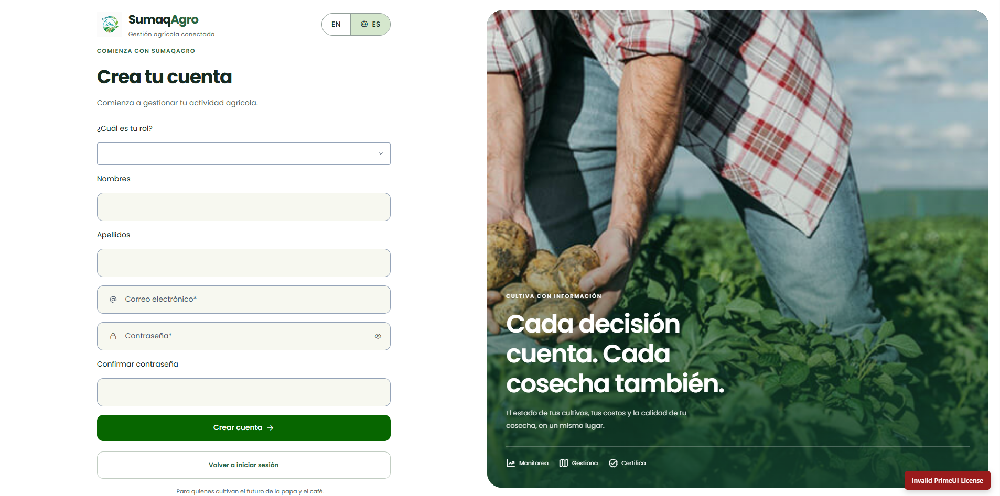
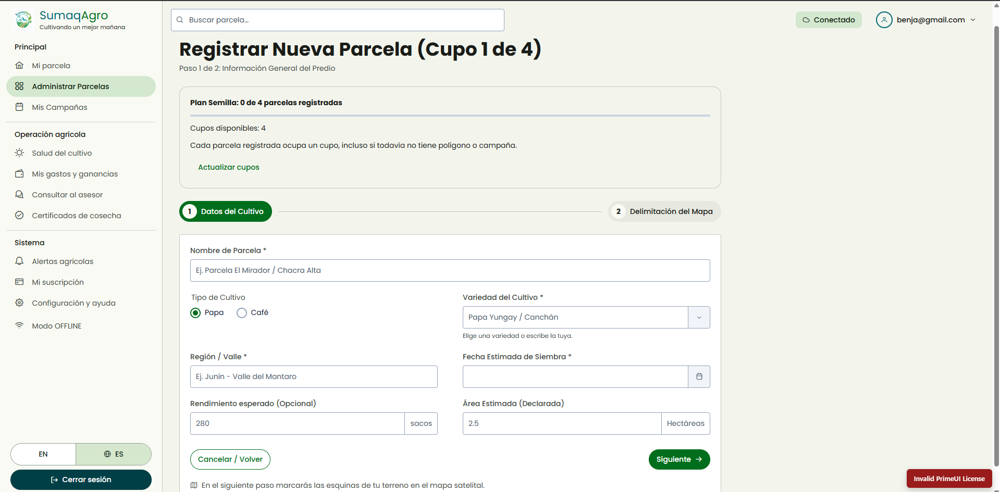
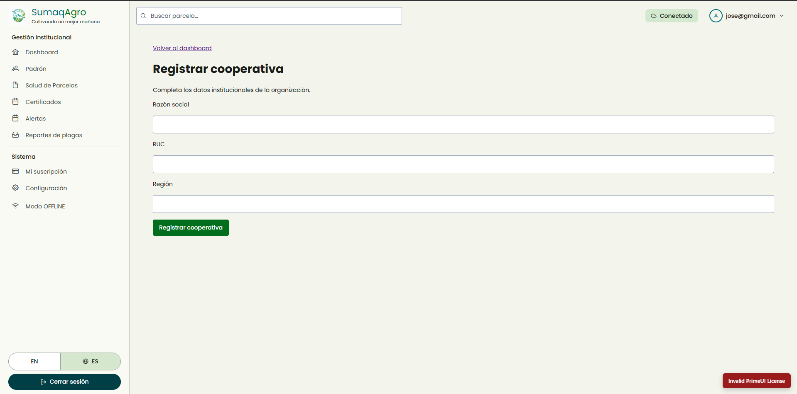

## Evaluación de User Experience según Heurísticas

### SITE o APP A EVALUAR

**SumaqAgro – Web Application**

### TAREAS A EVALUAR

El alcance de esta evaluación incluye la revisión de las siguientes tareas:

1. Registrar una nueva cuenta de usuario.
2. Registrar una nueva parcela y sus datos de cultivo.
3. Consultar el estado de salud de una parcela mediante los indicadores NDVI y NDWI.
4. Consultar y administrar una suscripción activa.
5. Registrar una cooperativa desde el segmento de director de cooperativa.
6. Delimitar geográficamente una parcela mediante el mapa.

### No están incluidas en esta etapa:

1. Recuperar o restablecer la contraseña.
2. Crear y administrar campañas agrícolas.
3. Registrar gastos e ingresos de una campaña.
4. Emitir y verificar certificados de calidad de cosecha.
5. Realizar pagos y descargar comprobantes.
6. Administrar miembros de cooperativas y asignar agrónomos.

### ESCALA DE SEVERIDAD

| Nivel | Descripción |
|---|---|
| 1 | Problema superficial. No impide completar la tarea y puede corregirse cuando exista disponibilidad de tiempo. |
| 2 | Problema menor. Genera confusión o esfuerzo adicional, pero permite continuar. Su corrección tiene prioridad baja. |
| 3 | Problema mayor. Dificulta considerablemente una tarea y debe corregirse con prioridad alta. |
| 4 | Problema muy grave. Impide completar una tarea esencial y debe corregirse antes del lanzamiento. |

### TABLA RESUMEN

| # | Problema | Escala de severidad | Heurística/Principio vulnerado |
|---|---|---|---|
| 1 | No se informan los requisitos de la contraseña antes de crear la cuenta. | 2 | Usabilidad — Prevención de errores. |
| 2 | La unidad del rendimiento esperado no especifica el peso de cada saco. | 2 | Usabilidad — Correspondencia entre el sistema y el mundo real. |
| 3 | Los indicadores NDVI y NDWI no incluyen una explicación para interpretar sus valores. | 2 | Usabilidad — Correspondencia entre el sistema y el mundo real. |
| 4 | No se explica el efecto de cancelar la renovación de la suscripción. | 2 | Usabilidad — Prevención de errores. |
| 5 | El campo “Región” no indica el formato de información esperado. | 2 | Usabilidad — Prevención de errores. |
| 6 | No se presenta una alternativa visible al mapa para ingresar los vértices del terreno. | 3 | Diseño inclusivo — Proporcionar experiencias comparables. |

### DESCRIPCIÓN DE PROBLEMAS

### PROBLEMA #1: No se informan los requisitos de la contraseña antes de crear la cuenta

**Severidad:** 2 — Problema menor.

**Heurística violada:** Usabilidad — Prevención de errores.

**Problema:**

En el formulario “Crea tu cuenta”, el campo “Contraseña” no presenta instrucciones visibles sobre los requisitos que debe cumplir. La aplicación exige un mínimo de ocho caracteres, pero esta condición no se comunica antes de enviar el formulario.

Esto puede provocar que el usuario ingrese una contraseña demasiado corta y descubra la restricción después de intentar crear la cuenta, obligándolo a corregir los datos y repetir la acción.

**Imagen:**

**Recomendación:**

Agregar debajo del campo una indicación permanente: “La contraseña debe tener al menos 8 caracteres”. Complementar esta ayuda con una validación durante la escritura o al salir del campo, e informar junto a “Confirmar contraseña” cuando ambos valores no coincidan.

### PROBLEMA #2: La unidad del rendimiento esperado no especifica el peso de cada saco

**Severidad:** 2 — Problema menor.

**Heurística violada:** Usabilidad — Correspondencia entre el sistema y el mundo real.

**Problema:**

En el primer paso del registro de una parcela, el campo “Rendimiento esperado (Opcional)” utiliza la unidad “sacos”, pero no indica el peso considerado para cada saco ni ofrece una equivalencia en kilogramos.

Como el peso de un saco puede variar según el producto y las prácticas comerciales, el usuario puede interpretar la cantidad de forma diferente a la prevista por el sistema. Esta ambigüedad dificulta registrar y comparar las estimaciones de producción de manera consistente.

**Imagen:**

**Recomendación:**

Especificar el peso de referencia de cada saco junto al campo. Si no existe un peso único, permitir ingresar el peso por saco o seleccionar una unidad estandarizada, como kilogramos o toneladas. Añadir un ejemplo que explique cómo registrar el rendimiento total esperado de la parcela.

### PROBLEMA #3: Los indicadores NDVI y NDWI no incluyen una explicación para interpretar sus valores

**Tarea evaluada:** Consultar el estado de salud de una parcela mediante el monitoreo del cultivo.

**Severidad:** 2 — Problema menor.

**Heurística violada:** Usabilidad — Correspondencia entre el sistema y el mundo real.

**Problema:**

La pantalla muestra los indicadores “NDVI” y “NDWI” con valores de 0.76 y 0.42, respectivamente, pero no presenta una explicación visible de su significado ni una escala de referencia para interpretarlos.

Un agricultor sin conocimientos sobre estos índices puede visualizar los datos sin comprender qué indican sobre la vegetación o la humedad del cultivo. Esto limita la utilidad de la información para evaluar el estado de su parcela.

**Imagen:**

**Recomendación:**

Incluir una descripción breve de cada indicador en lenguaje sencillo y una escala de interpretación contextualizada al cultivo. Complementar los valores con etiquetas descriptivas y ayudas consultables, explicando las limitaciones de los índices para evitar que se interpreten como un diagnóstico definitivo.

### PROBLEMA #4: No se explica el efecto de cancelar la renovación de la suscripción

**Tarea evaluada:** Consultar y administrar la suscripción activa.

**Severidad:** 2 — Problema menor.

**Heurística violada:** Usabilidad — Prevención de errores.

**Problema:**

La pantalla “Suscripción y pagos” presenta el botón “Cancelar renovación”, pero no incluye una explicación visible de sus consecuencias antes de seleccionarlo.

Aunque se muestra la fecha de fin del plan, no se aclara si la cancelación conserva el acceso hasta esa fecha o si afecta inmediatamente los beneficios. Esta falta de información puede generar dudas y dificultar que el usuario tome una decisión informada. La captura no permite verificar si existe una confirmación posterior.

**Imagen:**

**Recomendación:**

Añadir junto al botón una explicación breve del efecto real de la cancelación, indicando hasta cuándo se conservará el acceso y qué ocurrirá después. Antes de ejecutar la acción, presentar una confirmación que resuma estas consecuencias y permita volver sin modificar la suscripción.

### PROBLEMA #5: El campo “Región” no indica el formato de información esperado

**Tarea evaluada:** Registrar una cooperativa desde el segmento de director de cooperativa.

**Severidad:** 2 — Problema menor.

**Heurística violada:** Usabilidad — Prevención de errores.

**Problema:**

El formulario “Registrar cooperativa” presenta el campo de texto “Región” sin ejemplos, instrucciones ni opciones de selección. No se aclara si se debe ingresar un departamento, una provincia o una zona agrícola.

Esta ambigüedad puede provocar que los usuarios registren ubicaciones con distintos niveles de detalle o denominaciones, dificultando la uniformidad de los datos institucionales.

**Imagen:**

**Recomendación:**

Precisar la etiqueta según la información requerida, por ejemplo, “Región / Departamento”. Si corresponde a una división territorial definida, utilizar un selector con opciones estandarizadas. Si se mantiene el ingreso libre, incluir un ejemplo visible como “Ej.: Junín”.

### PROBLEMA #6: No se presenta una alternativa visible al mapa para ingresar los vértices del terreno

**Tarea evaluada:** Delimitar geográficamente una parcela.

**Severidad:** 3 — Problema mayor.

**Heurística violada:** Diseño inclusivo — Proporcionar experiencias comparables.

**Problema:**

La pantalla indica que el usuario debe hacer clic en el mapa para marcar las esquinas del terreno. Aunque presenta una lista de coordenadas y un campo para buscar una ubicación, no se observa una alternativa para introducir o editar numéricamente cada vértice del polígono.

Esta interacción puede dificultar la tarea para personas con limitaciones motoras o que utilizan dispositivos de entrada alternativos. Buscar una ubicación o utilizar el GPS no sustituye la definición de todos los límites de la parcela. La operación mediante teclado requiere una comprobación adicional.

**Imagen:**

**Recomendación:**

Ofrecer un formulario complementario para agregar, editar y eliminar vértices mediante sus valores de latitud y longitud. Sincronizar estos datos con el mapa y permitir completar la delimitación mediante teclado, con un orden de navegación y un foco visibles.

