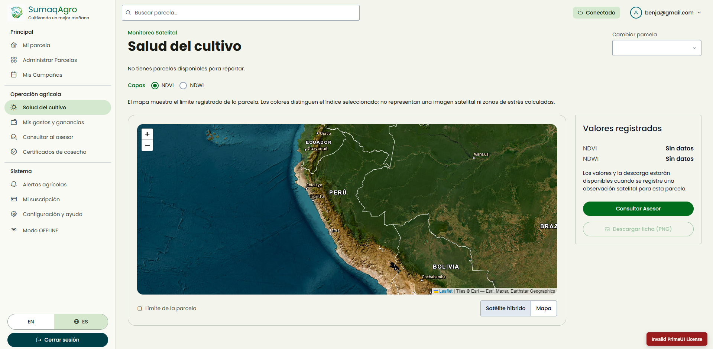
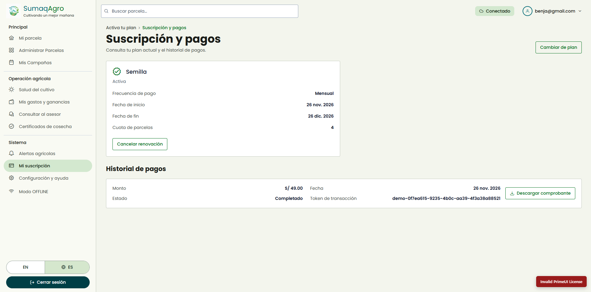

## Evaluación de User Experience según Heurísticas

### SITE o APP A EVALUAR

**SumaqAgro – Web Application**

### TAREAS A EVALUAR

El alcance de esta evaluación incluye la revisión de la usabilidad, el diseño inclusivo y la arquitectura de información de las siguientes tareas:

1. Registrar una cuenta de usuario e iniciar sesión.
2. Registrar una nueva parcela y definir su ubicación geográfica.
3. Registrar un gasto asociado a una campaña agrícola.
4. Consultar el estado de salud de los cultivos y sus alertas.
5. Consultar los certificados de calidad de los lotes de cosecha.

No están incluidas en esta etapa:

1. La validación de credenciales contra el backend.
2. La entrega de correos de recuperación.
3. El proceso completo de registro.
4. La navegación posterior al inicio de sesión.

### ESCALA DE SEVERIDAD

| Nivel | Descripción |
|---|---|
| 1 | Problema superficial. No impide completar la tarea y puede corregirse cuando exista disponibilidad de tiempo. |
| 2 | Problema menor. Genera confusión o esfuerzo adicional, pero permite continuar. Su corrección tiene prioridad baja. |
| 3 | Problema mayor. Dificulta considerablemente una tarea y debe corregirse con prioridad alta. |
| 4 | Problema muy grave. Impide completar una tarea esencial y debe corregirse antes del lanzamiento. |

### TABLA RESUMEN

| # | Problema | Severidad | Heurística/Principio vulnerado |
|---|---|---|---|
| 1 | Se muestra un aviso técnico de licencia inválida en la pantalla de acceso. | 2 | Usabilidad: Diseño estético y minimalista. |
| 2 | Los campos utilizan el texto interior como única identificación visual. | 2 | Usabilidad: Reconocimiento antes que recuerdo. |
| 3 | Las opciones de idioma se presentan únicamente mediante abreviaturas. | 1 | Usabilidad: Correspondencia entre el sistema y el mundo real. |

### DESCRIPCIÓN DE PROBLEMAS

### PROBLEMA #1: No se informan los requisitos de la contraseña antes de crear la cuenta

**Severidad:** 2 — Problema menor.

**Heurística violada:** Usabilidad — Prevención de errores.

**Problema:**

En el formulario “Crea tu cuenta”, el campo “Contraseña” no presenta instrucciones visibles sobre los requisitos que debe cumplir. La aplicación exige un mínimo de ocho caracteres, pero esta condición no se comunica antes de enviar el formulario.

Esto puede provocar que el usuario ingrese una contraseña demasiado corta y descubra la restricción después de intentar crear la cuenta, obligándolo a corregir los datos y repetir la acción.

**Imagen:**

**Recomendación:**

Agregar debajo del campo una indicación permanente: “La contraseña debe tener al menos 8 caracteres”. Complementar esta ayuda con una validación durante la escritura o al salir del campo, e informar junto a “Confirmar contraseña” cuando ambos valores no coincidan.

### PROBLEMA #2: La unidad del rendimiento esperado no especifica el peso de cada saco

**Severidad:** 2 — Problema menor.

**Heurística violada:** Usabilidad — Correspondencia entre el sistema y el mundo real.

**Problema:**

En el primer paso del registro de una parcela, el campo “Rendimiento esperado (Opcional)” utiliza la unidad “sacos”, pero no indica el peso considerado para cada saco ni ofrece una equivalencia en kilogramos.

Como el peso de un saco puede variar según el producto y las prácticas comerciales, el usuario puede interpretar la cantidad de forma diferente a la prevista por el sistema. Esta ambigüedad dificulta registrar y comparar las estimaciones de producción de manera consistente.

**Imagen:**

**Recomendación:**

Especificar el peso de referencia de cada saco junto al campo. Si no existe un peso único, permitir ingresar el peso por saco o seleccionar una unidad estandarizada, como kilogramos o toneladas. Añadir un ejemplo que explique cómo registrar el rendimiento total esperado de la parcela.

### PROBLEMA #3: Los indicadores NDVI y NDWI no incluyen una explicación para interpretar sus valores

**Tarea evaluada:** Consultar el estado de salud de una parcela mediante el monitoreo del cultivo.

**Severidad:** 2 — Problema menor.

**Heurística violada:** Usabilidad — Correspondencia entre el sistema y el mundo real.

**Problema:**

La pantalla muestra los indicadores “NDVI” y “NDWI” con valores de 0.76 y 0.42, respectivamente, pero no presenta una explicación visible de su significado ni una escala de referencia para interpretarlos.

Un agricultor sin conocimientos sobre estos índices puede visualizar los datos sin comprender qué indican sobre la vegetación o la humedad del cultivo. Esto limita la utilidad de la información para evaluar el estado de su parcela.

**Imagen:**

**Recomendación:**

Incluir una descripción breve de cada indicador en lenguaje sencillo y una escala de interpretación contextualizada al cultivo. Complementar los valores con etiquetas descriptivas y ayudas consultables, explicando las limitaciones de los índices para evitar que se interpreten como un diagnóstico definitivo.

### PROBLEMA #4: No se explica el efecto de cancelar la renovación de la suscripción

**Tarea evaluada:** Consultar y administrar la suscripción activa.

**Severidad:** 2 — Problema menor.

**Heurística violada:** Usabilidad — Prevención de errores.

**Problema:**

La pantalla “Suscripción y pagos” presenta el botón “Cancelar renovación”, pero no incluye una explicación visible de sus consecuencias antes de seleccionarlo.

Aunque se muestra la fecha de fin del plan, no se aclara si la cancelación conserva el acceso hasta esa fecha o si afecta inmediatamente los beneficios. Esta falta de información puede generar dudas y dificultar que el usuario tome una decisión informada. La captura no permite verificar si existe una confirmación posterior.

**Imagen:**

**Recomendación:**

Añadir junto al botón una explicación breve del efecto real de la cancelación, indicando hasta cuándo se conservará el acceso y qué ocurrirá después. Antes de ejecutar la acción, presentar una confirmación que resuma estas consecuencias y permita volver sin modificar la suscripción.

